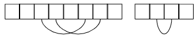
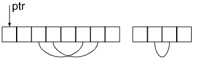
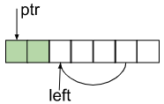
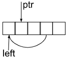
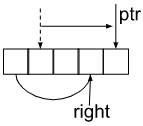
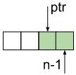

# I❤️Kotlin | Sorting + Running pointer Illustrated Explanation | Bonus: Java

**Author:** user3488KQ
**Votes:** 6
**Link:** [https://leetcode.com/problems/find-maximal-uncovered-ranges/solutions/3458821/](https://leetcode.com/problems/find-maximal-uncovered-ranges/solutions/3458821/)

---


# Approach

The idea behind the solution is pretty straightforward: place all ranges on the interval from `0` to `n - 1` and find uncovered sub-ranges by comparing lefts and rights of adjacent sub-ranges.

The best way to order ranges is to sort them by left or right limit in ascending order:



As you can see in the picture, the sorting makes uncovered cells pretty visible. To collect the gaps between sub-ranges we are going to introduce a pointer that will run from the first to last element. 




To move the pointer we are going to iterate over the sorted gaps and compare a distance between the pointer and the left limit of the sub-range. If the pointer is located on the left of the range we have a new uncovered cells:




If the pointer is located on the right of the left range limit, it means there is no uncovered cells.




As a last step we move the pointer to a new position: next to the right limit of the current sub-range:




After all sub-ranges passed could have some uncovered elements between the pointer and the last element, so we should add them to the result as well.




# Complexity
- Time complexity: $ O(nlogn) $

- Space complexity: $$O(n)$$

# Code
```
class Solution {
    fun findMaximalUncoveredRanges(n: Int, ranges: Array<IntArray>) = 
        mutableListOf<IntArray>().apply {
            ranges.sortBy { it[0] }
            var ptr = 0
            for ((left, right) in ranges) {
                if (ptr < left) {
                    add(intArrayOf(ptr, left - 1))
                }
                if (ptr <= right) {
                    ptr = right + 1
                }
            }
            if (ptr < n) {
                add(intArrayOf(ptr, n - 1))
            }
        }.toTypedArray()
}
```

# Bonus: Java Code
```
class Solution {
    public int[][] findMaximalUncoveredRanges(int n, int[][] ranges) {
        List<int[]> result = new ArrayList<>();

        Arrays.sort(ranges, (a, b) -> a[0] - b[0]);
        int ptr = 0;
        for (int[] range : ranges) {
            int left = range[0];
            int right = range[1];
            
            if (ptr < left) {
                result.add(new int[] { ptr, left - 1 });
            }
            if (ptr <= right) {
                ptr = right + 1;
            }
        }
        if (ptr < n) {
            result.add(new int[] { ptr, n - 1 });
        }
        return result.toArray(new int[result.size()][]);
    }
}
```