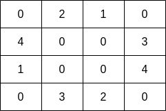
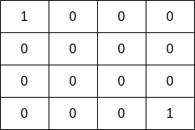

# [2658. Maximum Number of Fish in a Grid](https://leetcode.com/problems/maximum-number-of-fish-in-a-grid/)

| Category | Difficulty | Likes | Dislikes |
| :------: | :--------: | :---: | :------: |
| Algorithms | Medium | 940 | 65 |

**Tags:** [`array`](https://leetcode.com/tag/array), [`depth-first-search`](https://leetcode.com/tag/depth-first-search), [`breadth-first-search`](https://leetcode.com/tag/breadth-first-search), [`union-find`](https://leetcode.com/tag/union-find), [`matrix`](https://leetcode.com/tag/matrix)

**Companies:** `microsoft`, `facebook`, `amazon`, `google`

## Description

You are given a **0-indexed** 2D matrix `grid` of size `m x n`, where `(r, c)` represents:

	- A **land** cell if `grid[r][c] = 0`, or

	- A **water** cell containing `grid[r][c]` fish, if `grid[r][c] > 0`.

A fisher can start at any **water** cell `(r, c)` and can do the following operations any number of times:

	- Catch all the fish at cell `(r, c)`, or

	- Move to any adjacent **water** cell.

Return *the **maximum** number of fish the fisher can catch if he chooses his starting cell optimally, or *`0` if no water cell exists.

An **adjacent** cell of the cell `(r, c)`, is one of the cells `(r, c + 1)`, `(r, c - 1)`, `(r + 1, c)` or `(r - 1, c)` if it exists.

 

**Example 1:**


```

Input: grid = [[0,2,1,0],[4,0,0,3],[1,0,0,4],[0,3,2,0]]
Output: 7
Explanation: The fisher can start at cell (1,3) and collect 3 fish, then move to cell (2,3)&nbsp;and collect 4 fish.

```

**Example 2:**


```

Input: grid = [[1,0,0,0],[0,0,0,0],[0,0,0,0],[0,0,0,1]]
Output: 1
Explanation: The fisher can start at cells (0,0) or (3,3) and collect a single fish. 

```

 

**Constraints:**

	- `m == grid.length`

	- `n == grid[i].length`

	- `1 <= m, n <= 10`

	- `0 <= grid[i][j] <= 10`

---

**Links:** [Submissions](https://leetcode.com/problems/maximum-number-of-fish-in-a-grid/) | [Solutions](https://leetcode.com/problems/maximum-number-of-fish-in-a-grid/)
