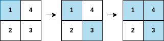
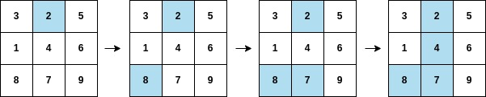

# [2661. First Completely Painted Row or Column](https://leetcode.com/problems/first-completely-painted-row-or-column/)

| Category | Difficulty | Likes | Dislikes |
| :------: | :--------: | :---: | :------: |
| Algorithms | Medium | 1100 | 32 |

**Tags:** [`array`](https://leetcode.com/tag/array), [`hash-table`](https://leetcode.com/tag/hash-table), [`matrix`](https://leetcode.com/tag/matrix)

**Companies:** `google`, `citadel`

## Description

You are given a **0-indexed** integer array `arr`, and an `m x n` integer **matrix** `mat`. `arr` and `mat` both contain **all** the integers in the range `[1, m * n]`.

Go through each index `i` in `arr` starting from index `0` and paint the cell in `mat` containing the integer `arr[i]`.

Return *the smallest index* `i` *at which either a row or a column will be completely painted in* `mat`.

 

**Example 1:**


```

Input: arr = [1,3,4,2], mat = [[1,4],[2,3]]
Output: 2
Explanation: The moves are shown in order, and both the first row and second column of the matrix become fully painted at arr[2].

```

**Example 2:**


```

Input: arr = [2,8,7,4,1,3,5,6,9], mat = [[3,2,5],[1,4,6],[8,7,9]]
Output: 3
Explanation: The second column becomes fully painted at arr[3].

```

 

**Constraints:**

	- `m == mat.length`

	- `n = mat[i].length`

	- `arr.length == m * n`

	- `1 <= m, n <= 10^5`

	- `1 <= m * n <= 10^5`

	- `1 <= arr[i], mat[r][c] <= m * n`

	- All the integers of `arr` are **unique**.

	- All the integers of `mat` are **unique**.

---

**Links:** [Submissions](https://leetcode.com/problems/first-completely-painted-row-or-column/) | [Solutions](https://leetcode.com/problems/first-completely-painted-row-or-column/)
