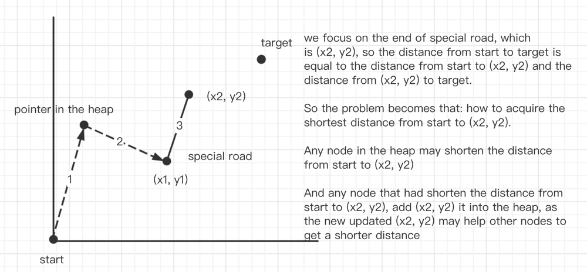

# Dijstra using go

**Author:** nacoward
**Votes:** 2
**Link:** [https://leetcode.com/problems/minimum-cost-of-a-path-with-special-roads/solutions/3474580/](https://leetcode.com/problems/minimum-cost-of-a-path-with-special-roads/solutions/3474580/)

---

# Intuition
Dijstra's algorithm

# Approach
1) Add one point which may shorten the distance from start(source) to target into the heap.
2) for any edge(road) in the specialRoads, e.g. for one road = [x1, y1, x2, y2, cost], if the road can help the above point(in the heap) reach (x2, y2) with a shorter distance, update the distance from start(source) to (x2, y2)
3) Then, add (x2, y2) into the heap, as the distance from start to target is shorter than before, (x2, y2) may helper shorten the distance from start to target.




# Code
```
type Heap [][]int
func(h Heap) Len() int {return len(h)}
func(h Heap) Less(i, j int)bool {return h[i][0]<h[j][0]}
func(h Heap) Swap(i, j int) {h[i],h[j] = h[j], h[i]}
func(h *Heap) Push(x interface{}) {
    *h = append(*h, x.([]int))
}
func(h *Heap) Pop() interface{} {
    v := (*h)[len(*h)-1]
    *h = (*h)[:len(*h)-1]
    return v
}

func minimumCost(start []int, target []int, specialRoads [][]int) int {
    dist := make(map[[2]int]int)
    ans := target[0]-start[0] + target[1]-start[1]
    h := &Heap{}
    heap.Push(h, []int{0, start[0], start[1]})
    for h.Len() > 0 {
        elem := heap.Pop(h).([]int)
        curDist, x, y := elem[0], elem[1], elem[2]
        for _, road := range specialRoads {
            x1, y1, x2, y2, cost := road[0], road[1], road[2], road[3], road[4]
            if _, ok := dist[[2]int{x2, y2}]; !ok {
                dist[[2]int{x2, y2}] = x2-start[0] + y2-start[1]
            }
            if  dist[[2]int{x2, y2}] > abs(x1-x)+abs(y1-y)+curDist+cost {
                dist[[2]int{x2, y2}] = abs(x1-x)+abs(y1-y)+curDist+cost
                heap.Push(h, []int{dist[[2]int{x2, y2}], x2, y2})               
            }
        }
    }

    for _, road := range specialRoads {
        x2, y2, cost := road[2], road[3], dist[[2]int{road[2], road[3]}]
        ans = min2(ans, cost+target[0]-x2+target[1]-y2)
    }
    return ans
}
func abs(a int) int {if a < 0 {return -a} else {return a}}
func min2(a, b int) int{if a < b {return a} else {return b}}
```