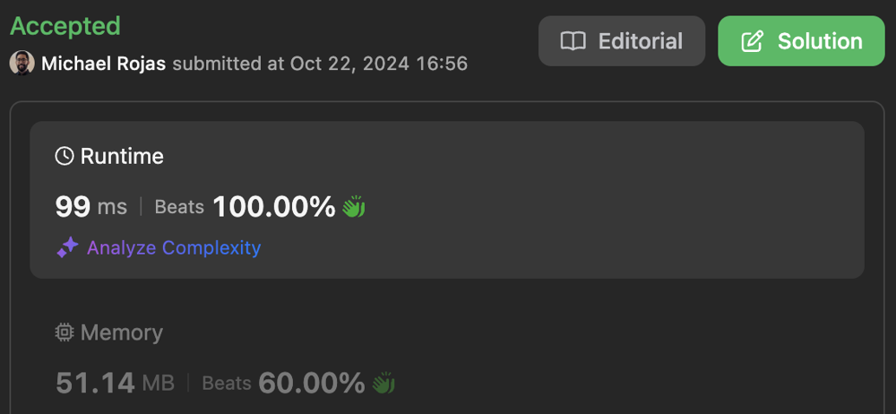
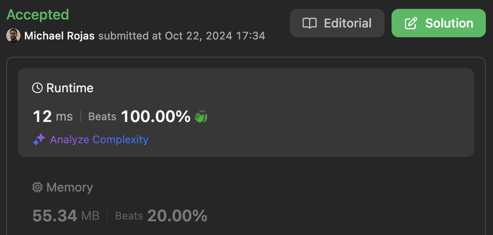

# 100% | DFS | Time: O(8^(NM)) | Space: O(NM)

**Author:** rojas
**Votes:** 0
**Link:** [https://leetcode.com/problems/the-knights-tour/solutions/5954610/](https://leetcode.com/problems/the-knights-tour/solutions/5954610/)

---

# Table of Contents

[toc]

# DFS

## Complexity

- Time complexity: $$O(8^{mn})$$

- Space complexity: $$O(MN)$$

## Performance

[JavaScript](https://leetcode.com/problems/the-knights-tour/submissions/1430839057/)



## Code

```typescript []
const NIL = -1;
const DIRS = [
              [-2, -1],     [-2,  1],
    [-1, -2],                         [-1, 2],
                       //O
    [ 1, -2],                         [ 1, 2],
              [ 2, -1],     [ 2,  1]
];

function tourOfKnight(m: number, n: number, r: number, c: number): number[][] {
    // Create board
    const board = new Array(m);
    for (let y = 0; y < m; ++y) {
        board[y] = new Array(n).fill(NIL);
    }

    // DFS
    dfs(board, r, c, 0, m * n - 1);

    return board;
}

function dfs(board: number[][], y: number, x: number, v: number, maxV: number): boolean {
    board[y][x] = v;
    if (v == maxV) {
        return true;
    }

    const Y = board.length;
    const X = board[0].length;
    for (const [dy, dx] of DIRS) {
        const y2 = y + dy;
        const x2 = x + dx;
        if (y2 >= 0 && y2 < Y && x2 >= 0 && x2 < X && board[y2][x2] == NIL) {
            if (dfs(board, y2, x2, v + 1, maxV)) {
                return true;
            }
        }
    }

    board[y][x] = NIL;
    return false;
}
```

```javascript []
const NIL = -1;
const DIRS = [
              [-2, -1],     [-2,  1],
    [-1, -2],                         [-1, 2],
                       //O
    [ 1, -2],                         [ 1, 2],
              [ 2, -1],     [ 2,  1]
];

/**
 * @param {number} m
 * @param {number} n
 * @param {number} r
 * @param {number} c
 * @return {number[][]}
 */
function tourOfKnight(m, n, r, c) {
    // Create board
    const board = new Array(m);
    for (let y = 0; y < m; ++y) {
        board[y] = new Array(n).fill(NIL);
    }

    // DFS
    dfs(board, r, c, 0, m * n - 1);

    // Return board
    return board;
}

/**
 * @param {number[][]} board
 * @param {number} y
 * @param {number} x
 * @param {number} v
 * @param {number} maxV
 * @return {boolean}
 */
function dfs(board, y, x, v, maxV) {
    board[y][x] = v;
    if (v == maxV) {
        return true;
    }

    const Y = board.length;
    const X = board[0].length;
    for (const [dy, dx] of DIRS) {
        const y2 = y + dy;
        const x2 = x + dx;
        if (y2 >= 0 && y2 < Y && x2 >= 0 && x2 < X && board[y2][x2] == NIL) {
            if (dfs(board, y2, x2, v + 1, maxV)) {
                return true;
            }
        }
    }

    board[y][x] = NIL;
    return false;
}
```

```java []
class Solution {
    final static int NIL = -1;
    final static int[][] DIRS = {
                {-2, -1},     {-2,  1},
        {-1, -2},                         {-1, 2},
                        //O
        { 1, -2},                         { 1, 2},
                { 2, -1},     { 2,  1}
    };

    public int[][] tourOfKnight(int m, int n, int r, int c) {
        // Create board
        final int[][] board = new int[m][n];
        for (int y = 0; y < m; ++y) {
            Arrays.fill(board[y], NIL);
        }

        // DFS
        dfs(board, r, c, 0, m * n - 1);

        return board;
    }

    private boolean dfs(int[][] board, int y, int x, int v, int maxV) {
        board[y][x] = v;
        if (v == maxV) {
            return true;
        }

        final int Y = board.length;
        final int X = board[0].length;
        for (final int[] deltas : DIRS) {
            final int y2 = y + deltas[0];
            final int x2 = x + deltas[1];
            if (y2 >= 0 && y2 < Y && x2 >= 0 && x2 < X && board[y2][x2] == NIL) {
                if (dfs(board, y2, x2, v + 1, maxV)) {
                    return true;
                }
            }
        }

        board[y][x] = NIL;
        return false;
    }
}
```

# Warnsdorff\u2019s Rule

[Wikipedia](https://en.wikipedia.org/wiki/Knight%27s_tour#Warnsdorf's_rule)

## Complexity

- Time complexity: $$O(8^{mn})$$

- Space complexity: $$O(MN)$$

## Performance

[JavaScript](https://leetcode.com/problems/the-knights-tour/submissions/1430861374/)



## Code

```typescript []
const NIL = -1;
const DIRS = [
              [-2, -1],     [-2,  1],
    [-1, -2],                         [-1, 2],
                       //O
    [ 1, -2],                         [ 1, 2],
              [ 2, -1],     [ 2,  1]
];

function tourOfKnight(m: number, n: number, r: number, c: number): number[][] {
    // Create board
    const board = new Array(m);
    for (let y = 0; y < m; ++y) {
        board[y] = new Array(n).fill(NIL);
    }

    // DFS
    dfs(board, r, c, 0, m * n - 1);

    return board;
}

function dfs(board: number[][], y: number, x: number, v: number, maxV: number): boolean {
    board[y][x] = v;
    if (v == maxV) {
        return true;
    }

    for (const [y2, x2] of getNextMoves(board, y, x)) {
        if (dfs(board, y2, x2, v + 1, maxV)) {
            return true;
        }
    }

    board[y][x] = NIL;
    return false;
}

function getNextMoves(board: number[][], y: number, x: number): number[][] {
    const Y = board.length;
    const X = board[0].length;
    const moves: number[][] = [];

    for (const [dy, dx] of DIRS) {
        const y2 = y + dy;
        const x2 = x + dx;
        if (y2 >= 0 && y2 < Y && x2 >= 0 && x2 < X && board[y2][x2] == NIL) {
            moves.push([y2, x2, countNextMoves(board, y2, x2)]);
        }
    }

    moves.sort((a, b) => a[2] - b[2]);
    return moves;
}

function countNextMoves(board: number[][], y: number, x: number): number {
    const Y = board.length;
    const X = board[0].length;

    let count = 0;
    for (const [dy, dx] of DIRS) {
        const y2 = y + dy;
        const x2 = x + dx;
        count += +(y2 >= 0 && y2 < Y && x2 >= 0 && x2 < X && board[y2][x2] == NIL);
    }

    return count;
}
```

```javascript []
const NIL = -1;
const DIRS = [
              [-2, -1],     [-2,  1],
    [-1, -2],                         [-1, 2],
                       //O
    [ 1, -2],                         [ 1, 2],
              [ 2, -1],     [ 2,  1]
];

/**
 * @param {number} m
 * @param {number} n
 * @param {number} r
 * @param {number} c
 * @return {number[][]}
 */
function tourOfKnight(m, n, r, c) {
    // Create board
    const board = new Array(m);
    for (let y = 0; y < m; ++y) {
        board[y] = new Array(n).fill(NIL);
    }

    // DFS
    dfs(board, r, c, 0, m * n - 1);

    // Return board
    return board;
}

/**
 * @param {number[][]} board
 * @param {number} y
 * @param {number} x
 * @param {number} v
 * @param {number} maxV
 * @return {boolean}
 */
function dfs(board, y, x, v, maxV) {
    board[y][x] = v;
    if (v == maxV) {
        return true;
    }

    for (const [y2, x2] of getNextMoves(board, y, x)) {
        if (dfs(board, y2, x2, v + 1, maxV)) {
            return true;
        }
    }

    board[y][x] = NIL;
    return false;
}

/**
 * @param {number[][]} board
 * @param {number} y
 * @param {number} x
 * @return {number[][]}
 */
function getNextMoves(board, y, x) {
    const Y = board.length;
    const X = board[0].length;

    const moves = [];
    for (const [dy, dx] of DIRS) {
        const y2 = y + dy;
        const x2 = x + dx;
        if (y2 >= 0 && y2 < Y && x2 >= 0 && x2 < X && board[y2][x2] == NIL) {
            moves.push([y2, x2, countNextMoves(board, y2, x2)]);
        }
    }

    moves.sort((a, b) => a[2] - b[2]);
    return moves;
}

/**
 * @param {number[][]} board
 * @param {number} y
 * @param {number} x
 * @return {number}
 */
function countNextMoves(board, y, x) {
    const Y = board.length;
    const X = board[0].length;

    let count = 0;
    for (const [dy, dx] of DIRS) {
        const y2 = y + dy;
        const x2 = x + dx;
        count += +(y2 >= 0 && y2 < Y && x2 >= 0 && x2 < X && board[y2][x2] == NIL);
    }

    return count;
}
```

```java []
class Solution {
    final static int NIL = -1;
    final static int[][] DIRS = {
                {-2, -1},     {-2,  1},
        {-1, -2},                         {-1, 2},
                        //O
        { 1, -2},                         { 1, 2},
                { 2, -1},     { 2,  1}
    };

    public int[][] tourOfKnight(int m, int n, int r, int c) {
        // Create board
        final int[][] board = new int[m][n];
        for (int y = 0; y < m; ++y) {
            Arrays.fill(board[y], NIL);
        }

        // DFS
        dfs(board, r, c, 0, m * n - 1);

        return board;
    }

    private boolean dfs(int[][] board, int y, int x, int v, int maxV) {
        board[y][x] = v;
        if (v == maxV) {
            return true;
        }

        for (final int[] move : getNextMoves(board, y, x)) {
            if (dfs(board, move[0], move[1], v + 1, maxV)) {
                return true;
            }
        }

        board[y][x] = NIL;
        return false;
    }

    private List<int[]> getNextMoves(int[][] board, int y, int x) {
        final int Y = board.length;
        final int X = board[0].length;
        final List<int[]> moves = new ArrayList<>();

        for (final int[] deltas : DIRS) {
            final int y2 = y + deltas[0];
            final int x2 = x + deltas[1];
            if (y2 >= 0 && y2 < Y && x2 >= 0 && x2 < X && board[y2][x2] == NIL) {
                moves.add(new int[]{y2, x2, countNextMoves(board, y2, x2)});
            }
        }

        Collections.sort(moves, (a, b) -> a[2] - b[2]);
        return moves;
    }

    private int countNextMoves(int[][] board, int y, int x) {
        final int Y = board.length;
        final int X = board[0].length;

        int count = 0;
        for (final int[] deltas : DIRS) {
            final int y2 = y + deltas[0];
            final int x2 = x + deltas[1];
            if (y2 >= 0 && y2 < Y && x2 >= 0 && x2 < X && board[y2][x2] == NIL) {
                ++count;
            }
        }

        return count;
    }
}
```
