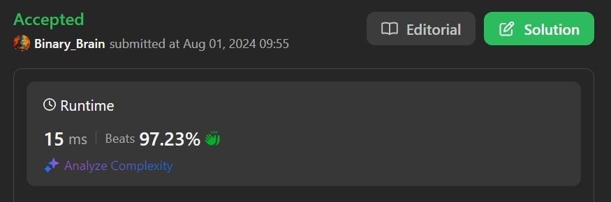

# Well built code for 3 languages with margin(97%)

**Author:** Success_Code
**Votes:** 45
**Link:** [https://leetcode.com/problems/number-of-senior-citizens/solutions/5565731/](https://leetcode.com/problems/number-of-senior-citizens/solutions/5565731/)

---

# My Result:


# Complexity
- Time complexity:
O(n)

- Space complexity:
O(1)

# Code
```python []
class Solution(object):
    def countSeniors(self, details):
        """
        :type details: List[str]
        :rtype: int
        """
        counter = 0
        for i in details:
            if int(i[11:13]) > 60:
                counter+=1
        return counter
```
```python3 []
class Solution:
    def countSeniors(self, details: List[str]) -> int:
        return sum(int(x[11:13]) > 60 for x in details)
```
```java []
class Solution {
    public int countSeniors(String[] details) {
        int ans = 0;
        for (var x : details) {
            int age = Integer.parseInt(x.substring(11, 13));
            if (age > 60) {
                ++ans;
            }
        }
        return ans;
    }
}
```
```C++ []
class Solution {
public:
    int countSeniors(vector<string>& details) {
        int ans = 0;
        for (auto& x : details) {
            int age = stoi(x.substr(11, 2));
            ans += age > 60;
        }
        return ans;
    }
};
```