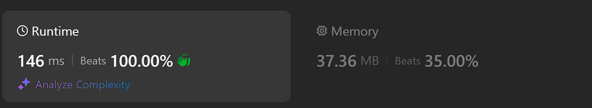

# Kotlin. Beats 100% (146 ms). Hex number comparison.

**Author:** mobdev778
**Votes:** 5
**Link:** [https://leetcode.com/problems/number-of-senior-citizens/solutions/5567532/](https://leetcode.com/problems/number-of-senior-citizens/solutions/5567532/)

---



# Code
```
class Solution {
    fun countSeniors(details: Array<String>): Int {
        return details.count {
            (it[11] - '0') shl 4 or (it[12] - '0') > 0x60
        }
    }
}
```

# Approach 

Let's try to number all the characters in the passenger line:

```
//       012345678901234
val s = "7868190130M7522"
```

As we can see, gender is the 10th character of the string, and the 11th and 12th characters form the age:

```
//         012
val s = "..M75.."
```

These symbols with numbers are in the ASCII encoding. It means, symbols '0'..'9' are encoded with values \u200B\u200Bfrom 48 (0x30) to 59 (0x39) inclusive.

To convert a single character of a string to a number, we can perform a simple operation of subtracting the value '0' (or 0x30) from the character, for example:

```
val s = "7868190130M7522"
val firstDigit: Int = s[11] - '0' // firstDigit = 7
val secondDigit: Int = s[12] - '0' // secondDigit = 5
```

So to convert 2 digit characters into a number we could use the following algorithm:

```
val s = "7868190130M7522"
val age = (s[11] - '0') * 10 + (s[12] - '0') // age = 75
```

But! There is a very important "but" here - the multiplication operation is a SLOW OPERATION for the CPU. I don't like multiplications )

Instead of multiplying by 10, we can multiply the number by 16. But not with multiplication, but with a bitwise shift to the left. This will be faster. And we can add the second digit to the result, but add it using a bitwise "OR". This will also be faster:

```
val s = "7868190130M7522"
val age = (s[11] - '0') shl 4 or (s[12] - '0') // age = 0x75 (age = 117)
```

With this conversion we get the age as a byte, where the high four bits will be the upper digit of the age, and the low four bits will be the lower digit of the age.

It is easy to see that in our case the string will match the "senior passenger" condition if both quadruples of bits form a value greater than 0x60:

```
class Solution {
    fun countSeniors(details: Array<String>): Int {
        return details.count {
            ((it[11] - '0') shl 4 or (it[12] - '0')) > 0x60
        }
    }
}
```