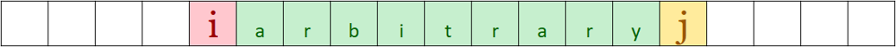

# 【C++|Java|Python】Sort and enumerate each maximum value

**Author:** RealFan
**Votes:** 117
**Link:** [https://leetcode.com/problems/power-of-heroes/solutions/3520233/](https://leetcode.com/problems/power-of-heroes/solutions/3520233/)

---

> **I know almost nothing about English, pointing out the mistakes in my article would be much appreciated.**

> **In addition, I'm too weak, please be critical of my ideas.**
---

# Intuition
1. Since we just consider "combination" instead of "permutation", **sorting doesn't affect the final result.**
2. After sorting, we try to enumerate all (minimum $$a_i$$, maximum $$a_j$$) pairs, guarantee that $$i<j$$. 
    For each pair, all elements between $$i$$ and $$j$$ can be independently selected to be included or not. **So there will be $$2^{j-i-1}$$ different combinations with minimum $$a_i$$ and maximum $$a_j$$.** 

    The contribution of pair$$(a_i, a_j)$$ to the answer will be:
    $$c(i,j) = {a_{j}}^{2} \\cdot a_i \\cdot 2^{j-i-1}$$
3. As a result, the contribution of $$a_j$$ is the sum of all valid $$(i,j)$$'s contribution:
    $$c(j) =\\sum\\limits_{i=0}^{j}c(i,j)$$
    In step 2, we have discussed the case $$i<j$$. And obviously, when $$i=j$$, the contribution is:
    $$c(j,j)={a_j}^3$$
    **So the total contribution of $$j$$ is:**
    $$c(j) = c(j,j) + \\sum\\limits_{i=0}^{j-1}c(i,j) ={a_{j}}^{3} + {a_{j}}^{2} \\cdot \\sum\\limits_{i=0}^{j-1} a_i \\cdot 2^{j-i-1}$$
4. Let's set $$S(j) = \\sum\\limits_{i=0}^{j-1} a_i \\cdot 2^{j-i-1}$$, so the $$c(j)$$ changes to:
    $$c(j) = {a_{j}}^{2} \\cdot [a_j + S(j)]$$
    Now, our task is to calculate $$S(j)$$ in a low average time, such as $$O(1)$$.
5. Obviously there is a sense that it is possible to **recursively derive $$S(j)$$ from $$S(j-1)$$.** We can easily get that:
    $$S(0) = 0$$
    $$S(j) = a_{j-1} + 2 \\cdot \\sum\\limits_{i=0}^{j-2} a_i \\cdot 2^{j-i-2} =  a_{j-1} + 2 S(j-1), j > 0$$
    *(That's because from $$j-1$$ to $$j$$, $$a_{j-1}$$ will be included for all $$i$$, so it offers a new independent choice.)*

6. Therefore, sort firstly, then traverse the array from front to back, and constantly maintain $$S(j)$$ and count.

# Complexity
- Time complexity: $$O(n \\log n)$$
- Space complexity: $$O(1)$$ or $$O(\\log n)$$ or $$O(n)$$, depends on `sort` implementation.

# Code
``` C++ []
class Solution {
public:
    int sumOfPower(vector<int>& nums) {
        long long res = 0, s = 0, base = 1e9 + 7;
        sort(nums.begin(), nums.end());
        for (int x: nums) {
            res = (res + (s + x) * x % base * x % base) % base;
            s = (s * 2 + x) % base;
        }
        return res;
    }
};
```
``` Java []
class Solution {
    public int sumOfPower(int[] nums) {
        long res = 0, s = 0, base = 1000000007;
        Arrays.sort(nums);
        for (int x: nums) {
            res = (res + (s + x) * x % base * x % base) % base;
            s = (s * 2 + x) % base;
        }
        return (int)res;
    }
}
```
``` Python3 []
class Solution:
    def sumOfPower(self, nums: List[int]) -> int:
        ans, t, base = 0, 0, 10**9 + 7
        for c in sorted(nums):
            ans = (ans + (t + c) * c * c) % base
            t = (2 * t + c) % base
        return ans
```
