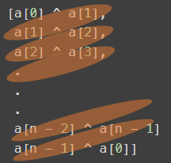

# [C++, Java, Python] Explanation with Formal Proof | One-Liner | Time: O(n)

**Author:** shivamaggarwal513
**Votes:** 42
**Link:** [https://leetcode.com/problems/neighboring-bitwise-xor/solutions/3521882/](https://leetcode.com/problems/neighboring-bitwise-xor/solutions/3521882/)

---

# Intuition
`derived` array is given as
```
[a[0] ^ a[1],
 a[1] ^ a[2],
 a[2] ^ a[3],
 .
 .
 .
 a[n - 2] ^ a[n - 1]
 a[n - 1] ^ a[0]]
```
Take Bitwise-XOR of `derived` array.
Since `x ^ x = 0` and `x ^ 0 = x`.
Use these properties to cancel out `a[1], a[2], ..., a[n - 1]`.



We will be left with `a[0] ^ a[0] = 0`.

So Bitwise-XOR of derived array should be `0` for `original` to exist.

**Proof of why this is a necessary condition**
If Bitwise-XOR comes `1` then it means there is some `a[i]` which didn't find it's another `a[i]` to cancel each other, meaning `a[i] != a[i]` which is a contradiction. So, for any possible `original` array, `derived` array's Bitwise-XOR will always be `0`. If it is not, that means `original` does not exists.

**Proof of why this is a sufficient condition**
Credits to [@Andimeo](/Andimeo) for pointing this out. I will also try to generate `original` array from `derived`.

> I will be using this identity which says:
If `x ^ y = z`, then `y ^ z = x` and `x ^ z = y`.
Proof: `y ^ z = y ^ (x ^ y) = x`
Means we can shuffle `x`, `y`, and `z` any way we want.

We have to make `[a[0], a[1], a[2], ..., a[n - 1]]`
Let's assume `a[0] = a[0]`. ~(Haha, really?)~ I mean just let's say we don't bother calculating `a[0]`.
Also, we are given `[d[0], d[1], d[2], ..., d[n - 1]]`

- If `d[0] = a[0] ^ a[1]` then `a[1] = a[0] ^ d[0]`.
- If `d[1] = a[1] ^ a[2]` then `a[2] = a[1] ^ d[1] = a[0] ^ d[0] ^ d[1]`.
- If `d[2] = a[2] ^ a[3]` then `a[3] = a[2] ^ d[2] = a[0] ^ d[0] ^ d[1] ^ d[2]`
.
.
.
- `a[n - 1] = a[0] ^ d[0] ^ d[1] ^ d[2] ^ ... ^ d[n - 2]`

The `original` array will be:
```
[a[0],
 a[0] ^ d[0],
 a[0] ^ d[0] ^ d[1],
 a[0] ^ d[0] ^ d[1] ^ d[2],
 .
 .
 .
 a[0] ^ d[0] ^ d[1] ^ d[2] ^ ... ^ d[n - 2]]
```

Now, we know `d[n - 1] = a[n - 1] ^ a[0]`. Put the value of `a[n - 1]` from above:
```
d[n - 1] = (a[0] ^ d[0] ^ d[1] ^ d[2] ^ ... ^ d[n - 2]) ^ a[0]
         =         d[0] ^ d[1] ^ d[2] ^ ... ^ d[n - 2]

d[n - 1] ^ 0 = d[0] ^ d[1] ^ d[2] ^ ... ^ d[n - 2]
d[0] ^ d[1] ^ d[2] ^ ... ^ d[n - 2] ^ d[n - 1] = 0
```
Hence proved.

> Notice how `a[0]` gets cancelled out in equation of `d[n - 1]`? Means value of `a[0]` does not matter. Therefore, for a valid `derived` array, there will be 2 `original` arrays, one with `a[0] = 0` and another with `a[0] = 1`. Also, both of them will be 1's complement of each other.

# Code
```C++ []
class Solution {
public:
    bool doesValidArrayExist(vector<int>& derived) {
        return !accumulate(derived.begin(), derived.end(), 0, bit_xor<int>());
    }
};
```
```Java []
class Solution {
    public boolean doesValidArrayExist(int[] derived) {
        int xr = 0;
        for (int x: derived) {
            xr = xr ^ x;
        }
        return xr == 0;
    }
}
```
```Python []
class Solution:
    def doesValidArrayExist(self, derived: List[int]) -> bool:
        return not reduce(operator.xor, derived)
```

# Complexity
- Time Complexity: $$O(n)$$
- Space Complexity: $$O(1)$$