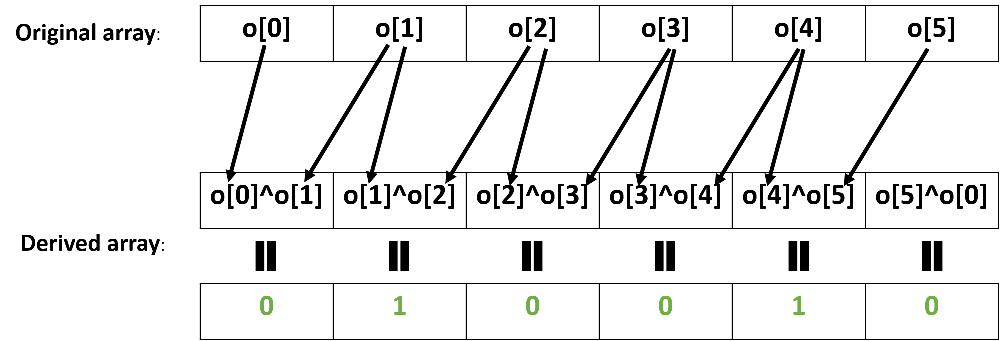
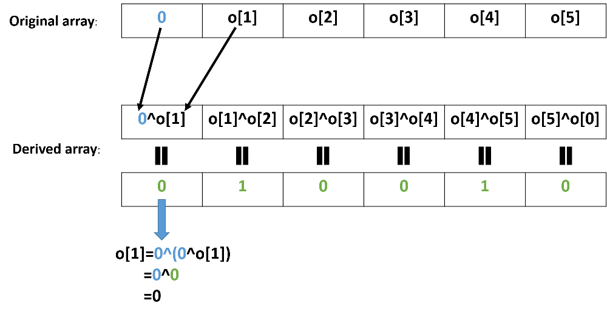
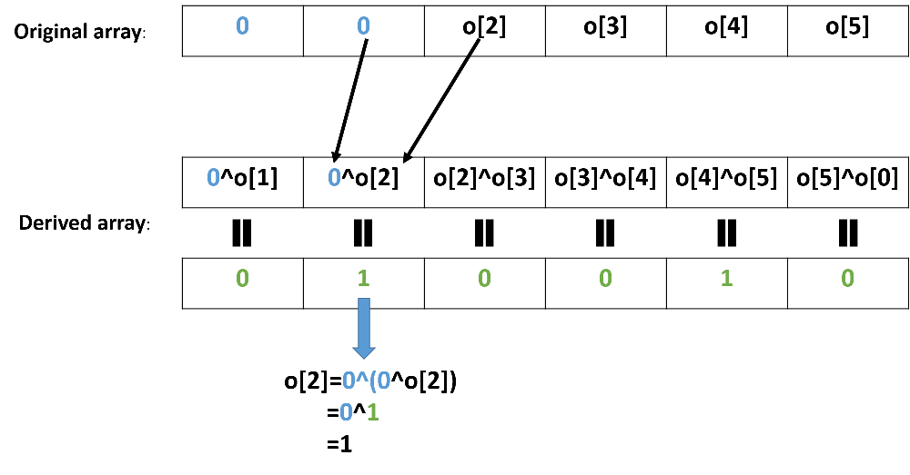
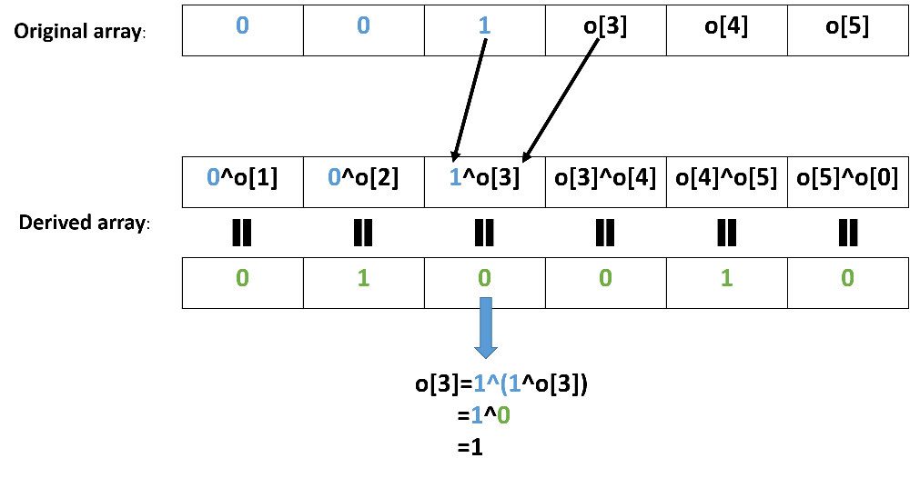
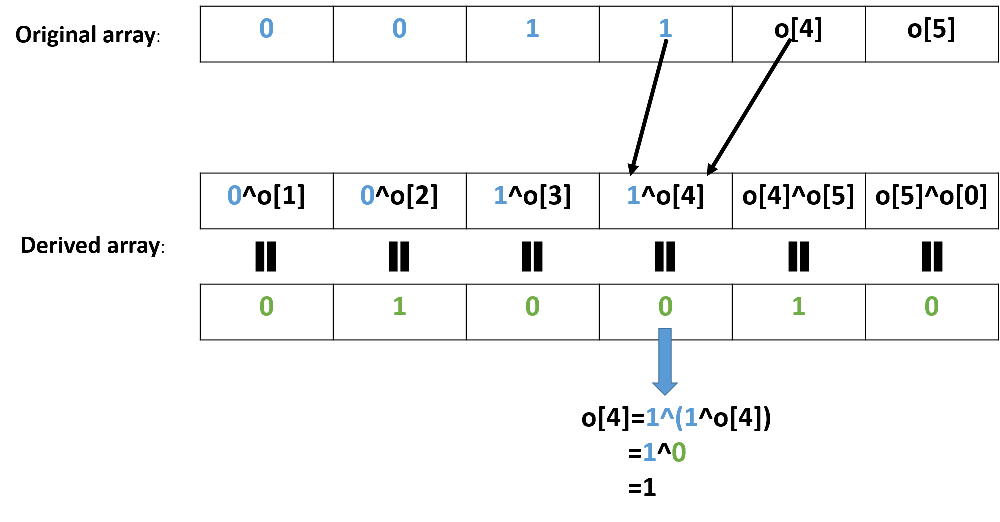
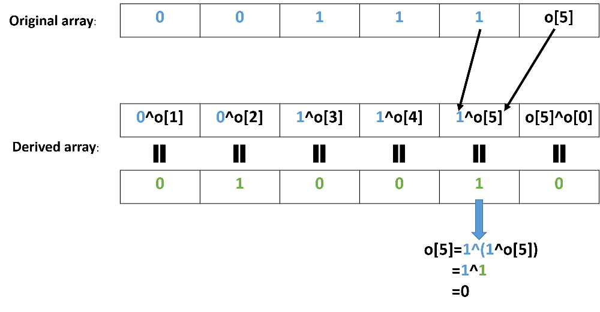

# illustrated step-by-step simulation

**Author:** cartesPerforees
**Votes:** 65
**Link:** [https://leetcode.com/problems/neighboring-bitwise-xor/solutions/3522096/](https://leetcode.com/problems/neighboring-bitwise-xor/solutions/3522096/)

---

We will discuss a solution that has the additional advantage of explicitly reconstructing the potential original array.
There are other ways of solving the problem that do not achieve this, You can check the last section of this post for links to other nice solutions which show you how to do just that.

# The inverse operation:
The key insight here is that the reverse operation for XOR is.. XOR

It means that $(x \\oplus a) \\oplus a = x$ (because $a \\oplus a = 0$). Basically, you can cancel the operation \u201C$\\oplus a$\u201D by applying it a second time.
This will prove very useful indeed to reverse the derived array into the original one!

# Let's draw an example 

Let\u2019s visualize the situation. We have the knowledge of a derived array `d=[0,1,0,0,1,0]` that is constructed from an potential (unknown) original array `o` as such:


We want to deduce the original array `o` from the derived one and see if it is valid. Well, having determined the reverse operation is sure gonna be useful for that! But we need a starting point\u2026 
**Let\u2019s first assume that the first element in the original array was 0**. Then we can compute the next element by using the reverse operation $\\oplus 0$, that is to say `o[1]=d[0]^0`. 
Have a look:


That\u2019s great because we can just repeat that procedure with the newly obtained element:



You get the drill! At each step, we can reconstruct the original array further using knowledge of the previous elements and our reverse operation! The whole procedure is shown below:

step3:


step4:


step5:



Eventually, we are able to reconstruct the whole array. In our case, we got `o=[0,0,1,1,1,0]`.
Now how do we know if it is valid? Well, we didn\u2019t yet use the last value of our derived array to reconstruct the orginal one (check again the graphical  steps above if you don't believe me!). That is our validity condition!  

We check if the last element of the original array XOR the first gives us the result in the last square indeed `o[0]^o[-1]==d[-1]`. 
If yes, the array is valid (it is valid in our case). **If not, try again assuming that the first value was 1!**
And that\u2019s all, we covered every case! If we can't find a valid original array starting with either 0 or 1, it means there's no possible original array

Do feel free to upvote if that helped you visualize and understand what is going on!


# Complexity
- Time complexity:
O(n)

- Space complexity:
O(1). We don't need to explicitly reconstruct the original array (which would be O(n) space), because at each step we only use the value at the previous index, so a single variable is enough to hold it

# Code
```
class Solution:
    def doesValidArrayExist(self, derived: List[int]) -> bool:
        
        #we try 0 and 1 as potential first elements
        for first in [0,1]:
            original=first
            for result in derived[:-1]:
                #we apply the reverse operation as shown in the pictures
                original=original^result
            #finally, we check if the validity condtion is true
            if original^first==derived[-1]:
                return True
        return False
        
```

# Other great solutions:
You can find a [different thought process explained here](https://leetcode.com/problems/neighboring-bitwise-xor/solutions/3521867/full-thought-process-one-line-solution/) or [more formally proven here](https://leetcode.com/problems/neighboring-bitwise-xor/solutions/3521882/c-java-python-explanation-with-formal-proof-one-liner-time-o-n/).
Those solutions are great because they are more "parcimonious". They do not reconstruct the original array (which the problem doesn't require), so it leads to shorter solutions.
They rely on the idea that if the array has been derived from an original array, then the whole XOR aggregation must be zero: $d[0] \\oplus d[1] \\oplus ... \\oplus d[n] == 0$.
If you have followed this solution, can you see why? Take another look at the images if you need it or just check out the links ;)
Lee has an [even slightly craftier version](https://leetcode.com/problems/neighboring-bitwise-xor/solutions/3522095/java-c-python-sum-is-even/) 
