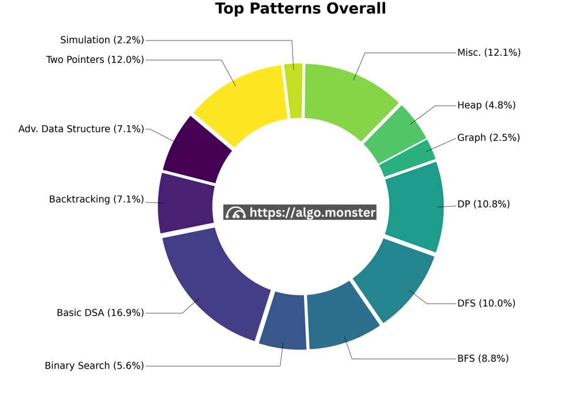
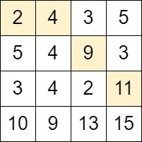
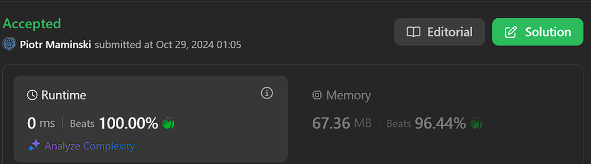
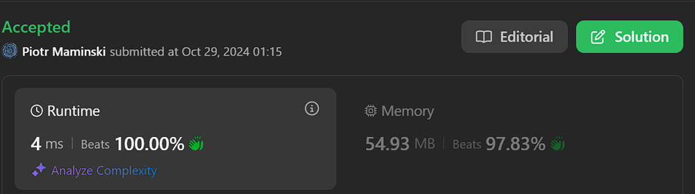
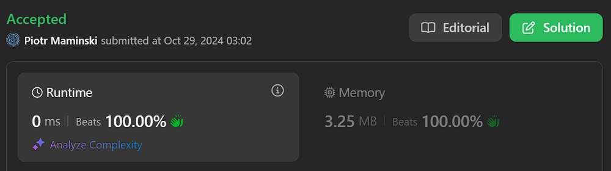

# ✅ List Most Common Interview Matrix | Beats 100% | ✅ Explained step by step

**Author:** Piotr_Maminski
**Votes:** 71
**Link:** [https://leetcode.com/problems/maximum-number-of-moves-in-a-grid/solutions/5980453/](https://leetcode.com/problems/maximum-number-of-moves-in-a-grid/solutions/5980453/)

---

```python3 []
class Solution:
    def maxMoves(self, grid: List[List[int]]) -> int:
        # Get dimensions of the grid
        m = len(grid)    # number of rows
        n = len(grid[0]) # number of columns
        
        # res will store the rightmost column we can reach
        res = 0
        
        # dp array stores the maximum number of moves possible to reach each cell
        # in the current column we're processing
        dp = [0] * m
        
        # Iterate through each column from left to right (starting from column 1)
        for j in range(1, n):
            # leftTop keeps track of the dp value from the cell above-left
            leftTop = 0
            # found indicates if we can reach any cell in current column
            found = False
            
            # Iterate through each row in current column
            for i in range(m):
                # cur will store the maximum moves to reach current cell
                cur = -1
                # Store dp[i] for next iteration's leftTop
                nxtLeftTop = dp[i]
                
                # Check move from top-left cell (if valid)
                if i - 1 >= 0 and leftTop != -1 and grid[i][j] > grid[i-1][j-1]:
                    cur = max(cur, leftTop + 1)
                
                # Check move from direct left cell (if valid)
                if dp[i] != -1 and grid[i][j] > grid[i][j-1]:
                    cur = max(cur, dp[i] + 1)
                
                # Check move from bottom-left cell (if valid)
                if i + 1 < m and dp[i+1] != -1 and grid[i][j] > grid[i+1][j-1]:
                    cur = max(cur, dp[i+1] + 1)
                
                # Update dp array for current cell
                dp[i] = cur
                # Update found flag if we can reach current cell
                found = found or (dp[i] != -1)
                # Update leftTop for next row's iteration
                leftTop = nxtLeftTop
            
            # If we can't reach any cell in current column, break
            if not found:
                break
            # Update result to current column if we can reach it
            res = j
        
        # Return the maximum number of moves possible
        return res
```
```cpp []
class Solution {
public:
    int maxMoves(vector<vector<int>>& grid) {
        // Get dimensions of the grid
        int m = grid.size();    // number of rows
        int n = grid[0].size(); // number of columns
        
        // res will store the rightmost column we can reach
        int res = 0;
        
        // dp array stores the maximum number of moves possible to reach each cell
        // in the current column we're processing
        vector<int> dp(m);
        
        // Iterate through each column from left to right (starting from column 1)
        for (int j = 1; j < n; ++j) {
            // leftTop keeps track of the dp value from the cell above-left
            int leftTop = 0;
            // found indicates if we can reach any cell in current column
            bool found = false;
            
            // Iterate through each row in current column
            for (int i = 0; i < m; ++i) {
                // cur will store the maximum moves to reach current cell
                int cur = -1;
                // Store dp[i] for next iteration's leftTop
                int nxtLeftTop = dp[i];
                
                // Check move from top-left cell (if valid)
                if (i - 1 >= 0 && leftTop != -1 && grid[i][j] > grid[i - 1][j - 1]) {
                    cur = max(cur, leftTop + 1);
                }
                
                // Check move from direct left cell (if valid)
                if (dp[i] != -1 && grid[i][j] > grid[i][j - 1]) {
                    cur = max(cur, dp[i] + 1);
                }
                
                // Check move from bottom-left cell (if valid)
                if (i + 1 < m && dp[i + 1] != -1 && grid[i][j] > grid[i + 1][j - 1]) {
                    cur = max(cur, dp[i + 1] + 1);
                }
                
                // Update dp array for current cell
                dp[i] = cur;
                // Update found flag if we can reach current cell
                found = found || (dp[i] != -1);
                // Update leftTop for next row's iteration
                leftTop = nxtLeftTop;
            }
            
            // If we can't reach any cell in current column, break
            if (!found) break;
            // Update result to current column if we can reach it
            res = j;
        }
        
        // Return the maximum number of moves possible
        return res;
    }
};
```
```java []
class Solution {
    public int maxMoves(int[][] grid) {
        // Get dimensions of the grid
        int m = grid.length;    // number of rows
        int n = grid[0].length; // number of columns
        
        // res will store the rightmost column we can reach
        int res = 0;
        
        // dp array stores the maximum number of moves possible to reach each cell
        // in the current column we're processing
        int[] dp = new int[m];
        
        // Iterate through each column from left to right (starting from column 1)
        for (int j = 1; j < n; j++) {
            // leftTop keeps track of the dp value from the cell above-left
            int leftTop = 0;
            // found indicates if we can reach any cell in current column
            boolean found = false;
            
            // Iterate through each row in current column
            for (int i = 0; i < m; i++) {
                // cur will store the maximum moves to reach current cell
                int cur = -1;
                // Store dp[i] for next iteration's leftTop
                int nxtLeftTop = dp[i];
                
                // Check move from top-left cell (if valid)
                if (i - 1 >= 0 && leftTop != -1 && grid[i][j] > grid[i - 1][j - 1]) {
                    cur = Math.max(cur, leftTop + 1);
                }
                
                // Check move from direct left cell (if valid)
                if (dp[i] != -1 && grid[i][j] > grid[i][j - 1]) {
                    cur = Math.max(cur, dp[i] + 1);
                }
                
                // Check move from bottom-left cell (if valid)
                if (i + 1 < m && dp[i + 1] != -1 && grid[i][j] > grid[i + 1][j - 1]) {
                    cur = Math.max(cur, dp[i + 1] + 1);
                }
                
                // Update dp array for current cell
                dp[i] = cur;
                // Update found flag if we can reach current cell
                found = found || (dp[i] != -1);
                // Update leftTop for next row's iteration
                leftTop = nxtLeftTop;
            }
            
            // If we can't reach any cell in current column, break
            if (!found) break;
            // Update result to current column if we can reach it
            res = j;
        }
        
        // Return the maximum number of moves possible
        return res;
    }
}
```
```csharp []
public class Solution {
    public int MaxMoves(int[][] grid) {
        // Get dimensions of the grid
        int m = grid.Length;     // number of rows
        int n = grid[0].Length;  // number of columns
        
        // res will store the rightmost column we can reach
        int res = 0;
        
        // dp array stores the maximum number of moves possible to reach each cell
        // in the current column we're processing
        int[] dp = new int[m];
        
        // Iterate through each column from left to right (starting from column 1)
        for (int j = 1; j < n; j++) {
            // leftTop keeps track of the dp value from the cell above-left
            int leftTop = 0;
            // found indicates if we can reach any cell in current column
            bool found = false;
            
            // Iterate through each row in current column
            for (int i = 0; i < m; i++) {
                // cur will store the maximum moves to reach current cell
                int cur = -1;
                // Store dp[i] for next iteration's leftTop
                int nxtLeftTop = dp[i];
                
                // Check move from top-left cell (if valid)
                if (i - 1 >= 0 && leftTop != -1 && grid[i][j] > grid[i - 1][j - 1]) {
                    cur = Math.Max(cur, leftTop + 1);
                }
                
                // Check move from direct left cell (if valid)
                if (dp[i] != -1 && grid[i][j] > grid[i][j - 1]) {
                    cur = Math.Max(cur, dp[i] + 1);
                }
                
                // Check move from bottom-left cell (if valid)
                if (i + 1 < m && dp[i + 1] != -1 && grid[i][j] > grid[i + 1][j - 1]) {
                    cur = Math.Max(cur, dp[i + 1] + 1);
                }
                
                // Update dp array for current cell
                dp[i] = cur;
                // Update found flag if we can reach current cell
                found = found || (dp[i] != -1);
                // Update leftTop for next row's iteration
                leftTop = nxtLeftTop;
            }
            
            // If we can't reach any cell in current column, break
            if (!found) break;
            // Update result to current column if we can reach it
            res = j;
        }
        
        // Return the maximum number of moves possible
        return res;
    }
}
```
```golang []
func maxMoves(grid [][]int) int {
    m := len(grid)    // number of rows
    n := len(grid[0]) // number of columns
    
    // res will store the rightmost column we can reach
    res := 0
    
    // dp array stores the maximum number of moves possible to reach each cell
    // in the current column we're processing
    dp := make([]int, m)
    
    // Iterate through each column from left to right (starting from column 1)
    for j := 1; j < n; j++ {
        // leftTop keeps track of the dp value from the cell above-left
        leftTop := 0
        // found indicates if we can reach any cell in current column
        found := false
        
        // Iterate through each row in current column
        for i := 0; i < m; i++ {
            // cur will store the maximum moves to reach current cell
            cur := -1
            // Store dp[i] for next iteration's leftTop
            nxtLeftTop := dp[i]
            
            // Check move from top-left cell (if valid)
            if i-1 >= 0 && leftTop != -1 && grid[i][j] > grid[i-1][j-1] {
                cur = max(cur, leftTop+1)
            }
            
            // Check move from direct left cell (if valid)
            if dp[i] != -1 && grid[i][j] > grid[i][j-1] {
                cur = max(cur, dp[i]+1)
            }
            
            // Check move from bottom-left cell (if valid)
            if i+1 < m && dp[i+1] != -1 && grid[i][j] > grid[i+1][j-1] {
                cur = max(cur, dp[i+1]+1)
            }
            
            // Update dp array for current cell
            dp[i] = cur
            // Update found flag if we can reach current cell
            found = found || (dp[i] != -1)
            // Update leftTop for next row's iteration
            leftTop = nxtLeftTop
        }
        
        // If we can't reach any cell in current column, break
        if !found {
            break
        }
        // Update result to current column if we can reach it
        res = j
    }
    
    // Return the maximum number of moves possible
    return res
}

// Helper function to find maximum of two integers
func max(a, b int) int {
    if a > b {
        return a
    }
    return b
}
```
```swift []
class Solution {
    func maxMoves(_ grid: [[Int]]) -> Int {
        // Get dimensions of the grid
        let m = grid.count      // number of rows
        let n = grid[0].count   // number of columns
        
        // res will store the rightmost column we can reach
        var res = 0
        
        // dp array stores the maximum number of moves possible to reach each cell
        // in the current column we're processing
        var dp = Array(repeating: 0, count: m)
        
        // Iterate through each column from left to right (starting from column 1)
        for j in 1..<n {
            // leftTop keeps track of the dp value from the cell above-left
            var leftTop = 0
            // found indicates if we can reach any cell in current column
            var found = false
            
            // Iterate through each row in current column
            for i in 0..<m {
                // cur will store the maximum moves to reach current cell
                var cur = -1
                // Store dp[i] for next iteration's leftTop
                let nxtLeftTop = dp[i]
                
                // Check move from top-left cell (if valid)
                if i - 1 >= 0 && leftTop != -1 && grid[i][j] > grid[i-1][j-1] {
                    cur = max(cur, leftTop + 1)
                }
                
                // Check move from direct left cell (if valid)
                if dp[i] != -1 && grid[i][j] > grid[i][j-1] {
                    cur = max(cur, dp[i] + 1)
                }
                
                // Check move from bottom-left cell (if valid)
                if i + 1 < m && dp[i+1] != -1 && grid[i][j] > grid[i+1][j-1] {
                    cur = max(cur, dp[i+1] + 1)
                }
                
                // Update dp array for current cell
                dp[i] = cur
                // Update found flag if we can reach current cell
                found = found || (dp[i] != -1)
                // Update leftTop for next row's iteration
                leftTop = nxtLeftTop
            }
            
            // If we can't reach any cell in current column, break
            if !found { break }
            // Update result to current column if we can reach it
            res = j
        }
        
        // Return the maximum number of moves possible
        return res
    }
}
```
```javascript [JS]
// JavaScript

/**
 * @param {number[][]} grid
 * @return {number}
 */
var maxMoves = function(grid) {
    // Get dimensions of the grid
    const m = grid.length;    // number of rows
    const n = grid[0].length; // number of columns
    
    // res will store the rightmost column we can reach
    let res = 0;
    
    // dp array stores the maximum number of moves possible to reach each cell
    // in the current column we're processing
    let dp = new Array(m).fill(0);
    
    // Iterate through each column from left to right (starting from column 1)
    for (let j = 1; j < n; j++) {
        // leftTop keeps track of the dp value from the cell above-left
        let leftTop = 0;
        // found indicates if we can reach any cell in current column
        let found = false;
        
        // Iterate through each row in current column
        for (let i = 0; i < m; i++) {
            // cur will store the maximum moves to reach current cell
            let cur = -1;
            // Store dp[i] for next iteration's leftTop
            let nxtLeftTop = dp[i];
            
            // Check move from top-left cell (if valid)
            if (i - 1 >= 0 && leftTop !== -1 && grid[i][j] > grid[i - 1][j - 1]) {
                cur = Math.max(cur, leftTop + 1);
            }
            
            // Check move from direct left cell (if valid)
            if (dp[i] !== -1 && grid[i][j] > grid[i][j - 1]) {
                cur = Math.max(cur, dp[i] + 1);
            }
            
            // Check move from bottom-left cell (if valid)
            if (i + 1 < m && dp[i + 1] !== -1 && grid[i][j] > grid[i + 1][j - 1]) {
                cur = Math.max(cur, dp[i + 1] + 1);
            }
            
            // Update dp array for current cell
            dp[i] = cur;
            // Update found flag if we can reach current cell
            found = found || (dp[i] !== -1);
            // Update leftTop for next row's iteration
            leftTop = nxtLeftTop;
        }
        
        // If we can't reach any cell in current column, break
        if (!found) break;
        // Update result to current column if we can reach it
        res = j;
    }
    
    // Return the maximum number of moves possible
    return res;
};
```
```typescript [TS]
function maxMoves(grid: number[][]): number {
    const m: number = grid.length;    
    const n: number = grid[0].length; 
    
    let res: number = 0;
    let dp: number[] = new Array(m).fill(0);
    
    for (let j = 1; j < n; j++) {
        let leftTop: number = 0;
        let found: boolean = false;
        
        for (let i = 0; i < m; i++) {
            let cur: number = -1;
            let nxtLeftTop: number = dp[i];
            
            if (i - 1 >= 0 && leftTop !== -1 && grid[i][j] > grid[i - 1][j - 1]) {
                cur = Math.max(cur, leftTop + 1);
            }
            
            if (dp[i] !== -1 && grid[i][j] > grid[i][j - 1]) {
                cur = Math.max(cur, dp[i] + 1);
            }
            
            if (i + 1 < m && dp[i + 1] !== -1 && grid[i][j] > grid[i + 1][j - 1]) {
                cur = Math.max(cur, dp[i + 1] + 1);
            }
            
            dp[i] = cur;
            found = found || (dp[i] !== -1);
            leftTop = nxtLeftTop;
        }
        
        if (!found) break;
        res = j;
    }
    
    return res;
}
```
```rust []
impl Solution {
    pub fn max_moves(grid: Vec<Vec<i32>>) -> i32 {
        let m = grid.len();    // number of rows
        let n = grid[0].len(); // number of columns
        
        let mut res = 0;
        let mut dp = vec![0; m];
        
        for j in 1..n {
            let mut left_top = 0;
            let mut found = false;
            
            for i in 0..m {
                let mut cur = -1;
                let next_left_top = dp[i];
                
                // Check move from top-left cell
                if i > 0 && left_top != -1 && grid[i][j] > grid[i - 1][j - 1] {
                    cur = cur.max(left_top + 1);
                }
                
                // Check move from direct left cell
                if dp[i] != -1 && grid[i][j] > grid[i][j - 1] {
                    cur = cur.max(dp[i] + 1);
                }
                
                // Check move from bottom-left cell
                if i + 1 < m && dp[i + 1] != -1 && grid[i][j] > grid[i + 1][j - 1] {
                    cur = cur.max(dp[i + 1] + 1);
                }
                
                dp[i] = cur;
                found = found || dp[i] != -1;
                left_top = next_left_top;
            }
            
            if !found {
                break;
            }
            res = j;
        }
        
        res as i32
    }
}
```
```ruby []
class Solution
  def max_moves(grid)
    m = grid.length     # number of rows
    n = grid[0].length  # number of columns
    
    res = 0
    dp = Array.new(m, 0)
    
    (1...n).each do |j|
      left_top = 0
      found = false
      
      m.times do |i|
        cur = -1
        nxt_left_top = dp[i]
        
        # Check move from top-left cell
        if i - 1 >= 0 && left_top != -1 && grid[i][j] > grid[i-1][j-1]
          cur = [cur, left_top + 1].max
        end
        
        # Check move from direct left cell
        if dp[i] != -1 && grid[i][j] > grid[i][j-1]
          cur = [cur, dp[i] + 1].max
        end
        
        # Check move from bottom-left cell
        if i + 1 < m && dp[i+1] != -1 && grid[i][j] > grid[i+1][j-1]
          cur = [cur, dp[i+1] + 1].max
        end
        
        dp[i] = cur
        found = found || dp[i] != -1
        left_top = nxt_left_top
      end
      
      break unless found
      res = j
    end
    
    res
  end
end

# Create an instance and call the method
def max_moves(grid)
  Solution.new.max_moves(grid)
end
```
## Without comments:
```python3 []
class Solution:
    def maxMoves(self, grid: List[List[int]]) -> int:
        m = len(grid)
        n = len(grid[0])
        res = 0
        dp = [0] * m
        
        for j in range(1, n):
            leftTop = 0
            found = False
            
            for i in range(m):
                cur = -1
                nxtLeftTop = dp[i]
                
                if i - 1 >= 0 and leftTop != -1 and grid[i][j] > grid[i-1][j-1]:
                    cur = max(cur, leftTop + 1)
                
                if dp[i] != -1 and grid[i][j] > grid[i][j-1]:
                    cur = max(cur, dp[i] + 1)
                
                if i + 1 < m and dp[i+1] != -1 and grid[i][j] > grid[i+1][j-1]:
                    cur = max(cur, dp[i+1] + 1)
                
                dp[i] = cur
                found = found or (dp[i] != -1)
                leftTop = nxtLeftTop
            
            if not found:
                break
            res = j
        
        return res
```
```cpp []
class Solution {
public:
    int maxMoves(vector<vector<int>>& grid) {
        int m = grid.size();
        int n = grid[0].size();
        int res = 0;
        vector<int> dp(m);
        
        for (int j = 1; j < n; ++j) {
            int leftTop = 0;
            bool found = false;
            
            for (int i = 0; i < m; ++i) {
                int cur = -1;
                int nxtLeftTop = dp[i];
                
                if (i - 1 >= 0 && leftTop != -1 && grid[i][j] > grid[i - 1][j - 1]) {
                    cur = max(cur, leftTop + 1);
                }
                
                if (dp[i] != -1 && grid[i][j] > grid[i][j - 1]) {
                    cur = max(cur, dp[i] + 1);
                }
                
                if (i + 1 < m && dp[i + 1] != -1 && grid[i][j] > grid[i + 1][j - 1]) {
                    cur = max(cur, dp[i + 1] + 1);
                }
                
                dp[i] = cur;
                found = found || (dp[i] != -1);
                leftTop = nxtLeftTop;
            }
            
            if (!found) break;
            res = j;
        }
        
        return res;
    }
};
```
```java []
class Solution {
    public int maxMoves(int[][] grid) {
        int m = grid.length;
        int n = grid[0].length;
        int res = 0;
        int[] dp = new int[m];
        
        for (int j = 1; j < n; j++) {
            int leftTop = 0;
            boolean found = false;
            
            for (int i = 0; i < m; i++) {
                int cur = -1;
                int nxtLeftTop = dp[i];
                
                if (i - 1 >= 0 && leftTop != -1 && grid[i][j] > grid[i - 1][j - 1]) {
                    cur = Math.max(cur, leftTop + 1);
                }
                
                if (dp[i] != -1 && grid[i][j] > grid[i][j - 1]) {
                    cur = Math.max(cur, dp[i] + 1);
                }
                
                if (i + 1 < m && dp[i + 1] != -1 && grid[i][j] > grid[i + 1][j - 1]) {
                    cur = Math.max(cur, dp[i + 1] + 1);
                }
                
                dp[i] = cur;
                found = found || (dp[i] != -1);
                leftTop = nxtLeftTop;
            }
            
            if (!found) break;
            res = j;
        }
        
        return res;
    }
}
```
```csharp []
public class Solution {
    public int MaxMoves(int[][] grid) {
        int m = grid.Length;
        int n = grid[0].Length;
        int res = 0;
        int[] dp = new int[m];
        
        for (int j = 1; j < n; j++) {
            int leftTop = 0;
            bool found = false;
            
            for (int i = 0; i < m; i++) {
                int cur = -1;
                int nxtLeftTop = dp[i];
                
                if (i - 1 >= 0 && leftTop != -1 && grid[i][j] > grid[i - 1][j - 1]) {
                    cur = Math.Max(cur, leftTop + 1);
                }
                
                if (dp[i] != -1 && grid[i][j] > grid[i][j - 1]) {
                    cur = Math.Max(cur, dp[i] + 1);
                }
                
                if (i + 1 < m && dp[i + 1] != -1 && grid[i][j] > grid[i + 1][j - 1]) {
                    cur = Math.Max(cur, dp[i + 1] + 1);
                }
                
                dp[i] = cur;
                found = found || (dp[i] != -1);
                leftTop = nxtLeftTop;
            }
            
            if (!found) break;
            res = j;
        }
        
        return res;
    }
}
```
```golang []
func maxMoves(grid [][]int) int {
    m := len(grid)
    n := len(grid[0]) 
    res := 0
    dp := make([]int, m)
    
    for j := 1; j < n; j++ {
        leftTop := 0
        found := false
        
        for i := 0; i < m; i++ {
            cur := -1
            nxtLeftTop := dp[i]
            
            if i-1 >= 0 && leftTop != -1 && grid[i][j] > grid[i-1][j-1] {
                cur = max(cur, leftTop+1)
            }
            
            if dp[i] != -1 && grid[i][j] > grid[i][j-1] {
                cur = max(cur, dp[i]+1)
            }
            
            if i+1 < m && dp[i+1] != -1 && grid[i][j] > grid[i+1][j-1] {
                cur = max(cur, dp[i+1]+1)
            }
            
            dp[i] = cur
            found = found || (dp[i] != -1)
            leftTop = nxtLeftTop
        }
        
        if !found {
            break
        }
        res = j
    }
    
    return res
}

func max(a, b int) int {
    if a > b {
        return a
    }
    return b
}
```
```swift []
class Solution {
    func maxMoves(_ grid: [[Int]]) -> Int {
        let m = grid.count
        let n = grid[0].count
        var res = 0
        var dp = Array(repeating: 0, count: m)
        
        for j in 1..<n {
            var leftTop = 0
            var found = false
            
            for i in 0..<m {

                var cur = -1
                let nxtLeftTop = dp[i]
                
                if i - 1 >= 0 && leftTop != -1 && grid[i][j] > grid[i-1][j-1] {
                    cur = max(cur, leftTop + 1)
                }
                
                if dp[i] != -1 && grid[i][j] > grid[i][j-1] {
                    cur = max(cur, dp[i] + 1)
                }
                
                if i + 1 < m && dp[i+1] != -1 && grid[i][j] > grid[i+1][j-1] {
                    cur = max(cur, dp[i+1] + 1)
                }
                
                dp[i] = cur
                found = found || (dp[i] != -1)
                leftTop = nxtLeftTop
            }
            
            if !found { break }
            res = j
        }
        
        return res
    }
}
```
```javascript [JS]
var maxMoves = function(grid) {
    const m = grid.length; 
    const n = grid[0].length; 
    
    let res = 0;
    let dp = new Array(m).fill(0);
    
    for (let j = 1; j < n; j++) {
        let leftTop = 0;
        let found = false;
        
        for (let i = 0; i < m; i++) {
            let cur = -1;
            let nxtLeftTop = dp[i];
            
            if (i - 1 >= 0 && leftTop !== -1 && grid[i][j] > grid[i - 1][j - 1]) {
                cur = Math.max(cur, leftTop + 1);
            }
            
            if (dp[i] !== -1 && grid[i][j] > grid[i][j - 1]) {
                cur = Math.max(cur, dp[i] + 1);
            }
            
            if (i + 1 < m && dp[i + 1] !== -1 && grid[i][j] > grid[i + 1][j - 1]) {
                cur = Math.max(cur, dp[i + 1] + 1);
            }
            
            dp[i] = cur;
            found = found || (dp[i] !== -1);
            leftTop = nxtLeftTop;
        }
        
        if (!found) break;
        res = j;
    }
    
    return res;
};
```
```typescript [TS]
function maxMoves(grid: number[][]): number {
    const m: number = grid.length;    
    const n: number = grid[0].length; 
    
    let res: number = 0;
    let dp: number[] = new Array(m).fill(0);
    
    for (let j = 1; j < n; j++) {
        let leftTop: number = 0;
        let found: boolean = false;
        
        for (let i = 0; i < m; i++) {
            let cur: number = -1;
            let nxtLeftTop: number = dp[i];
            
            if (i - 1 >= 0 && leftTop !== -1 && grid[i][j] > grid[i - 1][j - 1]) {
                cur = Math.max(cur, leftTop + 1);
            }
            
            if (dp[i] !== -1 && grid[i][j] > grid[i][j - 1]) {
                cur = Math.max(cur, dp[i] + 1);
            }
            
            if (i + 1 < m && dp[i + 1] !== -1 && grid[i][j] > grid[i + 1][j - 1]) {
                cur = Math.max(cur, dp[i + 1] + 1);
            }
            
            dp[i] = cur;
            found = found || (dp[i] !== -1);
            leftTop = nxtLeftTop;
        }
        
        if (!found) break;
        res = j;
    }
    
    return res;
}
```
```rust []
impl Solution {
    pub fn max_moves(grid: Vec<Vec<i32>>) -> i32 {
        let m = grid.len();    
        let n = grid[0].len(); 
        
        let mut res = 0;
        let mut dp = vec![0; m];
        
        for j in 1..n {
            let mut left_top = 0;
            let mut found = false;
            
            for i in 0..m {
                let mut cur = -1;
                let next_left_top = dp[i];
                
                if i > 0 && left_top != -1 && grid[i][j] > grid[i - 1][j - 1] {
                    cur = cur.max(left_top + 1);
                }
                
                if dp[i] != -1 && grid[i][j] > grid[i][j - 1] {
                    cur = cur.max(dp[i] + 1);
                }
                
                if i + 1 < m && dp[i + 1] != -1 && grid[i][j] > grid[i + 1][j - 1] {
                    cur = cur.max(dp[i + 1] + 1);
                }
                
                dp[i] = cur;
                found = found || dp[i] != -1;
                left_top = next_left_top;
            }
            
            if !found {
                break;
            }
            res = j;
        }
        
        res as i32
    }
}
```
```ruby []
class Solution
  def max_moves(grid)
    m = grid.length 
    n = grid[0].length 
    
    res = 0
    dp = Array.new(m, 0)
    
    (1...n).each do |j|
      left_top = 0
      found = false
      
      m.times do |i|
        cur = -1
        nxt_left_top = dp[i]
        
        if i - 1 >= 0 && left_top != -1 && grid[i][j] > grid[i-1][j-1]
          cur = [cur, left_top + 1].max
        end
        
        if dp[i] != -1 && grid[i][j] > grid[i][j-1]
          cur = [cur, dp[i] + 1].max
        end
        
        if i + 1 < m && dp[i+1] != -1 && grid[i][j] > grid[i+1][j-1]
          cur = [cur, dp[i+1] + 1].max
        end
        
        dp[i] = cur
        found = found || dp[i] != -1
        left_top = nxt_left_top
      end
      
      break unless found
      res = j
    end
    
    res
  end
end

def max_moves(grid)
  Solution.new.max_moves(grid)
end
```


### Complexity 
- Time complexity: O(m * n)

- Space complexity: O(m)

# Most common Interview Matrix Problems


From the most to the least common  (from GitHub/reddit):

[[54. Spiral Matrix]](https://leetcode.com/problems/spiral-matrix/description/) [[48. Rotate Image]](https://leetcode.com/problems/rotate-image/description/)  [[73. Set Matrix Zeroes]](https://leetcode.com/problems/set-matrix-zeroes/description/) [[240. Search a 2D Matrix II]](https://leetcode.com/problems/set-matrix-zeroes/description/)  [[329. Longest Increasing Path in a Matrix]](https://leetcode.com/problems/longest-increasing-path-in-a-matrix/description/) [[1252. Cells with Odd Values in a Matrix]](https://leetcode.com/problems/cells-with-odd-values-in-a-matrix/description/)



# Matrix BFS Template

```python3 []
num_rows, num_cols = len(grid), len(grid[0])
def get_neighbors(coord):
    row, col = coord
    delta_row = [-1, 0, 1, 0]
    delta_col = [0, 1, 0, -1]
    res = []
    for i in range(len(delta_row)):
        neighbor_row = row + delta_row[i]
        neighbor_col = col + delta_col[i]
        if 0 <= neighbor_row < num_rows and 0 <= neighbor_col < num_cols:
            res.append((neighbor_row, neighbor_col))
    return res

from collections import deque

def bfs(starting_node):
    queue = deque([starting_node])
    visited = set([starting_node])
    while len(queue) > 0:
        node = queue.popleft()
        for neighbor in get_neighbors(node):
            if neighbor in visited:
                continue
            # Do stuff with the node if required
            # ...
            queue.append(neighbor)
            visited.add(neighbor)

```
```cpp []
int num_rows = grid.size();
int num_cols = grid[0].size();

std::vector<Coordinate> get_neighbors(Coordinate coord) {
    int row = coord.row;
    int col = coord.col;
    int delta_row[4] = {-1, 0, 1, 0};
    int delta_col[4] = {0, 1, 0, -1};
    std::vector<Coordinate> res;
    for (int i = 0; i < 4; i++) {
        int neighbor_row = row + delta_row[i];
        int neighbor_col = col + delta_col[i];

        if (0 <= neighbor_row && neighbor_row < num_rows &&
        0 <= neighbor_col && neighbor_col < num_cols) {
            res.emplace_back(Coordinate(neighbor_row, neighbor_col));
        }
    }
    return res;
}

void bfs(Coordinate starting_node) {
    std::queue<Coordinate> q;
    q.push(starting_node);
    std::unordered_set<Coordinate> visited;
    visited.emplace(starting_node);

    while (q.size() > 0) {
        Coordinate node = q.front();
        for (Coordinate neighbor : get_neighbors(node)) {
            if (visited.count(neighbor)) continue;
            // Do stuff with the node if required
            // ...
            q.push(neighbor);
            visited.emplace(neighbor);
        }
        q.pop();
    }
}

```
```java []
public int numRows = grid.length;
public int numCols = grid[0].length;

public List<Coordinate> getNeighbors(Coordinate coord) {
    int row = coord.row;
    int col = coord.col;
    int[] deltaRow = {-1, 0, 1, 0};
    int[] deltaCol = {0, 1, 0, -1};
    List<Coordinate> res = new ArrayList<>();
    for (int i = 0; i < deltaRow.length; i++) {
        int neighborRow = row + deltaRow[i];
        int neighborCol = col + deltaCol[i];
        if (0 <= neighborRow && neighborRow < numRows &&
            0 <= neighborCol && neighborCol < numCols) {
                res.add(new Coordinate(neighborRow, neighborCol));
            }
    }
    return res;
}

public void bfs(Coordinate startingNode) {
    Deque<Coordinate> queue = new ArrayDeque<>();
    queue.add(startingNode);
    Set<Coordinate> visited = new HashSet<>();
    visited.add(startingNode);

    while (queue.size() > 0) {
        Coordinate node = queue.pop();
        for (Coordinate neighbor : getNeighbors(node)) {
            if (visited.contains(neighbor)) continue;
            // Do stuff with the node if required
            // ...
            queue.add(neighbor);
            visited.add(neighbor);
        }
    }
}

```
```csharp []
public static int numRows = grid.Count;
public static int numCols = grid[0].Count;

public static List<Coordinate> GetNeighbors(Coordinate coord)
{
    int row = coord.row;
    int col = coord.col;
    int[] deltaRow = {-1, 0, 1, 0};
    int[] deltaCol = {0, 1, 0, -1};
    List<Coordinate> res = new List<Coordinate>();
    for (int i = 0; i < deltaRow.Length; i++)
    {
        int neighborRow = row + deltaRow[i];
        int neighborCol = col + deltaCol[i];
        if (0 <= neighborRow && neighborRow < numRows &&
        0 <= neighborCol && neighborCol < numCols)
        {
            res.Add(new Coordinate(neighborRow, neighborCol));
        }
    }
    return res;
}

public static void Bfs(Coordinate startingNode)
{
    Queue<Coordinate> queue = new Queue<Coordinate>();
    queue.Enqueue(startingNode);
    HashSet<Coordinate> visited = new HashSet<Coordinate>();
    visited.Add(startingNode);
    while (queue.Count > 0)
    {
        Coordinate node = queue.Dequeue();
        foreach (Coordinate neighbor in GetNeighbors(node))
        {
            if (visited.Contains(neighbor)) continue;
            // Do stuff with the node if required
            // ...
            queue.Enqueue(neighbor);
            visited.Add(neighbor);
        }
    }
}

```
```javascript []
num_rows = grid.length;
num_cols = grid[0].length;

function get_neighbors(coord) {
    const [row, col] = coord;
    const delta_row = [-1, 0, 1, 0];
    const delta_col = [0, 1, 0, -1];
    const res = [];
    for (let i = 0; i < delta_row.length; i++) {
        neighbor_row = row + delta_row[i];
        neighbor_col = col + delta_col[i];
        if (0 <= neighbor_row && neighbor_row < num_rows &&
          0 <= neighbor_col && neighbor_col < num_cols) {
              res.push([neighbor_row, neighbor_col]);
          }
    }
    return res;
}

function bfs(starting_node) {
    const queue = [starting_node];
    const visited = new Set([starting_node]);
    while (queue.length > 0) {
        const node = queue.shift();
        for (const neighbor of get_neighbors(node)) {
            if (visited.has(neighbor)) continue;
            // Do stuff with the node if required
            // ...
            queue.push(neighbor);
            visited.add(neighbor);
        }
    }
}

```
# Explanation

---

## 1. Understanding

- We have a grid where we can start from any cell in the first column
- From each cell, we can move diagonally up-right, right, or diagonally down-right
- We can only move to cells with strictly larger values
- Goal: Find maximum possible moves

## 2. Approach

- Use dynamic programming to track reachable cells
- Process the grid column by column
- For each cell, check if we can reach it from previous column

## 3. Algorithm:

- For each column j (starting from 1):
    - For each row i:
        - Check three possible moves: a. From top-left (i-1, j-1) b. From left (i, j-1) c. From bottom-left (i+1, j-1)
        - Update dp[i] with maximum possible moves

## 4. Details

- Use leftTop variable to track previous diagonal value
- Use found flag to check if current column is reachable
- Break if no cell in current column is reachable

## 5. Optimalization

- Only store one column of dp values at a time
- Early termination when no cells are reachable
- Efficient tracking of diagonal values

---






