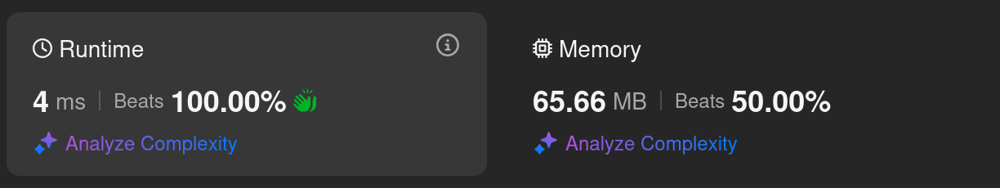
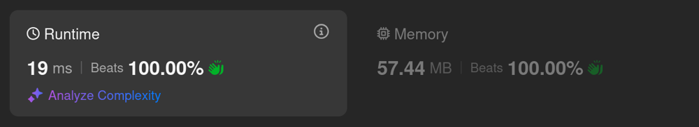
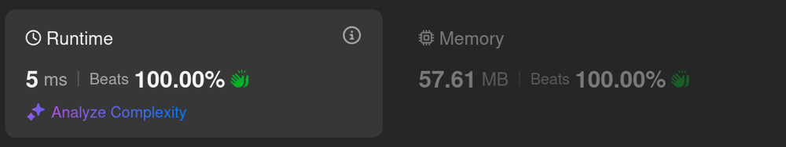
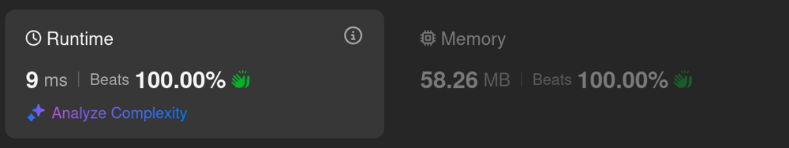

# Kotlin. Beats 100% (4 ms). Alternating BooleanArrays

**Author:** mobdev778
**Votes:** 2
**Link:** [https://leetcode.com/problems/maximum-number-of-moves-in-a-grid/solutions/5981804/](https://leetcode.com/problems/maximum-number-of-moves-in-a-grid/solutions/5981804/)

---



# Code
```kotlin []
class Solution {
    fun maxMoves(grid: Array<IntArray>): Int {
        var moveY = BooleanArray(grid.size) { true }
        var nextMoveY = BooleanArray(grid.size)

        var x = 0
        while (true) {
            var added = false
            for (y in 0 until moveY.size) {
                if (moveY[y]) {
                    val p = grid[y][x]
                    if (y > 0 && p < grid[y - 1][x + 1]) { nextMoveY[y - 1] = true; added = true }
                    if (p < grid[y][x + 1]) { nextMoveY[y] = true; added = true }
                    if (y < grid.size - 1 && p < grid[y + 1][x + 1]) { nextMoveY[y + 1] = true; added = true }
                }
            }

            if (!added) break

            Arrays.fill(moveY, false)
            moveY = nextMoveY.also { nextMoveY = moveY }

            x++
            if (x + 1 == grid[0].size) break
        }
        return x
    }
}
```

# Approach

It is probably worth pointing out right away that the DFS solution is not suitable for this problem, since with a high probability we will get to the same cells multiple times and essentially check the same solutions.

Instead, we can simply move from left to right, successively increasing X by 1.

At each step with X, we must look at the list of points that were obtained at the previous step and try to find a continuation for each point on the next line. In doing so, we must immediately cut off duplicates, since duplicates will force us to check the same branches of solutions again, and this is extra work and bad runtime.

When all the new points on the next line are found, we make a transition to this line and continue the search again.


# Alternative approaches

It was assumed that the hash set would give a win on large matrices with a small number of available paths. But, as empirical evidence shows, it turned out to be effective only in terms of memory consumption.

1. Alternating HashSets (19 ms)



```kotlin []
class Solution {
    fun maxMoves(grid: Array<IntArray>): Int {
        var moveY = HashSet<Int>()
        for (y in 0 until grid.size) {
            moveY.add(y)
        }
        var nextMoveY = HashSet<Int>()

        var x = 0
        while (moveY.size > 0) {
            for (y in moveY) {
                val p = grid[y][x]
                if (y > 0 && grid[y - 1][x + 1] > p) nextMoveY.add(y - 1)
                if (grid[y][x + 1] > p) nextMoveY.add(y)
                if (y < grid.size - 1 && grid[y + 1][x + 1] > p) nextMoveY.add(y + 1)
            }

            if (nextMoveY.size == 0) break

            moveY.clear()
            val temp = moveY
            moveY = nextMoveY
            nextMoveY = temp

            x++
            if (x + 1 == grid[0].size) break
        }
        return x
    }
}
```

2. Alternating BooleanArrays again



```
class Solution {
    fun maxMoves(grid: Array<IntArray>): Int {
        var moveY = BooleanArray(grid.size) { true }
        var nextMoveY = BooleanArray(grid.size)

        var x = 0
        do {
            var added = false
            loop@ for (y in 0 until moveY.size) {
                val nextP = grid[y][x + 1]
                for (py in y-1..y+1) {
                    if (py >= 0 && py < grid.size && moveY[py] && grid[py][x] < nextP) {
                        nextMoveY[y] = true
                        added = true
                        continue@loop
                    }
                }
            }

            if (!added) break

            Arrays.fill(moveY, false)
            moveY = nextMoveY.also { nextMoveY = moveY }

            x++
        } while (x < grid[0].size - 1)
        
        return x
    }
}
```

3. Making BitSets great again )



```
class Solution {
    fun maxMoves(grid: Array<IntArray>): Int {
        var moveY = BitSet(grid.size)
        for (i in 0 until grid.size) {
            moveY.set(i, true)
        }
        var nextMoveY = BitSet(grid.size)

        var x = 0
        while (x + 1 < grid[0].size) {
            for (y in 0 until grid.size) {
                for (py in y-1..y+1) {
                    if (py >= 0 && py < grid.size && moveY[py] && grid[py][x] < grid[y][x + 1]) {
                        nextMoveY.set(y, true)
                        break
                    }
                }
            }

            if (nextMoveY.cardinality() == 0) break

            moveY.clear()
            moveY = nextMoveY.also { nextMoveY = moveY }

            x++
        }
        return x
    }
}
```