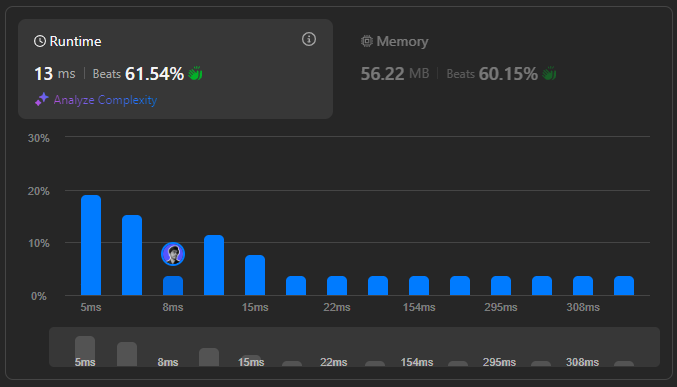

# 🌟 Beats 61.54%  ||  Step-by-Step Breakdown 💯🔥

**Author:** withaarzoo
**Votes:** 11
**Link:** [https://leetcode.com/problems/maximum-number-of-moves-in-a-grid/solutions/5980491/](https://leetcode.com/problems/maximum-number-of-moves-in-a-grid/solutions/5980491/)

---


## **\uD83C\uDF1F Access Daily LeetCode Solutions Repo :** [click here](https://github.com/withaarzoo/LeetCode-Solutions)

---



---

# Intuition
The problem is about finding the longest path in a grid where you can move only to the right and must always increase in value. The allowed moves make it possible to explore paths either directly right, up-right, or down-right. Given that starting from each cell in the first column might give different paths, we aim to maximize moves by taking advantage of all possible increasing paths.

A key observation is that the problem resembles dynamic programming, where we want to store and build upon solutions for each cell to avoid redundant calculations, especially since the grid size can be large.

---

# Approach
1. **Dynamic Programming (DP) Setup**: We'll use a `dp` table, where `dp[row][col]` holds the maximum number of moves that can be made starting from `grid[row][col]`.
2. **Reverse DP Calculation**: To avoid recalculations, we\u2019ll populate the DP table from the last column back to the first. This way, each cell's result can be built using already-calculated values in the next column.
3. **Transitions**: For each cell in the grid, check if moving to the right, up-right, or down-right is possible and leads to a strictly greater value. Update the `dp` table based on these moves.
4. **Result Extraction**: The answer will be the maximum value in the first column of the `dp` table, representing the longest increasing path from any starting cell in the first column.

---

# Complexity
- **Time complexity**: \\(O(m \	imes n)\\), where \\(m\\) and \\(n\\) are the grid dimensions. We examine each cell and compute possible moves in constant time.
- **Space complexity**: \\(O(m \	imes n)\\) for the DP table.

---

# Code
```C++ []
#include <vector>
#include <algorithm>
using namespace std;

class Solution {
public:
    int maxMoves(vector<vector<int>>& grid) {
        int m = grid.size(), n = grid[0].size();
        vector<vector<int>> dp(m, vector<int>(n, 0));
        int maxMoves = 0;

        for (int col = n - 2; col >= 0; --col) {
            for (int row = 0; row < m; ++row) {
                if (row > 0 && grid[row][col] < grid[row - 1][col + 1]) {
                    dp[row][col] = max(dp[row][col], dp[row - 1][col + 1] + 1);
                }
                if (grid[row][col] < grid[row][col + 1]) {
                    dp[row][col] = max(dp[row][col], dp[row][col + 1] + 1);
                }
                if (row < m - 1 && grid[row][col] < grid[row + 1][col + 1]) {
                    dp[row][col] = max(dp[row][col], dp[row + 1][col + 1] + 1);
                }
            }
        }

        for (int row = 0; row < m; ++row) {
            maxMoves = max(maxMoves, dp[row][0]);
        }
        return maxMoves;
    }
};

```
```Java []
class Solution {
    public int maxMoves(int[][] grid) {
        int m = grid.length, n = grid[0].length;
        int[][] dp = new int[m][n];
        int maxMoves = 0;

        for (int col = n - 2; col >= 0; col--) {
            for (int row = 0; row < m; row++) {
                if (row > 0 && grid[row][col] < grid[row - 1][col + 1]) {
                    dp[row][col] = Math.max(dp[row][col], dp[row - 1][col + 1] + 1);
                }
                if (grid[row][col] < grid[row][col + 1]) {
                    dp[row][col] = Math.max(dp[row][col], dp[row][col + 1] + 1);
                }
                if (row < m - 1 && grid[row][col] < grid[row + 1][col + 1]) {
                    dp[row][col] = Math.max(dp[row][col], dp[row + 1][col + 1] + 1);
                }
            }
        }

        for (int row = 0; row < m; row++) {
            maxMoves = Math.max(maxMoves, dp[row][0]);
        }
        return maxMoves;
    }
}

```
```JavaScript []
/**
 * @param {number[][]} grid
 * @return {number}
 */
var maxMoves = function(grid) {
    const m = grid.length, n = grid[0].length;
    const dp = Array.from({ length: m }, () => Array(n).fill(0));
    let maxMoves = 0;

    for (let col = n - 2; col >= 0; col--) {
        for (let row = 0; row < m; row++) {
            if (row > 0 && grid[row][col] < grid[row - 1][col + 1]) {
                dp[row][col] = Math.max(dp[row][col], dp[row - 1][col + 1] + 1);
            }
            if (grid[row][col] < grid[row][col + 1]) {
                dp[row][col] = Math.max(dp[row][col], dp[row][col + 1] + 1);
            }
            if (row < m - 1 && grid[row][col] < grid[row + 1][col + 1]) {
                dp[row][col] = Math.max(dp[row][col], dp[row + 1][col + 1] + 1);
            }
        }
    }

    for (let row = 0; row < m; row++) {
        maxMoves = Math.max(maxMoves, dp[row][0]);
    }
    return maxMoves;
};

```
```Python []
class Solution:
    def maxMoves(self, grid: List[List[int]]) -> int:
        m, n = len(grid), len(grid[0])
        dp = [[0] * n for _ in range(m)]
        max_moves = 0

        for col in range(n - 2, -1, -1):
            for row in range(m):
                if row > 0 and grid[row][col] < grid[row - 1][col + 1]:
                    dp[row][col] = max(dp[row][col], dp[row - 1][col + 1] + 1)
                if grid[row][col] < grid[row][col + 1]:
                    dp[row][col] = max(dp[row][col], dp[row][col + 1] + 1)
                if row < m - 1 and grid[row][col] < grid[row + 1][col + 1]:
                    dp[row][col] = max(dp[row][col], dp[row + 1][col + 1] + 1)

        for row in range(m):
            max_moves = max(max_moves, dp[row][0])
        return max_moves

```
```Go []
func maxMoves(grid [][]int) int {
    m, n := len(grid), len(grid[0])
    dp := make([][]int, m)
    for i := range dp {
        dp[i] = make([]int, n)
    }
    maxMoves := 0

    for col := n - 2; col >= 0; col-- {
        for row := 0; row < m; row++ {
            if row > 0 && grid[row][col] < grid[row-1][col+1] {
                dp[row][col] = max(dp[row][col], dp[row-1][col+1]+1)
            }
            if grid[row][col] < grid[row][col+1] {
                dp[row][col] = max(dp[row][col], dp[row][col+1]+1)
            }
            if row < m-1 && grid[row][col] < grid[row+1][col+1] {
                dp[row][col] = max(dp[row][col], dp[row+1][col+1]+1)
            }
        }
    }

    for row := 0; row < m; row++ {
        maxMoves = max(maxMoves, dp[row][0])
    }
    return maxMoves
}

func max(a, b int) int {
    if a > b {
        return a
    }
    return b
}

```
---

# Step-by-Step Detailed Explanation
1. **Initialize DP Table**: We start by creating a DP table `dp` to store the maximum moves from each cell.
2. **Backwards Traversal**: By processing each column from right to left, each cell\u2019s value is updated based on possible moves to strictly greater values in the next column.
3. **Calculate Maximum**: Finally, by iterating over the first column, we can determine the maximum number of moves possible by starting from any cell in this column.

---


