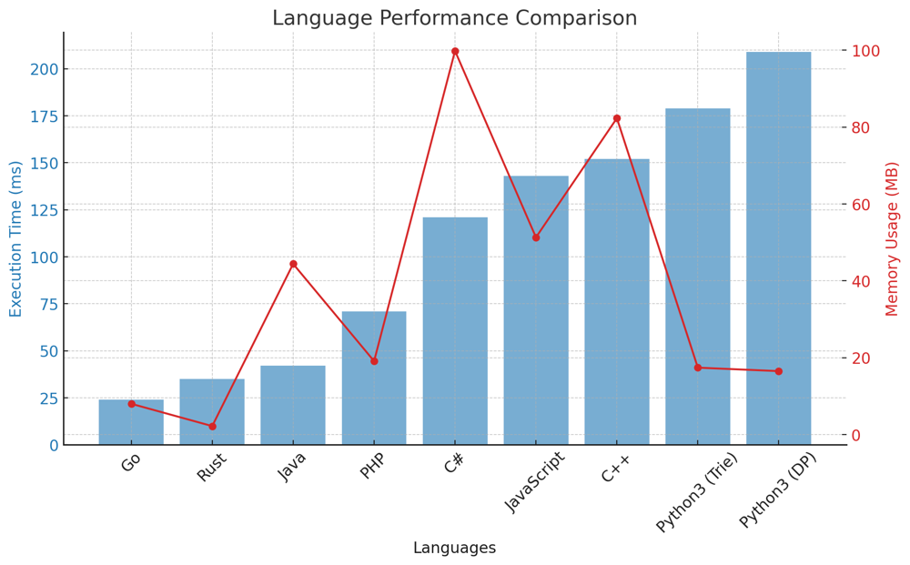

# ✅ 96.3% Easy DP & Trie

**Author:** vanAmsen
**Votes:** 89
**Link:** [https://leetcode.com/problems/extra-characters-in-a-string/solutions/3990359/](https://leetcode.com/problems/extra-characters-in-a-string/solutions/3990359/)

---

# Interview Guide - Finding the Minimum Extra Characters in a String
## Problem Understanding

The problem presents us with a string `s` and a dictionary of words. The challenge is to break `s` into one or more non-overlapping substrings such that each substring is present in the dictionary. However, there may be some extra characters in `s` which are not present in any of the substrings. The goal is to find the minimum number of such extra characters.

### Key Points to Consider

1. **Understand the Constraints**:  
   String length: `1 <= |s| <= 50`  
   Dictionary size: `1 <= |dictionary| <= 50`  
   Dictionary word length: `1 <= |dictionary[i]| <= 50`

2. **String Manipulation and Substring Matching**:  
   This problem is essentially about efficiently handling strings and substrings. You need to consider all possible substrings of `s` and check if they are present in the dictionary.

3. **Dynamic Programming Approach**:  
   This problem can be efficiently solved using Dynamic Programming. We will define `dp[i]` as the minimum number of extra characters when considering the string `s[0:i]`.

## Live Coding & More
https://youtu.be/nEjvcsqqONs?si=sR5DNI-P2HOXA2Xp

## Solution #1: Dynamic Programming 

### Intuition and Logic Behind the Solution

The idea here is to use the Dynamic Programming array `dp` to store the minimum number of extra characters needed when the string is broken up optimally up to index `i`.

### Step-by-step Explanation

1. **Initialization**: Create an array `dp` of length `|s| + 1`, initialized with a large value (larger than the maximum possible extra characters). Set `dp[0] = 0`.
  
2. **Main Algorithm**:  
   - Iterate through the string from `1` to `|s|`.
   - For each `i`, set `dp[i] = dp[i-1] + 1` as a worst-case scenario.
   - Update `dp[i]` based on substrings of `s` ending at `i` that are in the dictionary. Use `dp[i - len(substring)]` for this.

### Complexity Analysis

- **Time Complexity**: $$ O(n^2) $$ \u2014 We iterate through the string and for each character, we consider all substrings ending at that character.
- **Space Complexity**: $$ O(n) $$ \u2014 For the DP array.

---

### Solution #2: Dynamic Programming with Trie: Explained

#### Intuition

The key to speeding up the solution is avoiding the creation of substrings. We achieve this by using a Trie data structure, which allows us to check if a substring exists in the dictionary without actually creating it.

#### Algorithm

1. **Define a TrieNode Class**:  
   Each node in the Trie represents a character and has a dictionary of children and a flag indicating whether it's the end of a word.

2. **Building the Trie**:  
   The Trie is built from the given dictionary. Each word in the dictionary is inserted into the Trie character by character.

3. **Initialize DP Array**:  
   We use an array `dp` where `dp[i]` represents the minimum number of extra characters needed for the substring `s[i:]`.

4. **Fill DP Array**:  
   - Iterate through the string `s` from right to left.
   - For each index `start`, initialize `dp[start] = dp[start + 1] + 1` as the base case.
   - Traverse the Trie to find substrings that start at the index `start` and update `dp[start]` accordingly.

#### Complexity Analysis

- **Time Complexity**: $$O(n \	imes m)$$  
  $$n$$ is the length of the string `s`, and $$m$$ is the maximum length of a word in the dictionary. This complexity is because we traverse the Trie for each starting index in `s`.

- **Space Complexity**: $$O(n + k)$$  
  $$n$$ is the length of the string `s`, and $$k$$ is the total number of characters in the Trie (dictionary).

---

# Performance

| Language   | Execution Time (ms) | Memory Usage |
|------------|---------------------|--------------|
| Go         | 24                  | 8 MB         |
| Rust       | 35                  | 2.2 MB       |
| Java       | 42                  | 44.4 MB      |
| PHP        | 71                  | 19.1 MB      |
| C#         | 121                 | 99.8 MB      |
| JavaScript | 143                 | 51.3 MB      |
| C++        | 152                 | 82.3 MB      |
| Python3 (Trie)   | 179                 | 17.4 MB      |
| Python3 (DP)   | 209                 | 16.5 MB      |




# Code #1
``` Python []
class Solution:
    def minExtraChar(self, s: str, dictionary: List[str]) -> int:
        max_val = len(s) + 1
        dp = [max_val] * (len(s) + 1)
        dp[0] = 0 
        dictionary_set = set(dictionary)

        for i in range(1, len(s) + 1):
            dp[i] = dp[i - 1] + 1

            for l in range(1, i + 1): 
                if s[i-l:i] in dictionary_set:
                    dp[i] = min(dp[i], dp[i-l])
                    
        return dp[-1]
```
``` Rust []

use std::collections::HashSet;

impl Solution {
    pub fn min_extra_char(s: String, dictionary: Vec<String>) -> i32 {
        let max_val = s.len() as i32 + 1;
        let mut dp = vec![max_val; s.len() + 1];
        dp[0] = 0;

        let dictionary_set: HashSet<_> = dictionary.into_iter().collect();

        for i in 1..=s.len() {
            dp[i] = dp[i - 1] + 1;
            for l in 1..=i {
                if dictionary_set.contains(&s[i-l..i].to_string()) {
                    dp[i] = std::cmp::min(dp[i], dp[i-l]);
                }
            }
        }
        dp[s.len()] as i32
    }
}
```
``` Go []
func minExtraChar(s string, dictionary []string) int {
	maxVal := len(s) + 1
	dp := make([]int, len(s)+1)
	for i := range dp {
		dp[i] = maxVal
	}
	dp[0] = 0

	dictionarySet := make(map[string]bool)
	for _, word := range dictionary {
		dictionarySet[word] = true
	}

	for i := 1; i <= len(s); i++ {
		dp[i] = dp[i-1] + 1
		for l := 1; l <= i; l++ {
			if dictionarySet[s[i-l:i]] {
				dp[i] = int(math.Min(float64(dp[i]), float64(dp[i-l])))
			}
		}
	}
	return dp[len(s)]
}
```
``` C++ []
class Solution {
public:
    int minExtraChar(string s, vector<string>& dictionary) {
        int max_val = s.length() + 1;
        vector<int> dp(s.length() + 1, max_val);
        dp[0] = 0;

        unordered_set<string> dictionary_set(dictionary.begin(), dictionary.end());

        for (int i = 1; i <= s.length(); ++i) {
            dp[i] = dp[i - 1] + 1;
            for (int l = 1; l <= i; ++l) {
                if (dictionary_set.find(s.substr(i - l, l)) != dictionary_set.end()) {
                    dp[i] = min(dp[i], dp[i - l]);
                }
            }
        }
        return dp.back();
    }
};
```
``` Java []
class Solution {
    public int minExtraChar(String s, String[] dictionary) {
        int maxVal = s.length() + 1;
        int[] dp = new int[s.length() + 1];
        Arrays.fill(dp, maxVal);
        dp[0] = 0;

        Set<String> dictionarySet = new HashSet<>(Arrays.asList(dictionary));

        for (int i = 1; i <= s.length(); ++i) {
            dp[i] = dp[i - 1] + 1;
            for (int l = 1; l <= i; ++l) {
                if (dictionarySet.contains(s.substring(i - l, i))) {
                    dp[i] = Math.min(dp[i], dp[i - l]);
                }
            }
        }
        return dp[s.length()];
    }
}
```
``` C# []
public class Solution {
    public int MinExtraChar(string s, string[] dictionary) {
        int maxVal = s.Length + 1;
        int[] dp = new int[s.Length + 1];
        Array.Fill(dp, maxVal);
        dp[0] = 0;

        HashSet<string> dictionarySet = new HashSet<string>(dictionary);

        for (int i = 1; i <= s.Length; ++i) {
            dp[i] = dp[i - 1] + 1;
            for (int l = 1; l <= i; ++l) {
                if (dictionarySet.Contains(s.Substring(i - l, l))) {
                    dp[i] = Math.Min(dp[i], dp[i - l]);
                }
            }
        }
        return dp[s.Length];
    }
}
```
``` PHP []
class Solution {
    function minExtraChar($s, $dictionary) {
        $maxVal = strlen($s) + 1;
        $dp = array_fill(0, strlen($s) + 1, $maxVal);
        $dp[0] = 0;

        $dictionarySet = array_flip($dictionary);

        for ($i = 1; $i <= strlen($s); ++$i) {
            $dp[$i] = $dp[$i - 1] + 1;
            for ($l = 1; $l <= $i; ++$l) {
                if (isset($dictionarySet[substr($s, $i - $l, $l)])) {
                    $dp[$i] = min($dp[$i], $dp[$i - $l]);
                }
            }
        }
        return $dp[strlen($s)];
    }
}
```
``` JAvaScript []
/**
 * @param {string} s
 * @param {string[]} dictionary
 * @return {number}
 */
var minExtraChar = function(s, dictionary) {
    const maxVal = s.length + 1;
    const dp = Array(s.length + 1).fill(maxVal);
    dp[0] = 0;

    const dictionarySet = new Set(dictionary);

    for (let i = 1; i <= s.length; ++i) {
        dp[i] = dp[i - 1] + 1;
        for (let l = 1; l <= i; ++l) {
            if (dictionarySet.has(s.substring(i - l, i))) {
                dp[i] = Math.min(dp[i], dp[i - l]);
            }
        }
    }
    return dp[s.length];
}
```
# Code #2
``` Python []
class TrieNode:
    def __init__(self):
        self.children = {}
        self.is_word = False

def buildTrie(dictionary):
    root = TrieNode()
    for word in dictionary:
        node = root
        for ch in word:
            if ch not in node.children:
                node.children[ch] = TrieNode()
            node = node.children[ch]
        node.is_word = True
    return root

class Solution:
    def minExtraChar(self, s: str, dictionary: List[str]) -> int:
        root = buildTrie(dictionary)
        n = len(s)
        dp = [float('inf')] * (n + 1)
        dp[-1] = 0  # No extra character for an empty string

        for start in reversed(range(n)):
            dp[start] = dp[start + 1] + 1  # Initialize with worst-case scenario
            node = root
            for end in range(start, n):
                if s[end] not in node.children:
                    break
                node = node.children[s[end]]
                if node.is_word:
                    dp[start] = min(dp[start], dp[end + 1])
        
        return dp[0]
```

Conquering this problem is an exploration into the nuances of Dynamic Programming and String Manipulation. From efficiently handling substrings to using DP for optimization, each aspect of the solution serves as a lesson in strategic problem-solving. So dive in, bring your creativity to the table, and elevate your coding skills. This is more than just solving a problem; it's a vital step in your journey towards mastering algorithms and data structures. \uD83D\uDE80\uD83D\uDC69\u200D\uD83D\uDCBB\u2728