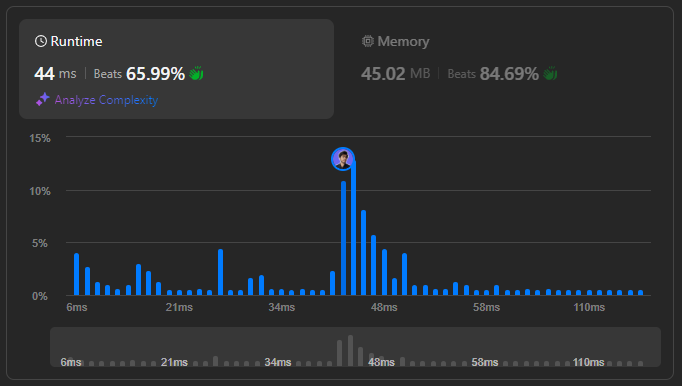

# 🌟 How to Solve Extra Characters in a String with Step-by-Step Solutions in Multiple Languages 🔥💯

**Author:** withaarzoo
**Votes:** 57
**Link:** [https://leetcode.com/problems/extra-characters-in-a-string/solutions/5822289/](https://leetcode.com/problems/extra-characters-in-a-string/solutions/5822289/)

---


Explore a collection of solutions to LeetCode problems in multiple programming languages. Each solution includes a detailed explanation and step-by-step approach to solving the problem efficiently. Whether you're a beginner looking to learn or an experienced coder seeking optimized solutions, this repository aims to provide clear and insightful approaches to tackling challenging LeetCode problems.

### **Access daily LeetCode Solutions Repo :** [click here](https://github.com/withaarzoo/LeetCode-Solutions)

---



# Intuition
<!-- Describe your initial thoughts and strategy to solve this problem. -->

We are given a string `s` and a dictionary of words. The problem requires us to break `s` into valid words from the dictionary while minimizing the number of extra characters that cannot form valid words. This problem can be thought of as a dynamic programming (DP) problem where we aim to minimize "extra" characters by finding the optimal partition of the string using the words from the dictionary.

# Approach
<!-- Detail the specific method and steps you used to solve the problem. -->

1. **Dynamic Programming Setup**: 
   - We define a DP array `dp[i]`, where `dp[i]` represents the minimum number of extra characters in the substring `s[0:i]`.
   
2. **Transition**: 
   - For each index `i`, we check all possible substrings `s[j:i]` where `0 <= j < i` and determine if the substring is a valid word in the dictionary.
   - If the substring `s[j:i]` is found in the dictionary, we update `dp[i] = min(dp[i], dp[j])`.
   - Additionally, we update `dp[i] = min(dp[i], dp[i-1] + 1)` to account for the case where the current character `s[i-1]` is considered extra.

3. **Final Answer**: 
   - The answer will be stored in `dp[n]`, where `n` is the length of the string `s`.

# Complexity
- **Time complexity**:  
  - $$O(n^2)$$, where \\(n\\) is the length of the string `s`. For each index `i`, we check all possible substrings, which leads to a quadratic time complexity.
  
- **Space complexity**:  
  - $$O(n + d)$$, where \\(n\\) is the length of the string `s` and \\(d\\) is the size of the dictionary. The space is used for the DP array and storing the dictionary in a set.

# Code
```C++ []
#include <iostream>
#include <vector>
#include <string>
#include <unordered_set>
using namespace std;

class Solution {
public:
    int minExtraChar(string s, vector<string>& dictionary) {
        unordered_set<string> dict(dictionary.begin(), dictionary.end()); // Set for O(1) lookup
        int n = s.size();
        vector<int> dp(n + 1, n); // DP array initialized with maximum extra characters
        
        dp[0] = 0; // No extra characters for an empty string
        
        // Iterate through each index in the string
        for (int i = 1; i <= n; i++) {
            // Try all possible substrings ending at i
            for (int j = 0; j < i; j++) {
                string sub = s.substr(j, i - j); // Get the substring s[j:i]
                if (dict.find(sub) != dict.end()) {
                    dp[i] = min(dp[i], dp[j]); // If substring is found in dictionary
                }
            }
            dp[i] = min(dp[i], dp[i - 1] + 1); // Consider the current character as extra
        }
        
        return dp[n]; // Result stored in dp[n]
    }
};

```
```Java []
import java.util.HashSet;
import java.util.Set;

class Solution {
    public int minExtraChar(String s, String[] dictionary) {
        Set<String> dict = new HashSet<>();
        for (String word : dictionary) {
            dict.add(word); // Add dictionary words to a set for quick lookup
        }
        int n = s.length();
        int[] dp = new int[n + 1]; // DP array to track the minimum extra characters
        for (int i = 0; i <= n; i++) {
            dp[i] = n; // Initialize with maximum extra characters
        }
        dp[0] = 0; // No extra characters for an empty string

        // Iterate through each index in the string
        for (int i = 1; i <= n; i++) {
            // Check all substrings ending at i
            for (int j = 0; j < i; j++) {
                String sub = s.substring(j, i); // Get substring s[j:i]
                if (dict.contains(sub)) {
                    dp[i] = Math.min(dp[i], dp[j]); // If substring found in dictionary
                }
            }
            dp[i] = Math.min(dp[i], dp[i - 1] + 1); // Consider current character as extra
        }

        return dp[n]; // Return the result from dp[n]
    }
}

```
```JavaScript []
var minExtraChar = function(s, dictionary) {
    let dict = new Set(dictionary); // Store dictionary in a set for O(1) lookup
    let n = s.length;
    let dp = new Array(n + 1).fill(n); // DP array initialized with maximum extra characters
    dp[0] = 0; // No extra characters for an empty string

    // Iterate through the string
    for (let i = 1; i <= n; i++) {
        // Try all substrings ending at i
        for (let j = 0; j < i; j++) {
            let sub = s.substring(j, i); // Get substring s[j:i]
            if (dict.has(sub)) {
                dp[i] = Math.min(dp[i], dp[j]); // If substring found in dictionary
            }
        }
        dp[i] = Math.min(dp[i], dp[i - 1] + 1); // Consider current character as extra
    }

    return dp[n]; // Return the result from dp[n]
};

```
```Python []
class Solution:
    def minExtraChar(self, s: str, dictionary: List[str]) -> int:
        dict_set = set(dictionary) # Store dictionary in a set for fast lookup
        n = len(s)
        dp = [n] * (n + 1) # DP array initialized with maximum extra characters
        dp[0] = 0 # No extra characters for an empty string

        # Iterate through each index in the string
        for i in range(1, n + 1):
            # Try all substrings ending at i
            for j in range(i):
                sub = s[j:i] # Get substring s[j:i]
                if sub in dict_set:
                    dp[i] = min(dp[i], dp[j]) # If substring found in dictionary
            dp[i] = min(dp[i], dp[i - 1] + 1) # Consider current character as extra

        return dp[n] # Return the result from dp[n]

```
```Go []
func minExtraChar(s string, dictionary []string) int {
    dict := make(map[string]bool) // Use a map to store dictionary for O(1) lookup
    for _, word := range dictionary {
        dict[word] = true
    }

    n := len(s)
    dp := make([]int, n+1) // DP array initialized with maximum extra characters
    for i := 0; i <= n; i++ {
        dp[i] = n // Initialize DP array with maximum extra characters
    }
    dp[0] = 0 // No extra characters for an empty string

    // Iterate through the string
    for i := 1; i <= n; i++ {
        // Try all substrings ending at i
        for j := 0; j < i; j++ {
            sub := s[j:i] // Get substring s[j:i]
            if dict[sub] {
                dp[i] = min(dp[i], dp[j]) // If substring found in dictionary
            }
        }
        dp[i] = min(dp[i], dp[i-1]+1) // Consider current character as extra
    }

    return dp[n] // Return the result from dp[n]
}

// Helper function to find minimum of two integers
func min(a, b int) int {
    if a < b {
        return a
    }
    return b
}

```


# Step-by-Step Detailed Explanation
1. **Dictionary Setup**: The first step is to store the dictionary words in a set (or hash map in Go) for O(1) lookup. This allows us to efficiently check if a substring is in the dictionary.

2. **DP Array Initialization**: We initialize a DP array `dp` of size `n + 1` (where `n` is the length of string `s`). Each entry `dp[i]` represents the minimum number of extra characters for the substring `s[0:i]`. We initialize the array with the maximum possible value, `n`, as this is the worst case.

3. **Dynamic Programming Transition**: For each index `i`, we check all substrings ending at `i-1`. If a valid word from the dictionary is found, we update `dp[i]` by considering the state before the start of the substring (`dp[j]`). Additionally, we handle the case where the current character is considered extra.

4. **Final Result**: The final result is stored in `dp[n]`, which gives the minimum number of extra characters left after optimally splitting the string.

---


