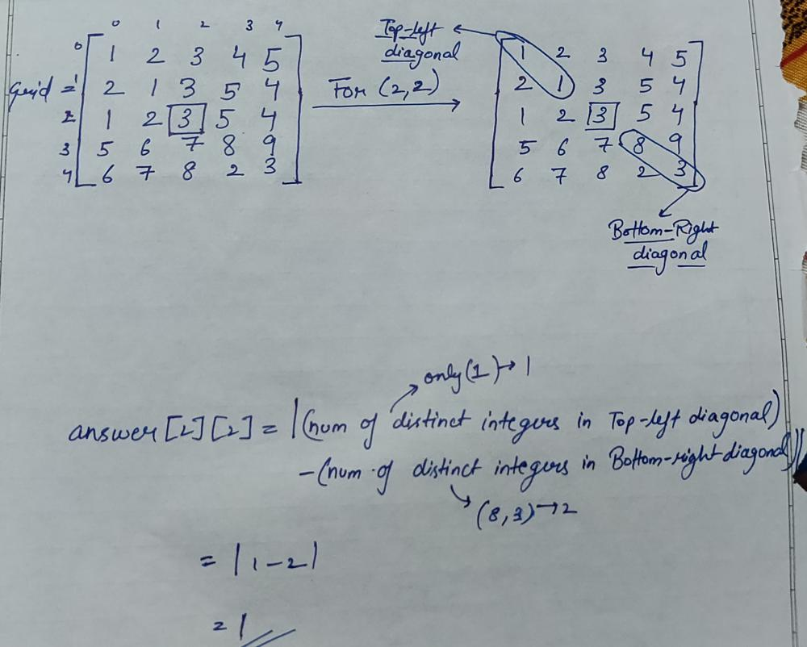

# Simplified Problem Statement

**Author:** _srahul_
**Votes:** 17
**Link:** [https://leetcode.com/problems/difference-of-number-of-distinct-values-on-diagonals/solutions/3572121/](https://leetcode.com/problems/difference-of-number-of-distinct-values-on-diagonals/solutions/3572121/)

---

# Explanation
For those who still are not able to comprehend the problem statement, these are my 2 cents about it.

First `topLeft diagonal` and `bottomRight diagonal`, for an index `(r, c)`: 
1. `topLeft diagonal` is going to be the diagonal starting from `(r-1, c-1)` till  `r >= 0 & c >= 0`.
2. `bottomRight diagonal` is going to be the diagonal starting from `(r+1, c+1)` till  `r <= (m-1) & c <= (n-1)`.

Now, for each cell `(r, c)` of answer array, we want to calcaulate absolute difference of: 
1. `topLeft[r][c]`, which is the count of distinct numbers in `topLeft` diagonal in `grid`, and
2. `bottomRight[r][c]`, which is the count of distinct numbers in `bottomRight` diagonal in `grid`.

To be certain, 
`answer[r][c] = |topLeft[r][c] - bottomRight[r][c]|`

For better understanding,




# Code
Incase, you need the code also. This is really brute-force approach.

```
class Solution {
    public int[][] differenceOfDistinctValues(int[][] grid) {
        int m = grid.length, n = grid[0].length;
        
        int[][] ans = new int[m][n];
        
        for(int i = 0; i < m; i++){
            for(int j = 0; j < n; j++){
                
                //using set for determining distinct integers

                Set<Integer> topLeft = new HashSet(); 

                //traversing topLeft diagonal, 
                for(int r = i-1, c = j-1; r >= 0 && c >= 0; r--, c--){
                    topLeft.add(grid[r][c]);
                }
                
                Set<Integer> bottomRight = new HashSet();

                // traversing bottomRight diagonal
                for(int r = i+1, c = j+1; r < m && c < n; r++, c++){
                    bottomRight.add(grid[r][c]);
                }
                
                ans[i][j] = Math.abs(bottomRight.size() - topLeft.size());
            }
        }
        
        return ans;
    }
}
```

**HOPE IT HELPS!!**