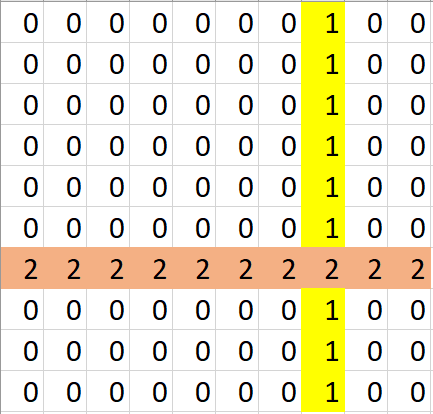

# [C++, Java, Python] Track Seen Count | With Image Example

**Author:** shivamaggarwal513
**Votes:** 48
**Link:** [https://leetcode.com/problems/sum-of-matrix-after-queries/solutions/3595010/](https://leetcode.com/problems/sum-of-matrix-after-queries/solutions/3595010/)

---

# Intuition
```
n = 10, queries = [[1, 7, 1], [0, 6, 2]]
```


The queries which will come later will have a **greater** impact on final sum because it will overwrite any cell that was filled/not-filled before. Therefore, we can try to make sum by traversing in reverse direction of `queries`.

In above example,
1. We can first add `2 * 10 = 20` to our sum because it will overwrite everything as it is the **last** query.
2. Then, while considering the previous query `[1, 7, 1]`, we need to know how many rows will be there that would have been overwritten in upcoming queries. So, we can track this by maintaining seen rows' count. By this we will know that there is one row that will be overwritten in future so we add `1 * 9 = 9` to our sum.

# Code
```C++ []
class Solution {
public:
    long long matrixSumQueries(int n, vector<vector<int>>& queries) {
        int rowSeenCount = 0, colSeenCount = 0;
        vector<bool> rowSeen(n), colSeen(n);
        long long sum = 0;
        for (int qi = queries.size() - 1; qi >= 0; qi--) {
            int type = queries[qi][0], index = queries[qi][1], val = queries[qi][2];
            if (type == 0 && !rowSeen[index]) {
                rowSeenCount++;
                rowSeen[index] = true;
                sum += 1LL * (n - colSeenCount) * val;
            }
            if (type == 1 && !colSeen[index]) {
                colSeenCount++;
                colSeen[index] = true;
                sum += 1LL * (n - rowSeenCount) * val;
            }
        }
        return sum;
    }
};
```
```Java []
class Solution {
    public long matrixSumQueries(int n, int[][] queries) {
        int rowSeenCount = 0, colSeenCount = 0;
        boolean[] rowSeen = new boolean[n];
        boolean[] colSeen = new boolean[n];
        long sum = 0;
        for (int qi = queries.length - 1; qi >= 0; qi--) {
            int type = queries[qi][0], index = queries[qi][1], val = queries[qi][2];
            if (type == 0 && !rowSeen[index]) {
                rowSeenCount++;
                rowSeen[index] = true;
                sum += (n - colSeenCount) * val;
            }
            if (type == 1 && !colSeen[index]) {
                colSeenCount++;
                colSeen[index] = true;
                sum += (n - rowSeenCount) * val;
            }
        }
        return sum;
    }
}
```
```Python []
class Solution:
    def matrixSumQueries(self, n: int, queries: List[List[int]]) -> int:
        rowSeenCount, colSeenCount, total = 0, 0, 0
        rowSeen, colSeen = [False] * n, [False] * n
        for qi in range(len(queries) - 1, -1, -1):
            typei, index, val = queries[qi][0], queries[qi][1], queries[qi][2]
            if typei == 0 and not rowSeen[index]:
                rowSeenCount += 1
                rowSeen[index] = True
                total += (n - colSeenCount) * val
            if typei == 1 and not colSeen[index]:
                colSeenCount += 1
                colSeen[index] = True
                total += (n - rowSeenCount) * val
        return total
```

# Complexity
- Time complexity: $$O(queries.length)$$
- Space complexity: $$O(n)$$

# QnA
**Q:** [@Bacon_lord](/Bacon_lord) : I dont understand why we need to track the rows/cols, shouldn't counting the rows/cols be enough, and once you reach n no need to increment further.... this is wrong but i dont understand why it's wrong?
**A:** It is required as there can be multiple queries for same row (or same column). Take same example as above, add another query: 
```
n = 10, queries = [[1, 7, 1], [0, 6, 3], [0, 6, 2]]
```
Final matrix will be same as in above image. But if we counted same row `6` twice, then when we reach `[1, 7, 1]` we will do `1 * 8 = 8` but we should have done `1 * 9 = 9`.
Also, those multiple queries are meaningless because only last of all the same will be in the final result as it will overwrite on completely same row (or column). Since we are traversing in reverse direction, we put it in hashmap or visited array and we will not consider queries to same row (or column) that would have been made in past with respect to it.