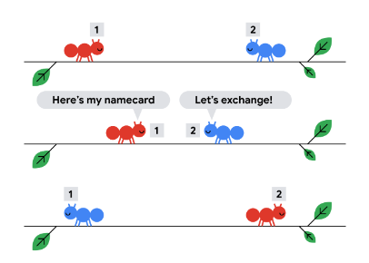

# Easy Beginner Friendly with Explanations Pass Through + Prefix Sum | C++ Python

**Author:** Chanpreet3000
**Votes:** 64
**Link:** [https://leetcode.com/problems/movement-of-robots/solutions/3622277/](https://leetcode.com/problems/movement-of-robots/solutions/3622277/)

---

# Intuition
<!-- Describe your first thoughts on how to solve this problem. -->
If two objects collide then it appears that they have pass through
> In short if the ith robot is moving left then after time d it's position would be nums[i] - d and if it is moving right then it's position would be nums[i] + d

**Example:** let 1 be moving right and 2 be moving left.



Similar intuition: [https://codingcompetitions.withgoogle.com/kickstart/round/00000000008cb4d1/0000000000b209bc#analysis](https://codingcompetitions.withgoogle.com/kickstart/round/00000000008cb4d1/0000000000b209bc#analysis)


# Approach
<!-- Describe your approach to solving the problem. -->
1. We change the final positions using pass through property.
    ``` C++
    for(ll i = 0; i < n; i ++){
        if(s[i] == 'L'){
            nums[i] -= d;
        }else{
            nums[i] += d;
        }
    }
    ```
2. To calculate absolute diff between every pair in O(N). We can sort the distance array.
    - The index `j` contribution would be sum of `abs(nums[j] - nums[0]) + abs(nums[j] - nums[1]) + abs(nums[j] - nums[2]) + ...... + abs(nums[j] - nums[j - 1])`.
    - But we know `for (i<j)` `nums[i] < nums[j](Sorted array)`
    - So we can open the `abs()` as `nums[j] - nums[i]` 
    - The index `j` contribution would be sum of `nums[j] - nums[0] + nums[j] - nums[1] + nums[j] - nums[2] + ..... + nums[j] - nums[j - 1]`.
    - If we notice then this converts into `j * nums[j] - sum(nums[i] i belongs from 0 to j - 1)` 
    - Sum of [0, j- 1] can be calculated in `O(1)` using prefix sum.
        ``` C++ 
        for(ll i = 1; i < n; i++){
            ll temp = (MOD + i * nums[i] - pre[i - 1])%MOD;
            ans = ((ans%MOD) + (temp%MOD))%MOD;
        }
        ```

# Complexity
- Time complexity: `O(N * Log(N))`
<!-- Add your time complexity here, e.g. $$O(n)$$ -->

- Space complexity: `O(N)`
<!-- Add your space complexity here, e.g. $$O(n)$$ -->

# Code
``` Python3 []
class Solution:
    def sumDistance(self, nums: List[int], s: str, d: int) -> int:
        n, m = len(nums), int(1e9 + 7)
        # Ignore the Collisions
        for i in range(n):
            if s[i] == 'L':
                nums[i] -= d
            else: 
                nums[i] += d
        
        # Sort according to position to calculate abs sum of each pair in O(N)
        nums.sort()

        pre = nums.copy()
        # Calculate Prefix Sum
        for i in range(1, n):
            pre[i] += pre[i - 1]
            pre[i] %= m

        ans = 0
        for i in range(1, n):
            # each jth index contributes to j * nums[j] - pre[j - 1]
            ans += i * nums[i] - pre[i - 1]
            ans %= m
        return ans
```
``` C++ []
typedef long long int ll;
const ll MOD = 1e9 + 7;
class Solution {
public:
    int sumDistance(vector<int>& nums, string s, int d) {
        //Ignore the collisions!
        for(ll i = 0; i < s.length(); i ++)
            if(s[i] == 'L')nums[i] -= d;
            else nums[i] += d;
        // Sort according to position to calculate abs sum of each pair in O(N)
        sort(nums.begin(), nums.end());
        
        //Calculate Prefix Sum
        vector<ll> pre(nums.begin(), nums.end());
        for(ll i = 1; i < nums.size(); i++){
            pre[i] += pre[i - 1];
            pre[i] %= MOD;
        }

        ll ans = 0;
        for(ll i = 1; i < nums.size(); i++){
            // each jth index contributes to j * nums[j] - pre[j - 1]
            ans += i * nums[i] - pre[i - 1];
            ans %= MOD;
        }
        return ans;
    }
};
```