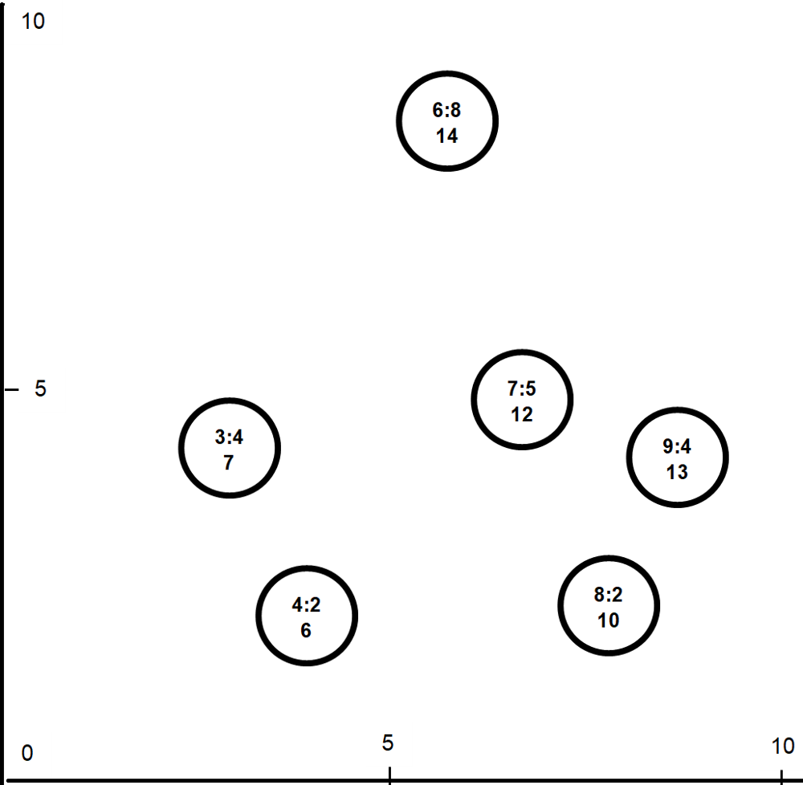
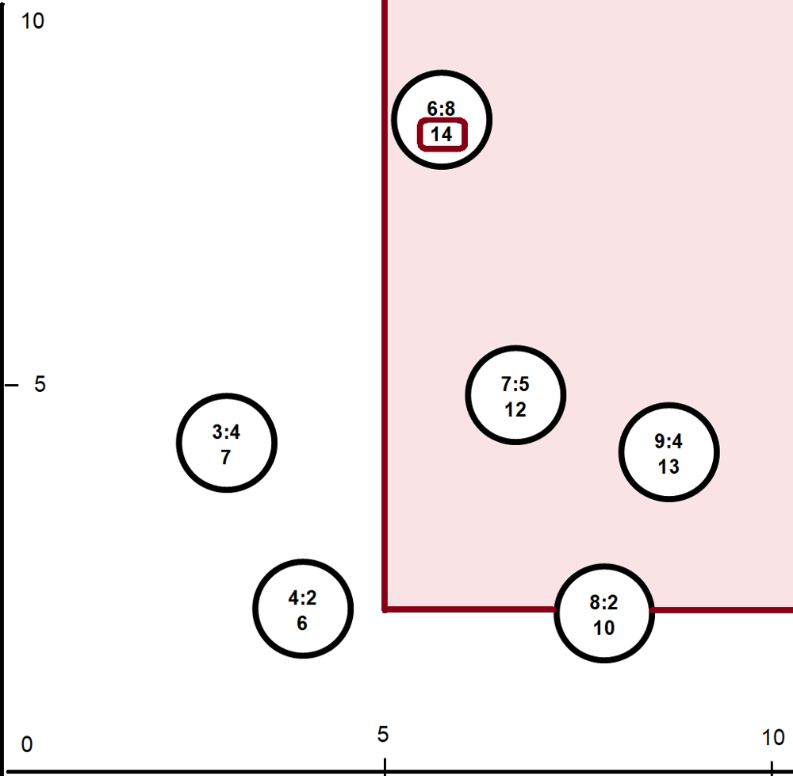
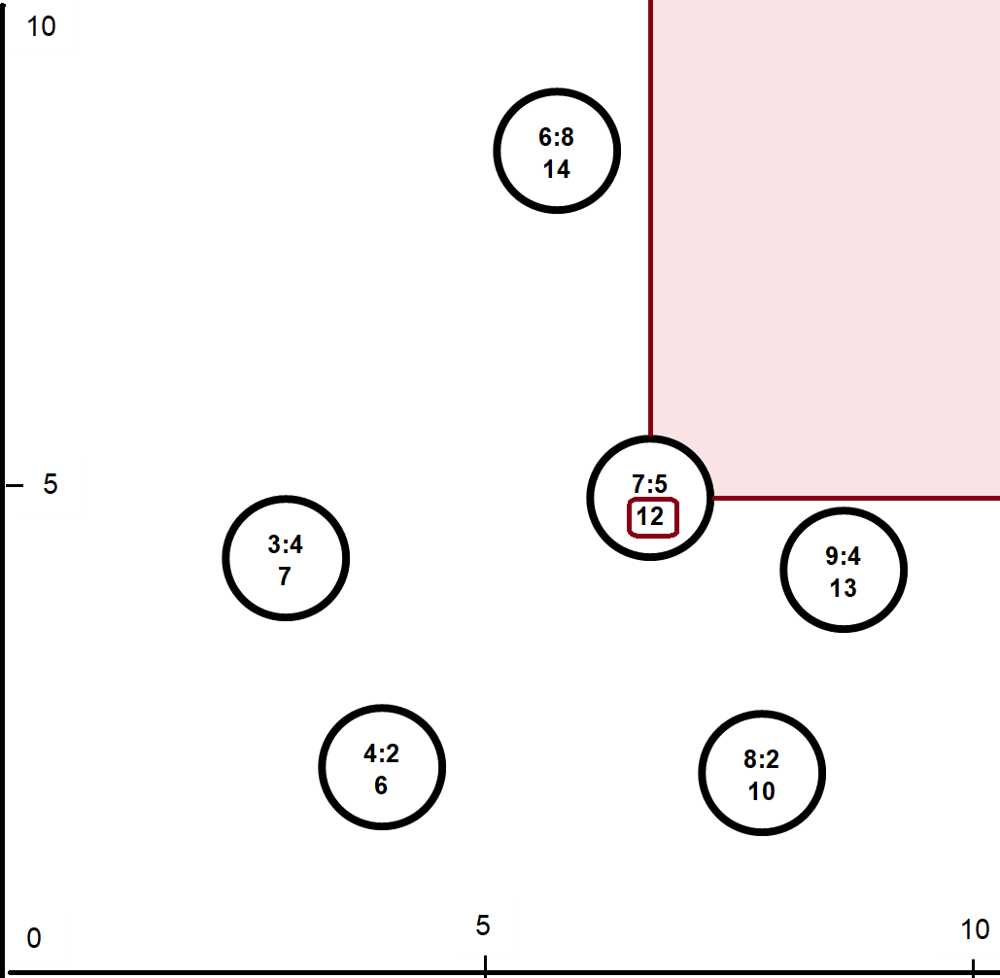
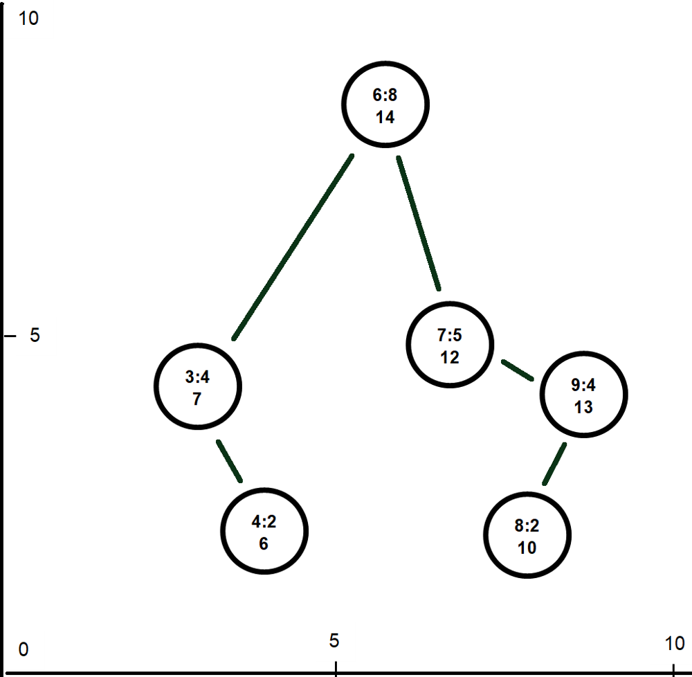
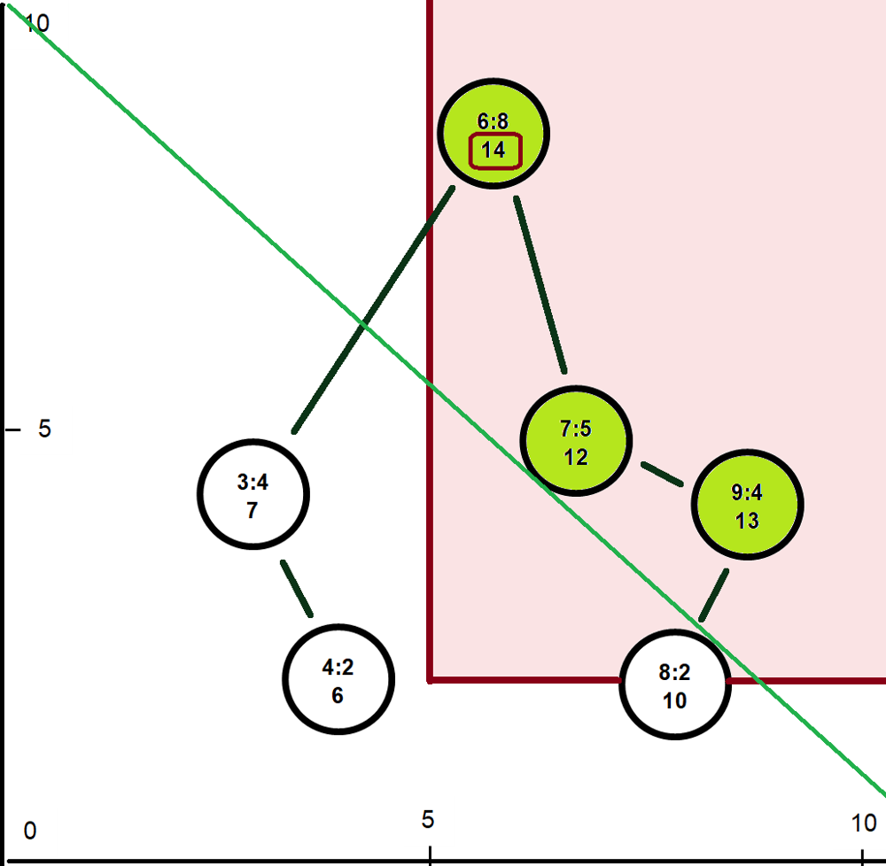

# C# | Treap (aka Cartesian Tree) | Detailed Explanation

**Author:** scale-tone
**Votes:** 1
**Link:** [https://leetcode.com/problems/maximum-sum-queries/solutions/4383459/](https://leetcode.com/problems/maximum-sum-queries/solutions/4383459/)

---


# Approach

Let's use these input arrays as an example:
```
[7,3,4,8,9,6]
[5,4,2,2,4,8]
```

Let's think of them as of coordinates in a 2D space and plot them as points on a surface:



First two digits in a point are coordinates and the third one is the *sum* of them, which we will further on refer to as the *point's value* and use later as a result.

Now let's use `[5,2]` as a query. It is now plain to see that what a query actually does is just limiting the area of interest, aka filtering out the points that have coordinates below the query values:
 


So we just need to find a maximum value across all the remaining points. For this sample query it will be `14`.

Let's take another illustrative query example - `[7,5]`. Then the plot will look like this:



and the answer will be `12`.

Now we just need a data structure that efficiently produces a maximum value across a filtered subset of 2D points.
When looking at those plots a [Treap](https://en.wikipedia.org/wiki/Treap) (also known as a Cartesian Tree) comes into mind immediately. 

By its definition, it arranges points as a Binary Search Tree by their X coordinate, and also as a Heap by their Y coordinate. So for this example the tree will look like this:



Note that there's always *only one* way of arranging points as a Treap - and that's the beauty of it. Also note that we're using our Y coordinates for building that heap, *not* the point's values.

Another useful feature of a Treap for us will be that it can be efficiently (O(log(n))) split into two halves by a given X coordinate - everything *less than* a given X will go into a left half and everything *more or equal* than X will go into a right one. That *Split* operation is destructive (the original treap will be lost), but that's OK for us - we can just process the queries *in ascending order* (by their first number, aka by their X coordinate) and *gradually filter out* the unneeded points by X.

Once filtered by X, next we would need to filter the remaining points by Y. Since by Y it is a heap, we can just traverse the tree breadth-first and stop, when Y goes below a given query value. And while doing that we can simultaneously calculate the maximum of those point's values. Normally this would require traversing the whole tree (because remember, it's our Y coordinates that produce the heap, not point's values). But now we remember that a point's value is just a sum of its coordinates, therefore *its maximum has no chance to appear to the left of a tree's root* (try to prove this geometrically yourself). So we can safely traverse *only the right part* of our treap:



and that greatly saves time. 

Also, since our point's value is a sum of that point's coordinates, we do not actually need to store that value, and instead we can always calculate it on-the-fly. And that is a great space optimization.

# Code
```
// Implements a Treap (Cartesian Tree)
class Treap
{
    public int X { get; private set; }
    public int Y { get; private set; }

    private Treap(int x, int y)
    {
        this.X = x;
        this.Y = y;
    }

    // Adds a point to the treap and returns the new root
    public static Treap? Add(int x, int y, Treap? treap)
    {
        var newNode = new Treap(x, y);
        if (treap == null) 
        {
            return newNode;
        }

        treap.Split(x, out var less, out var moreOrEqual);

        moreOrEqual = Merge(newNode, moreOrEqual);

        return Merge(less, moreOrEqual);
    }

    // Returns a new treap containing all points with X >= minX
    public Treap? MoreOrEqualThanX(int minX)
    {
        this.Split(minX, out var less, out var moreOrEqual);

        return moreOrEqual;
    }

    // Returns maximum across all points with Y >= minY
    public int MaxValueAcrossMoreOrEqualThanY(int minY)
    {
        int result = -1;

        // In our particular case points to the left can never have 
        // a Value more than points to the right (because Value is a sum of X and Y).
        // Therefore we just need to traverse the right branch only.
        var node = this;
        while (node != null && node.Y >= minY)
        {
            if (result < node.Value)
            {
                result = node.Value;
            }

            node = node._right;
        }

        return result;
    }

    private Treap? _left;
    private Treap? _right;

    private int Value => this.X + this.Y;

    // Splits a treap into two halves by X coordinate
    private void Split(int x, out Treap? left, out Treap? right)
    {
        if (this.X >= x)
        {
            right = this;
            left = null;

            if (this._left != null)
            {
                this._left.Split(x, out left, out this._left);
            }
        }
        else
        {
            left = this;
            right = null;

            if (this._right != null)
            {
                this._right.Split(x, out this._right, out right);
            }
        }
    }

    // Merges two treaps and returns the new root.
    // All points in left are supposed to have their X coordinate
    // _less_ than all points in right.
    private static Treap? Merge(Treap? left, Treap? right)
    {
        if (left == null)
        {
            return right;
        }

        if (right == null)
        {
            return left;
        }

        if (left.Y > right.Y)
        {
            left._right = Merge(left._right, right);

            return left;
        }
        else
        {
            right._left = Merge(left, right._left);

            return right;
        }
    }
}

public class Solution 
{
    public int[] MaximumSumQueries(int[] nums1, int[] nums2, int[][] queries) 
    {
        var result = new int[queries.Length];

        // Initializing Treap
        Treap treap = null;
        for (int i = 0; i < nums1.Length; i++)
        {
            treap = Treap.Add(nums1[i], nums2[i], treap);
        }

        // Need to convert queries into a list sorted by X. Also storing each query's original index, so that we can reconstruct the result
        int j = 0;
        var queryMap = queries
            .Select(query => new { x = query[0], y = query[1], index = j++ })
            .OrderBy(query => query.x);

        foreach (var query in queryMap)
        {
            // Removing all nodes with X < xy.Item1
            treap = treap?.MoreOrEqualThanX(query.x);

            // Now obtaining a result for given X and Y
            result[query.index] = treap == null ? -1 : treap.MaxValueAcrossMoreOrEqualThanY(query.y);
        }

        return result;
    }
}
```