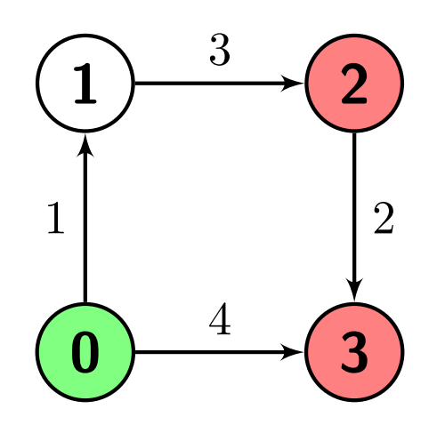
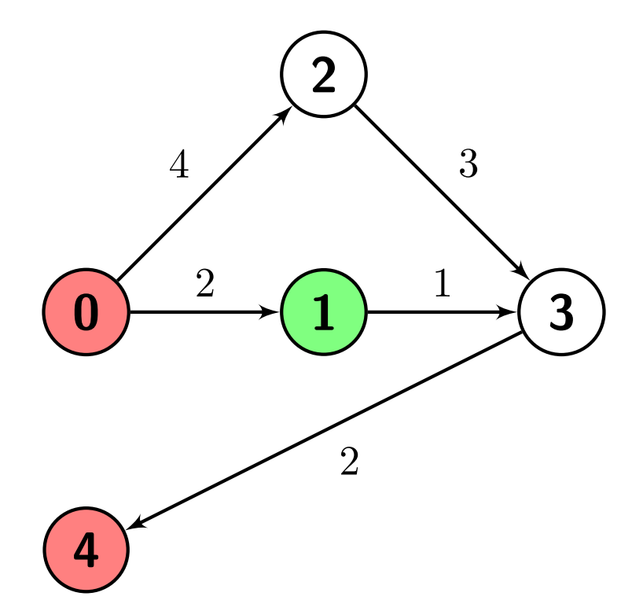
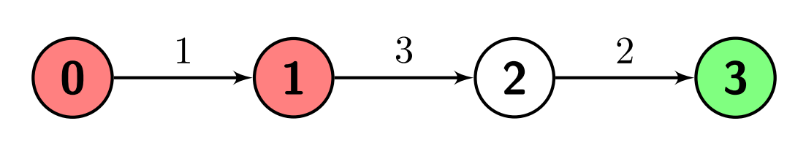

# [2737. Find the Closest Marked Node](https://leetcode.com/problems/find-the-closest-marked-node/)

| Category | Difficulty | Likes | Dislikes |
| :------: | :--------: | :---: | :------: |
| Algorithms | Medium | 58 | 6 |

**Tags:** [`array`](https://leetcode.com/tag/array), [`graph`](https://leetcode.com/tag/graph), [`heap-priority-queue`](https://leetcode.com/tag/heap-priority-queue), [`shortest-path`](https://leetcode.com/tag/shortest-path)


## Description

You are given a positive integer `n` which is the number of nodes of a **0-indexed directed weighted** graph and a **0-indexed** **2D array** `edges` where `edges[i] = [u_i, v_i, w_i]` indicates that there is an edge from node `u_i` to node `v_i` with weight `w_i`.

You are also given a node `s` and a node array `marked`; your task is to find the **minimum** distance from `s` to **any** of the nodes in `marked`.

Return *an integer denoting the minimum distance from *`s`* to any node in *`marked`* or *`-1`* if there are no paths from s to any of the marked nodes*.

 

**Example 1:**

```

Input: n = 4, edges = [[0,1,1],[1,2,3],[2,3,2],[0,3,4]], s = 0, marked = [2,3]
Output: 4
Explanation: There is one path from node 0 (the green node) to node 2 (a red node), which is 0-&gt;1-&gt;2, and has a distance of 1 + 3 = 4.
There are two paths from node 0 to node 3 (a red node), which are 0-&gt;1-&gt;2-&gt;3 and 0-&gt;3, the first one has a distance of 1 + 3 + 2 = 6 and the second one has a distance of 4.
The minimum of them is 4.

```



**Example 2:**

```

Input: n = 5, edges = [[0,1,2],[0,2,4],[1,3,1],[2,3,3],[3,4,2]], s = 1, marked = [0,4]
Output: 3
Explanation: There are no paths from node 1 (the green node) to node 0 (a red node).
There is one path from node 1 to node 4 (a red node), which is 1-&gt;3-&gt;4, and has a distance of 1 + 2 = 3.
So the answer is 3.

```



**Example 3:**

```

Input: n = 4, edges = [[0,1,1],[1,2,3],[2,3,2]], s = 3, marked = [0,1]
Output: -1
Explanation: There are no paths from node 3 (the green node) to any of the marked nodes (the red nodes), so the answer is -1.

```



 

**Constraints:**

	- `2 <= n <= 500`

	- `1 <= edges.length <= 10^4`

	- `edges[i].length = 3`

	- `0 <= edges[i][0], edges[i][1] <= n - 1`

	- `1 <= edges[i][2] <= 10^6`

	- `1 <= marked.length <= n - 1`

	- `0 <= s, marked[i] <= n - 1`

	- `s != marked[i]`

	- `marked[i] != marked[j]` for every `i != j`

	- The graph might have **repeated edges**.

	- The graph is generated such that it has no **self-loops**.

---

**Links:** [Submissions](https://leetcode.com/problems/find-the-closest-marked-node/) | [Solutions](https://leetcode.com/problems/find-the-closest-marked-node/)
