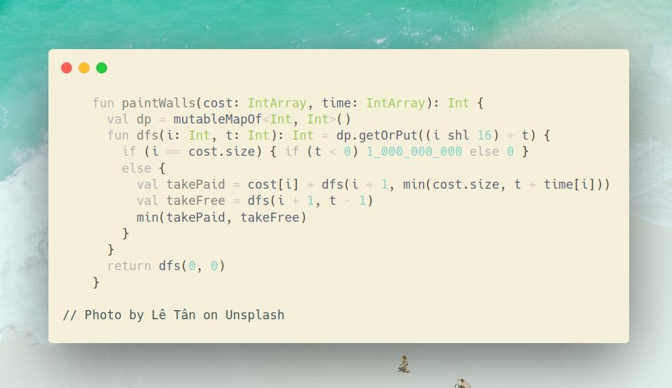

# Kotlin | DFS + memo

**Author:** SamoylenkoDmitry
**Votes:** 3
**Link:** [https://leetcode.com/problems/painting-the-walls/solutions/4166620/](https://leetcode.com/problems/painting-the-walls/solutions/4166620/)

---



#### Join me on Telegram

https://t.me/leetcode_daily_unstoppable/369

#### Problem TLDR

Min cost to complete all tasks using one paid `cost[]` & `time[]` and one free `0` & `1` workers

#### Intuition

Let's use a Depth First Search and try each wall by `free` and by `paid` workers. 

After all the walls taken, we see if it is a valid combination: if `paid` worker time less than `free` worker time, then free worker dares to take task before paid worker, so it is invalid. We will track the `time`, keeping it around zero: if free worker takes a task, time flyes back, otherwise time goes forward by paid worker request. The valid combination is `t >= 0`.

```kotlin
      fun dfs(i: Int, t: Int): Int = dp.getOrPut(i to t) {
        if (i == cost.size) { if (t < 0) 1_000_000_000 else 0 }
        else {
          val takePaid = cost[i] + dfs(i + 1, t + time[i])
          val takeFree = dfs(i + 1, t - 1)
          min(takePaid, takeFree)
        }
      }
```

This solution almost works, however gives TLE, so we need another trick `min(cost.size, t + time[i])`:
* Pay attention that free worker takes exactly `1` point of time that is, can paint all the walls by `n` points of time.
* So, after time passes `n` points it's over, we can use free worker, or basically we done.
* Example of that is times: `7 6 5 4 3 2 1`. If paid worker takes task with time `7`, all the other tasks will be left for free worker, because he is doing them by `1` points of time.

#### Approach

* store two Int's in one by bits shifting
* or use an `Array` for the cache, but code becames complex

#### Complexity

- Time complexity:
$$O(n^2)$$

- Space complexity:
$$O(n^2)$$

#### Code

```kotlin

    fun paintWalls(cost: IntArray, time: IntArray): Int {
      val dp = mutableMapOf<Int, Int>()
      fun dfs(i: Int, t: Int): Int = dp.getOrPut((i shl 16) + t) {
        if (i == cost.size) { if (t < 0) 1_000_000_000 else 0 }
        else {
          val takePaid = cost[i] + dfs(i + 1, min(cost.size, t + time[i]))
          val takeFree = dfs(i + 1, t - 1)
          min(takePaid, takeFree)
        }
      }
      return dfs(0, 0)
    }

```