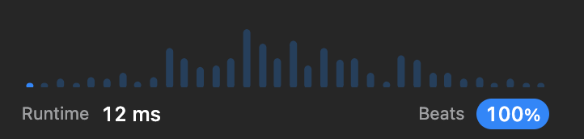

# ✅Runtime 12 ms Beats 🚀100% and 💡Memory 13 MB Beats 📉99.67%

**Author:** deleted_user
**Votes:** 6
**Link:** [https://leetcode.com/problems/find-maximum-number-of-string-pairs/solutions/4186834/](https://leetcode.com/problems/find-maximum-number-of-string-pairs/solutions/4186834/)

---

# Intuition
<!-- Describe your first thoughts on how to solve this problem. -->

# Approach
<!-- Describe your approach to solving the problem. -->

# Complexity
- Time complexity:
<!-- Add your time complexity here, e.g. $$O(n)$$ -->

- Space complexity:
<!-- Add your space complexity here, e.g. $$O(n)$$ -->

# Runtime 12 ms Beats \uD83D\uDE80100% 
```
class Solution(object):
    def maximumNumberOfStringPairs(self, words):
        pairs = 0
        reverse_dict = {}

        for word in words:
            reverse_word = word[::-1]
            if reverse_word in reverse_dict:
                pairs += reverse_dict[reverse_word]
                reverse_dict[reverse_word] += 1
            else:
                reverse_dict[word] = 1

        return pairs
```


# Memory 13 MB Beats \uD83D\uDCC999.67%

```
class Solution(object):
    def maximumNumberOfStringPairs(self, words):
        arr = []
        for i in words:
            demo_arr = []
            for j in words:
                if i[::-1] == j or i == j:
                    demo_arr.append(j)
            if len(demo_arr) > 1:
                arr.append(demo_arr)
        return int(len(arr) / 2)
```


# \u2B06\uFE0F Please upvote \u2B06\uFE0F


