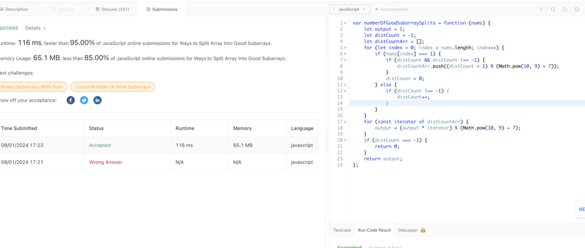

# ❇ ways-to-split-array-into-good-subarrays Images👌 🏆O(N)❤️ Javascript🎯 Memory👀95%🕕 ++Explanation

**Author:** anurag-sindhu
**Votes:** 2
**Link:** [https://leetcode.com/problems/ways-to-split-array-into-good-subarrays/solutions/5568664/](https://leetcode.com/problems/ways-to-split-array-into-good-subarrays/solutions/5568664/)

---


Time Complexity: O(N)
Space Complexity: O(N)

* Loop through the array nums to identify 1s and count distances between them.
* When encountering a 1:
* If distCount is not 0 and not -1, it means we've found at least one previous 1 and have counted a distance since the last 1.
* Push the distance incremented by 1 (because the count starts after the last 1) to distCountArr. The modulo operation ensures that numbers remain manageable given the large values possible.
* Reset distCount to 0 to start counting the distance to the next 1.
* When encountering a 0:
* If distCount is not -1, increment distCount to count the distance between 1s.

```
var numberOfGoodSubarraySplits = function (nums) {
    let output = 1;
    let distCount = -1;
    let distCountArr = [];
    for (let index = 0; index < nums.length; index++) {
        if (nums[index] === 1) {
            if (distCount && distCount !== -1) {
                distCountArr.push((distCount + 1) % (Math.pow(10, 9) + 7));
            }
            distCount = 0;
        } else {
            if (distCount !== -1) {
                distCount++;
            }
        }
    }
    for (const iterator of distCountArr) {
        output = (output * iterator) % (Math.pow(10, 9) + 7);
    }
    if (distCount === -1) {
        return 0;
    }
    return output;
};
```


