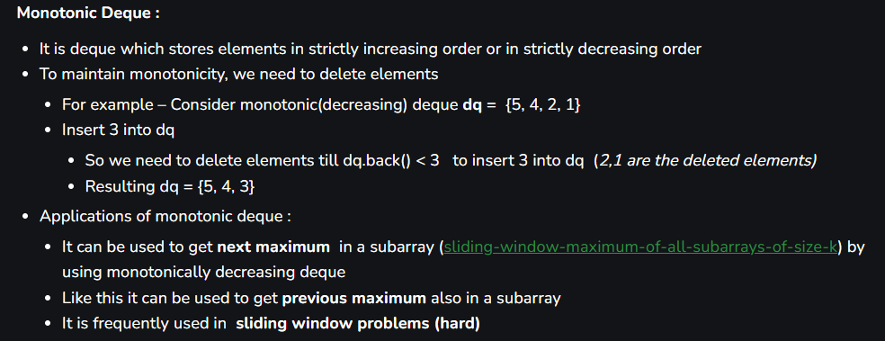
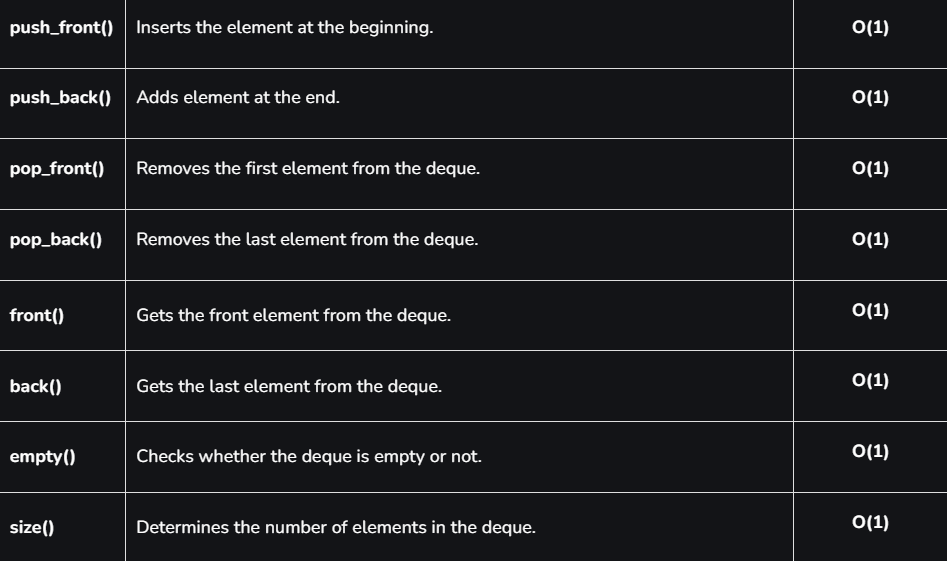

# ✅Monotonic deque image explanation with comments

**Author:** rishi800900
**Votes:** 27
**Link:** [https://leetcode.com/problems/continuous-subarrays/solutions/3706513/](https://leetcode.com/problems/continuous-subarrays/solutions/3706513/)

---




ALGORITHM:
1. Maintain a data structure which can give you max element of current window and min element of current window in o(1) time so its monotonic deque ( I have attached image what a monotonic deque is)

2. If difference between largest element and smallest element is greater than 2 then shift the window and do fruitful operations as shown in below code.

**mxq ---> store largest element at front (largest to smallest)**
**mnq ---> store smallest element at front (smallest to largest)**

**\uD83E\uDD1ENote: You may watch biggest sliding window playlist on entire internet using single template by clicking my profile and visiting my youtube channel "Coding samurai"

```

class Solution {
public:
        
    long long continuousSubarrays(vector<int>& nums) {
           int n = nums.size(),head=0,tail=0;
          long long  ans = 0;
          deque<int> mxq, mnq;
     
    for (head=0; head < n; head++) {
        while (!mxq.empty() && mxq.back() < nums[head])         // if current element is greater than back of mxq means    
            mxq.pop_back();                                   // we have to pop back of mxq so that we can insert nums[head] at correct place
        while (!mnq.empty() && mnq.back() > nums[head])    // if current element is less than back of mnq means
            mnq.pop_back();                                // pop back of mnq so that we can insert nums[head] means current element at correct place
        
///////////////////////// to maintain monotonicity of mxq and mnq we are doing above two operations ////////////////////////////////////
        
        mxq.push_back(nums[head]);         // now you can insert it in mxq
        mnq.push_back(nums[head]);         // now you can insert it in mnq

        while (mxq.front() - mnq.front() > 2) {  // if differencd b/w largest and smallest element of current window is > 2
            if (mxq.front() == nums[tail])      // remove largest element from mxq i.e its front value if its equal to nums[tail]
                mxq.pop_front();
            if (mnq.front() == nums[tail])     // remove smallest element from mnq i.e its front value if its equal to nums[tail]
                mnq.pop_front();
            tail++;  // move window forward
        }
        ans += head - tail + 1;  // count subarrays
    }

    return ans;
    }
};
```