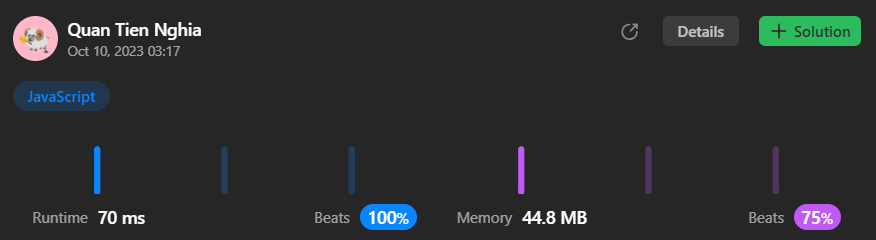

# Efficient JS solution (Beat 100 time and 75% memory)

**Author:** CuteTN
**Votes:** 1
**Link:** [https://leetcode.com/problems/sum-of-imbalance-numbers-of-all-subarrays/solutions/4151537/](https://leetcode.com/problems/sum-of-imbalance-numbers-of-all-subarrays/solutions/4151537/)

---



# Complexity
- let `n = nums.length`, `m = max(nums)`
- Time complexity: $$O(n(n+m))$$
- Space complexity: $$O(m)$$

# Code
```js
const counters = new Uint8Array(1002);

/**
 * @param {number[]} nums
 * @return {number}
 */
var sumImbalanceNumbers = function (nums) {
  let res = 0;
  let n = nums.length;

  let num;
  let cur;
  for (let r = 1; r < n; r++) {
    counters.fill(0, 0, n+2);
    num = nums[r];
    counters[num] = 1;
    cur = 0;

    for (let l = r-1; l >= 0; l--) {
      num = nums[l];

      if (!counters[num]) {
        counters[num] = 1;
        cur += 1;

        if (counters[num+1]) cur--;
        if (counters[num-1]) cur--;
      }

      res += cur;
    }
  }

  return res;
};
```