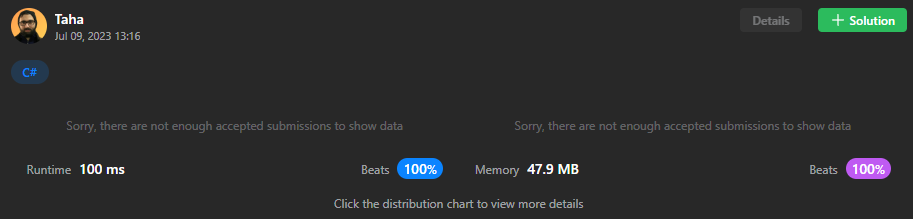

# ✅ C# | easy and readable solution 🚅 faster than 100% 💻 less than 100%

**Author:** Thanat05
**Votes:** 1
**Link:** [https://leetcode.com/problems/longest-alternating-subarray/solutions/3740908/](https://leetcode.com/problems/longest-alternating-subarray/solutions/3740908/)

---



**Don't hesitate to suggest or ask bellow about something that you don't understand**

```
public class Solution {
    public int AlternatingSubarray(int[] nums) {
        int ans = -1;
        for (int i = 1; i < nums.Length;)
        {
            if (nums[i - 1] + 1 != nums[i++])
                continue;
            ans = Math.Max(ans, 2);
            for (int j = 3; i < nums.Length && nums[i] == nums[i - 2]; i++, j++)
                ans = Math.Max(ans, j);
        }
        return ans;
    }
}
```

If you like it don't forget to **upvote!**