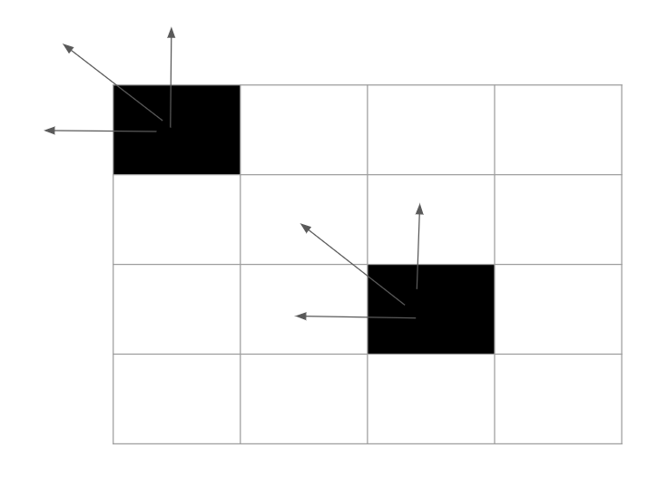
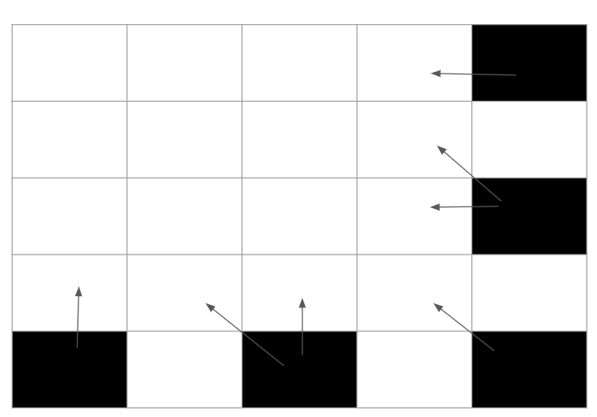

# 🔥 Picture Explanation || Intution Explained || MAP 🔥

**Author:** piyushjaiswal380
**Votes:** 34
**Link:** [https://leetcode.com/problems/number-of-black-blocks/solutions/3739225/](https://leetcode.com/problems/number-of-black-blocks/solutions/3739225/)

---

# **Intution**
Constraint indicates we can not make the matrix hence we need to think something different!!

When you draw the matrix you will notice that every cell can contribute to maximum of 4  2 * 2 blocks,



**As you can see  a cell can contribute to maximum of 4 2 * 2 block (x,y-1) (x,y-1), (x-1,y-1) and (x,y) itself..**

Some cell contributing to outside matrix ,we can ignore them by checking if row or column is negative(check in code)

**But things changes a little bit when the cell is in last row or last column or last cell that is (m-1,n-1) as you see in the figure, no cell is contributing to itself**




```
class Solution {
public:
    vector<long long> countBlackBlocks(int m, int n, vector<vector<int>>& coord) {
            
            map<pair<int,int>,int> mp;
            
            for(auto a : coord){
                    
                    int x = a[0];
                    int y = a[1];
                    
                    if(x == m-1 && y == n-1) // If last cell
                       mp[{x-1,y-1}]++;
                    
                    else if(y == n-1){ // If last column
                        mp[{x,y-1}]++;
                        mp[{x-1,y-1}]++;
                    }
                    else if(x == m-1){ // If last row
                        mp[{x-1,y}]++;
                        mp[{x-1,y-1}]++;
                    }
                    else{  // Common cells
                            mp[{x-1,y}]++;
                            mp[{x,y-1}]++;
                            mp[{x-1,y-1}]++;
                            mp[{x,y}]++;
                    }
            }
            
            vector<long long> ans(5,0); // Answer array
            
            for(auto[a,b] : mp)
                    if(a.first >= 0 && a.second >= 0) // do not count out of the array row and column
                    ans[b]++;
            
            int sum = accumulate(ans.begin(),ans.end(),0); // total count of 1 , 2 , 3 , 4 in 2 * 2 block
            
             
            ans[0] = (long long)(m-1) * (long long)(n-1) - sum; // total 0 black block in matrix  - 1, 2, 3, 4 block
            return ans;
        
    }
};
```


