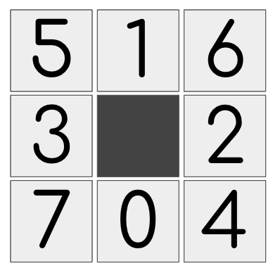
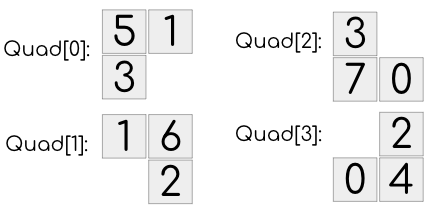

# Dart Solution with Diagram Explanation

**Author:** darv
**Votes:** 0
**Link:** [https://leetcode.com/problems/number-of-black-blocks/solutions/3741795/](https://leetcode.com/problems/number-of-black-blocks/solutions/3741795/)

---

# Approach

For each black dot, we examine the 3x3 matrix around it.

With how the `DIRS` was defined, we can see the cells around the black dot are indexed as:



We then check each of the four quadrants it has:




If the boundary was valid, then we count it. Otherwise, we don't.

### Duplicates

Because each black dot would count the quad around it, we will have duplicates. For example, the following quad would produce a `3` count because each of the black would identify it as part of a valid quad.


So in the code, we divide it out.

## Empty quad

Empty quad is the total quads `(m-1)x(n-1)` minus all 1-quad, 2-quad, 3-quad and 4-quad.


# Code
```
import 'dart:collection';
import 'dart:math';

const DIRS = [
  [1, 0], [-1, 0], [0, 1], [0, -1],
  [1, 1], [-1, -1], [-1, 1], [1, -1],
];
const QUADS = [
  [1, 3, 5], [1, 2, 6], [0, 3, 7], [0, 2, 4]
];
const MIN = -1 << 30, MAX = 1 << 30;
class Solution {
  List<int> countBlackBlocks(int m, int n, List<List<int>> coordinates) {
    final points = HashSet<int>();
    int key(int x, int y) { return (x << 30) | y; }
    for (final coor in coordinates) points.add(key(coor[0], coor[1]));
    final res = List.filled(5, 0);

    final blacks = List.filled(8, 0);
    final coorX = List.filled(8, 0);
    final coorY = List.filled(8, 0);

    for (final coor in coordinates) {
      final r = coor[0], c = coor[1];

      for (int i = 0; i < 8; i++) {
        coorX[i] = r + DIRS[i][0];
        coorY[i] = c + DIRS[i][1];
        blacks[i] = points.contains(key(coorX[i], coorY[i])) ? 1 : 0;
      }

      for (final quad in QUADS) {
        // find the boundary of each quad
        var min_x = MAX, min_y = MAX, max_x = MIN, max_y = MIN;
        var sum = 1;
        for (final idx in quad) {
          min_x = min(min_x, coorX[idx]);
          max_x = max(max_x, coorX[idx]);
          min_y = min(min_y, coorY[idx]);
          max_y = max(max_y, coorY[idx]);
          sum += blacks[idx];
        }
        if (min_x < 0 || max_x >= m || min_y < 0 || max_y >= n) continue;
        res[sum]++;
      }
    }

    res[0] = (m - 1) * (n - 1);

    // Remove duplicates
    for (int i = 1; i <= 4; i++) {
      res[i] ~/= i;
      res[0] -= res[i];
    }

    return res;
  }
}
```