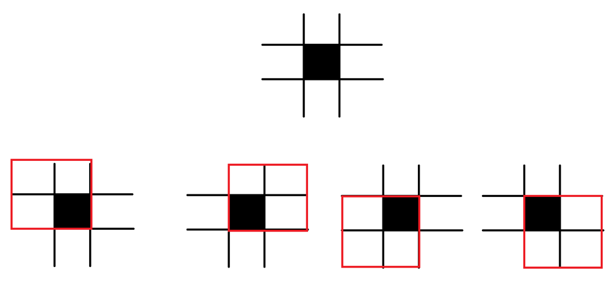

# HashSet, Kotlin, O(n)

**Author:** rdayneko
**Votes:** 0
**Link:** [https://leetcode.com/problems/number-of-black-blocks/solutions/3737355/](https://leetcode.com/problems/number-of-black-blocks/solutions/3737355/)

---

# Approach
<!-- Describe your approach to solving the problem. -->
If we see on the area **m \u0445 n** we've got **(n - 1) * (m - 1)** total numbers of blocks. And also we have **4** blocks that contains one of the colored ceil. So the approach is to for every filled ceil count filled ceil in it and substract it from the total counts of blocks. And do not forget about checking double counting the same blocks.



# Complexity
- Time complexity:
 O(len(coordinates))

- Space complexity:
 O(len(coordinates))

# Code
```
class Solution {
fun countBlackBlocks(m: Int, n: Int, coordinates: Array<IntArray>): LongArray {
    val s = HashSet<Pair<Int, Int>>()
    for (c in coordinates) {
        s.add(Pair(c[0], c[1]))
    }

    fun count(x: Int, y: Int): Int {
        if (x < 0 || x + 1 >= m) return 0
        if (y < 0 || y + 1 >= n) return 0

        var res = 0
        if (Pair(x, y) in s) res++
        if (Pair(x + 1, y) in s) res++
        if (Pair(x, y + 1) in s) res++
        if (Pair(x + 1, y + 1) in s) res++
        return res
    }

    val res = longArrayOf((n - 1L) * (m - 1), 0, 0, 0, 0)
    val counted = HashSet<Pair<Int, Int>>()
    val delta = arrayOf(intArrayOf(0, 0, -1, -1), intArrayOf(0, -1, 0, -1))
    for (c in coordinates) {
        for (i in 0..3) {
            val p = Pair(c[0] + delta[0][i], c[1] + delta[1][i])
            if (p !in counted) {
                val count = count(p.first, p.second)
                if (count == 0) continue
                res[count]++
                res[0]--
                counted.add(p)
            }
        }
    }
    return res
}
}
```