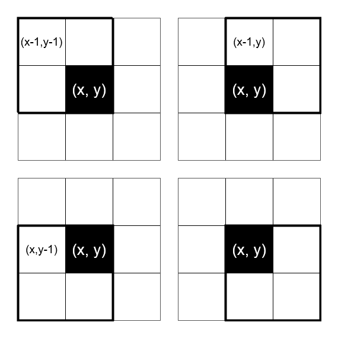

# Swift | Explained hashmap solution

**Author:** VladimirTheLeet
**Votes:** 0
**Link:** [https://leetcode.com/problems/number-of-black-blocks/solutions/3738575/](https://leetcode.com/problems/number-of-black-blocks/solutions/3738575/)

---

# Approach

Each given black cell `[x, y]` can be a part of maximum 4 square blocks, denoted by the top-left cell.



Creeate a hashmap `squares` for the blocks affected by black.
Iterate through the coordinates and increment the black count for the squares to which the black cell belong.

After that the hashmap will hold the black count for each square where is at least one black cell. That gives us 4/5 of needed answer. The only left to find number of pure white squares is calculated as *number of all blocks in the grid* (which is `(m-1)*(n-1`) minus *counts of all blocks touched by blackness*.

# Complexity
- Time complexity: $O(c)$
- Space complexity: $O(c)$
$c$ is coordinates count.

# Code
```
class Solution {
    func countBlackBlocks(_ m: Int, _ n: Int, _ coordinates: [[Int]]) -> [Int]
    {
        var squares: [[Int]:Int] = [:] // [x, y] : blackCount
        var x: Int, y: Int
        for coord in coordinates
        {
            x = coord[0]; y = coord[1];
            if x > 0 && y > 0 { squares[[x-1, y-1], default: 0] += 1 }
            if x > 0 && y < n-1 { squares[[x-1, y], default: 0] += 1 }
            if x < m-1 && y > 0 { squares[[x, y-1], default: 0] += 1 }
            if x < m-1 && y < n-1 { squares[[x, y], default: 0] += 1 }
        }
        var res = [0,0,0,0,0]
        for blackCount in squares.values {
            res[blackCount] += 1
        }
        res[0] = (m-1)*(n-1) - (res[1] + res[2] + res[3] + res[4])
        return res
    }
}
```