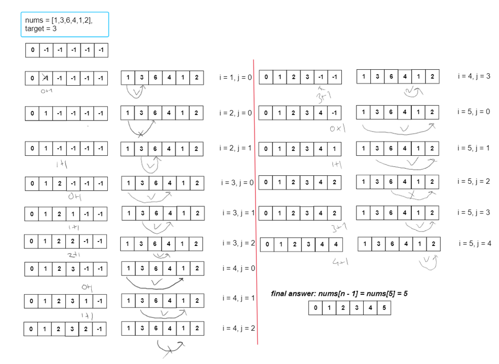

# DP with full explanation

**Author:** some_user_beginner
**Votes:** 15
**Link:** [https://leetcode.com/problems/maximum-number-of-jumps-to-reach-the-last-index/solutions/3738971/](https://leetcode.com/problems/maximum-number-of-jumps-to-reach-the-last-index/solutions/3738971/)

---

Main idea of this algorithm is checking every num between nums[0, i - 1] is reachable or not to nums[i] i =0..n, where n = nums.length

Next steps:
1) create array which stores number of jumps, dp[n], where n = nums.length
2) initialize dp[0] = 0, because it is initial position, and rest of them fill with -1, because in the beginning they are not reachable
3) then for every i=1,n(why from 1?, because we should compare at least with one num behind curr number) check every j=0,i - 1 that satisfies next condition:
3.1) abs(nums[i] - nums[j]) <= target
3.2) nums[j] != -1 (it means that nums[j] reachable from nums[0])

then update dp[i] with max(dp[i], (dp[j] + 1))



```
class Solution {
    public int maximumJumps(int[] nums, int target) {
       int n = nums.length;
       int[] dp = new int[n + 1];
       Arrays.fill(dp, -1);
        dp[0] = 0;
       for(int i = 1; i < n; i++) {
           for(int j = 0; j < i; j++) {
               if(Math.abs(nums[j] - nums[i]) <= target && dp[j] != -1) {
                   dp[i] = Math.max(dp[i], dp[j] + 1);
               }
           }
       }
        
       return dp[n - 1]; 
    }
}
```