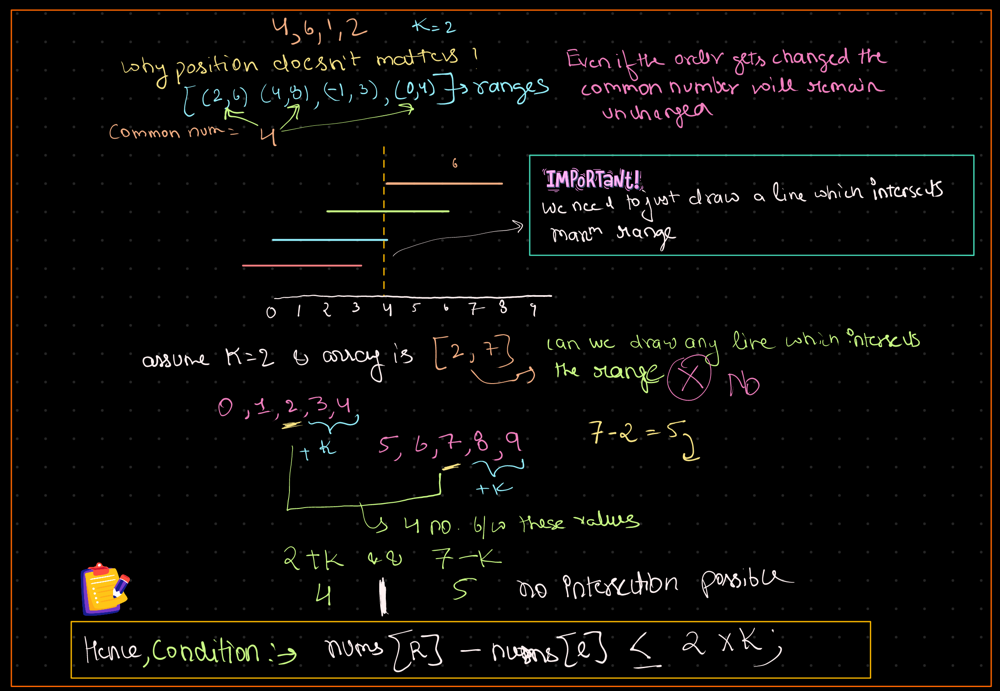
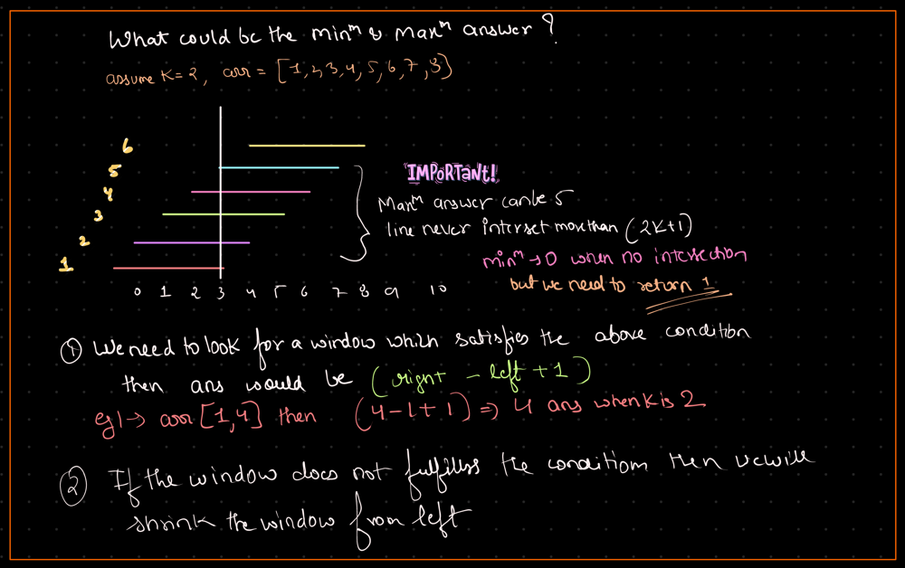

# 🔥BEATS 💯 % 🎯 |✨SUPER EASY BEGINNERS 👏

**Author:** CodeWithSparsh
**Votes:** 5
**Link:** [https://leetcode.com/problems/maximum-beauty-of-an-array-after-applying-operation/solutions/6135692/](https://leetcode.com/problems/maximum-beauty-of-an-array-after-applying-operation/solutions/6135692/)

---


---



---


---

# Intuition
The goal is to find the maximum size subarray such that the difference between the maximum and minimum elements in that subarray is at most \\(2 \	imes k\\). This can be done by utilizing a **sliding window** approach, where we maintain a window of elements and adjust its boundaries dynamically to ensure the condition is satisfied.

---

# Approach
1. **Sort the array**: First, sort the array so that the smallest elements are at the beginning and the largest are at the end. This allows us to efficiently calculate the difference between the maximum and minimum elements in any subarray.
2. **Sliding window**: Use two pointers (`left` and `right`) to define the window. Start by expanding the `right` pointer and compute the difference between `nums[right]` and `nums[left]`.
3. **Condition check**: If the difference exceeds \\(2 \	imes k\\), move the `left` pointer to shrink the window until the condition is met.
4. **Track maximum window size**: At each step, update the maximum size of the window that satisfies the condition.

---

# Complexity
- **Time Complexity**:  
  Sorting the array takes \\(O(n \\log n)\\). The sliding window part is \\(O(n)\\) since both pointers only move forward. Hence, the overall time complexity is \\(O(n \\log n)\\).
  
- **Space Complexity**:  
  The space complexity is \\(O(1)\\) because we use a constant amount of extra space, except for the input array.

---


```dart []
import 'dart:math';

class Solution {
  int maximumBeauty(List<int> nums, int k) {
    nums.sort();
    int res = 0;
    int left = 0;
    for (int right = 0; right < nums.length; right++) {
      int diff = nums[right] - nums[left];
      bool isGreaterThanLimit = diff > 2 * k;

      while (isGreaterThanLimit) {
        left++;
        diff = nums[right] - nums[left];
        isGreaterThanLimit = diff > 2 * k;
      }
      
      res = max(res, right + 1 - left);
    }
    return res;
  }
}
```


```python []
class Solution:
    def maximumBeauty(self, nums: List[int], k: int) -> int:
        nums.sort()
        res = 0
        left = 0
        for right in range(len(nums)):
            diff = nums[right] - nums[left]
            while diff > 2 * k:
                left += 1
                diff = nums[right] - nums[left]
            res = max(res, right - left + 1)
        return res
```


```cpp []
#include <vector>
#include <algorithm>
using namespace std;

class Solution {
public:
    int maximumBeauty(vector<int>& nums, int k) {
        sort(nums.begin(), nums.end());
        int res = 0;
        int left = 0;
        
        for (int right = 0; right < nums.size(); right++) {
            int diff = nums[right] - nums[left];
            while (diff > 2 * k) {
                left++;
                diff = nums[right] - nums[left];
            }
            res = max(res, right - left + 1);
        }
        return res;
    }
};
```


```java []
import java.util.Arrays;

class Solution {
    public int maximumBeauty(int[] nums, int k) {
        Arrays.sort(nums);
        int res = 0;
        int left = 0;
        
        for (int right = 0; right < nums.length; right++) {
            int diff = nums[right] - nums[left];
            while (diff > 2 * k) {
                left++;
                diff = nums[right] - nums[left];
            }
            res = Math.max(res, right - left + 1);
        }
        return res;
    }
}
```


```javascript []
var maximumBeauty = function(nums, k) {
    nums.sort((a, b) => a - b);
    let res = 0;
    let left = 0;
    
    for (let right = 0; right < nums.length; right++) {
        let diff = nums[right] - nums[left];
        while (diff > 2 * k) {
            left++;
            diff = nums[right] - nums[left];
        }
        res = Math.max(res, right - left + 1);
    }
    return res;
};
```


```go []
package main

import "sort"

func maximumBeauty(nums []int, k int) int {
    sort.Ints(nums)
    res := 0
    left := 0

    for right := 0; right < len(nums); right++ {
        diff := nums[right] - nums[left]
        for diff > 2*k {
            left++
            diff = nums[right] - nums[left]
        }
        if right-left+1 > res {
            res = right - left + 1
        }
    }

    return res
}
```

---
 {:style='width:250px'}