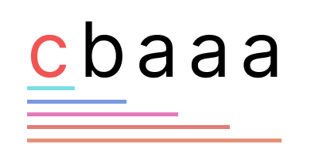
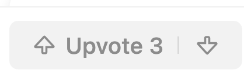

# [Picture] Short and Concise Approach, Easy to Understand, In-depth Explanation

**Author:** jmyanxiang
**Votes:** 233
**Link:** [https://leetcode.com/problems/length-of-the-longest-valid-substring/solutions/3771333/](https://leetcode.com/problems/length-of-the-longest-valid-substring/solutions/3771333/)

---

# Intuition

The key to this problem is to realize the following condition:

```
1 <= forbidden[i].length <= 10
```

In words, this means the length of a forbidden substring will be no more than 10 characters.

This means if we know the length of the longest substring without forbidden words starting at index `i + 1`, we need to check at most 10 new substrings to calculate the longest substring starting at index `i`.



In the picture above, for the new character `c` that we start considering (moving from index `i + 1` to index `i`), the new substrings that we need to consider are `c`, `cb`, `cba`, `cbaa`, `cbaaa`.

To find the length of the longest substring starting at `i`, not including any substrings in `forbidden`, we can use a variable `k`.

* If we continuously increase `k` and realize that the substring in range `[i, i + k]` (inclusive) is in `forbidden` (for the first time, as we increase `k`), then we know that the substring in `[i, i + k - 1]` (of length `k`) is "valid".
* If we do **NOT** encounter a substring in `forbidden` as we increase `k`, the solution is `1 + (the solution for i + 1)`.
* However, we don't need to keep track of this number; we can simply keep track of the right most index of the "valid" substring.

# Approach

```python
class Solution:
    def longestValidSubstring(self, word: str, forbidden: List[str]) -> int:
        forbidden_set = set(forbidden)
        res = 0
        right = len(word) - 1
        for left in range(len(word) - 1, -1, -1):
            for k in range(left, min(left + 10, right + 1)):
                if word[left:k+1] in forbidden_set:
                    right = k - 1
                    break
            res = max(res, right - left + 1)
        return res
```

The right pointer keeps track of where the "valid" substring ends. `forbidden_set` allows `O(1)` look-ups for forbidden words.
Also, `min(left + 10, right + 1)` is utilizing the condition that forbidden words not contain more than 10 characters.

# Other Approaches

1. We can use a `Trie` to check if a substring is a forbidden word. The depth of the `Trie` will be limited to 10, as the constraint specifies. The advantage of using a `Trie` is to eliminate the substring slicing work -- whose runtime is bounded by `O(k^2)`, where `k` is the maximum length of a word in `forbidden`.
2. We can perform the checks forward instead of backwards. This only applies to the case where we use a set. @Berthouille provided a great example of this in the comment section. Make sure to go there and give him an upvote, too :D

# FAQ: Trie vs Set

Suppose that,
```
1 <= forbidden[i].length <= k
```

In this problem, `k = 10`.

When we use a set of `forbidden` words, to check if a substring beginning at `i` is in `forbidden_set`, we need to perform a slicing on the provided `word`. That is, for `1 <= j <= k`, we need to perform `word[i:j]`. As you can see, this runs in `O(k^2)` time.

If we use a `Trie`, we can keep track of the node in the trie as we move through the substring. This means, we can store the node `cb` before we move on to `cba`, as node `cba` will be a child of node `cb`. That is `O(k)` time complexity.

In this problem, `k` is small enough that a set will do just fine. As `k` grows, the runtime will start to favour using a trie.

I hope this helps!

# Final Words



Please **upvote** for more content to come! Your support is my motivation - thanks for motivating me to create more content!