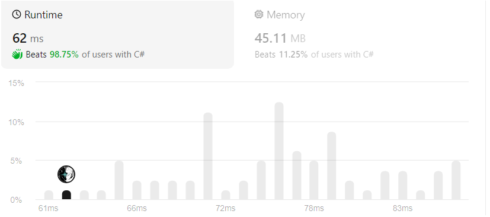

# 5 ways to solve in C# (beats 98.75% runtime)

**Author:** yeuhoahuuco
**Votes:** 1
**Link:** [https://leetcode.com/problems/check-if-array-is-good/solutions/4855417/](https://leetcode.com/problems/check-if-array-is-good/solutions/4855417/)

---



# Code
```
public class Solution {
    public bool IsGood(int[] nums) {
        int l = nums.Length;
        if(l == 1)
           return false;
        
        if(l == 2 && nums[0] == 1 && nums[1] == 1)
           return true;
        
        // Solution 1:
        // Array.Sort(nums);
        // int maxValue = nums[l - 1];

        // if(nums[0] > 1)
        //    return false;

        // if(l != maxValue + 1)
        //    return false;

        // for(int i = 0; i < maxValue; i++)
        // {
        //     if(nums[i] != i + 1)
        //     {
        //         return false;
        //     }
        // }
        // if(nums[l - 1] != maxValue)
        //    return false;     
        // return true;


        // Solution 2:
        int defaultMaxValue = l - 1;
        int duplicate = 0;
        var set = new HashSet<int>();
        for(int i = 0; i < l; i++)
        {
            if(nums[i] > defaultMaxValue)
            {
                return false;
            }
            if(!set.Add(nums[i]))
            {
                duplicate++;
                if(duplicate > 1 || nums[i] != defaultMaxValue)
                {
                   return false;
                }
            }
        }
        return true;

        // Solution 3:
        // return Enumerable.Range(1, l - 1).Append(l - 1)
        //                  .SequenceEqual(nums.OrderBy(x => x));

        // Solution 4:
        // Array.Sort(nums);
        // return Enumerable.Range(1, l - 1).Append(l - 1)
        //                  .SequenceEqual(nums);

        // Solution 5:
        // Array.Sort(nums);
        // return nums.SequenceEqual(Enumerable.Range(1, l - 1).Append(l - 1));
    }
}
```