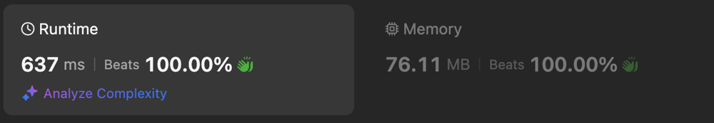

# Recursion solution | Memo | Beats 100%

**Author:** NaNLagger
**Votes:** 0
**Link:** [https://leetcode.com/problems/visit-array-positions-to-maximize-score/solutions/5312440/](https://leetcode.com/problems/visit-array-positions-to-maximize-score/solutions/5312440/)

---

# Intuition
go from end -> 2,3,6,1,9,2
for array [2] answer is 2
for [9, 2] -> max(9 + 2 - 5, 9 + 0) = 9
for [1, 9, 2] -> max(1 + 9 + 2 - 5, 1 + 9 + 0, 1 + 0 + 0, 1 + 0 + 2 - 5) = 10
etc.

# Approach
Every element in array we can pick or skip and take maximum

# Complexity


- Time complexity:
$$O(2*n)$$

- Space complexity:
$$O(2*n)$$

# Code
```
class Solution {
    fun maxScore(nums: IntArray, x: Int): Long {
        val memo = arrayOf(LongArray(nums.size) { -1L }, LongArray(nums.size) { -1L })
        fun dfs(i: Int, parity: Int): Long {
            if (i >= nums.size) return 0
            if (memo[parity][i] != -1L) return memo[parity][i] //if we already have a result
            val penalty = if (nums[i] % 2 == parity) 0 else -x
            return max(
                nums[i] + dfs(i + 1, nums[i] % 2) + penalty, //pick number
                dfs(i + 1, parity) //skip number
            )
                .also { memo[parity][i] = it } //save result
        }
        return dfs(1, nums[0] % 2) + nums[0] //first number we always pick
    }
}
```