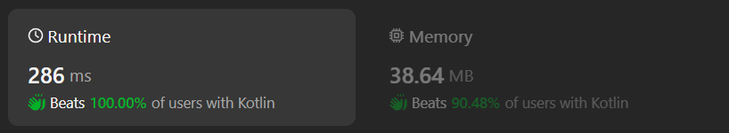

# Kotlin simple solution (easy to understand)

**Author:** chayangkoon
**Votes:** 0
**Link:** [https://leetcode.com/problems/split-strings-by-separator/solutions/4945854/](https://leetcode.com/problems/split-strings-by-separator/solutions/4945854/)

---



# Code
```
class Solution {
    fun splitWordsBySeparator(words: List<String>, separator: Char): List<String> {
        val resultList = mutableListOf<String>()

        for(word in words) {
            var left = 0
            var right = 0

            while(right < word.length) {
                while(right < word.length && word[right] != separator) {
                    right++
                }
                val substring = word.substring(left, right)
                if(substring.isNotEmpty()) resultList.add(substring)
                
                left = ++right
            }
        }

        return resultList
    }
}
```