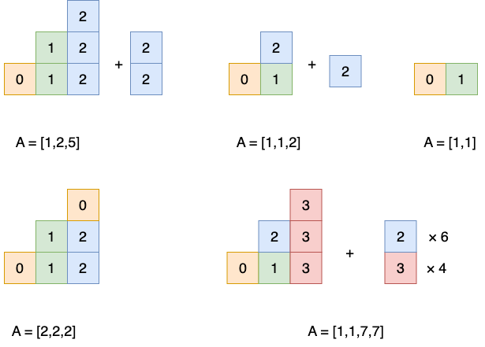

# [Java/C++/Python] Math, O(n)

**Author:** lee215
**Votes:** 134
**Link:** [https://leetcode.com/problems/maximum-number-of-groups-with-increasing-length/solutions/3803904/](https://leetcode.com/problems/maximum-number-of-groups-with-increasing-length/solutions/3803904/)

---

# **Preword**
I noticed some active discussion about the thinking process and intuition.
So I spent some time adding a diagram and more detailed explanation.
**Please upvote me if you like.**
<br>


# **Intuition**
If we can have `k` group,
we need at least `1 + 2 + ... + k` elements.
<br>

# **Solution 1: Math**
So we use `A[i]` to fill this pattern.




Take this diagram as an example,
for each column,
we will try to fill in `i` with `A[i]` times.
And each row,
will form up the group for problem.
we can see that,
each row won't have duplicates.

So we will try to fill the last colomu with element of bigger limit,
and fill the left columu with element of small limit.
That's the reason we need to sort the elements by their limit.

We will fill from left to right,
because obviously we don't know how many group we can reach.
Note that we can also trying fill the `k`th group,
then from right to left,
this will lead us to binary search solution,
with complexity `O(nlogn)`,
could be easier to think through.

Assume currently we already have `k` groups and `x` more availble elements,
we check if we can form the `k + 1`th group.

If `x < k + 1`,
we don't have enough elements,
need to wait more element to come in.

If `x >= k + 1`,
we can fullfill the `k + 1`th group.

But we can not have the `k + 2`th group directly,
even we have enough elements.
Because in `n` groups,
we can use one elements at most `n` times.

Those overflow will counted as availble elements,
and can be used as availble elements in future.
Note that,
we count this part as availble elements,
but actually we will use `A[i]`,
these availble elements will be really used,
when we don't have enough elements for the group.


Time `O(sort)`
Space `O(sort)`
<br>

**Java**
```java
    public int maxIncreasingGroups(List<Integer> A) {
        Collections.sort(A);
        long total = 0, k = 0, n = A.size();
        for (int i = 0; i < n; i++) {
            total += A.get(i);
            if (total >= (k + 1) * (k + 2) / 2)
                k++;
        }
        return (int)k;
    }
```
**C++**
```cpp
    int maxIncreasingGroups(vector<int>& A) {
        sort(A.begin(), A.end());
        long long total = 0, k = 0;
        for (int a : A) {
            total += a;
            if (total >= (k + 1) * (k + 2) / 2)
                k++;
        }
        return k;
    }
```
**Python**
```py
    def maxIncreasingGroups(self, A: List[int]) -> int:
        A.sort()
        total = k = 0
        for a in A:
            total += a
            if total >= (k + 1) * (k + 2) // 2:
                k += 1
        return k
```
<br>

# **Solution 2: O(n)**
Apply counting sort to improve to `O(n)`.

The inner for-j loop will be called exact `n` times,

Time `O(n)`
Space `O(n)`
<br>

**Java**
```java
    public int maxIncreasingGroups(List<Integer> A) {
        int n = A.size();
        Map<Integer, Integer> count = new HashMap<>();
        for (int a : A) {
            a = Math.min(a, n);
            count.put(a, count.getOrDefault(a, 0) + 1);
        }
        long total = 0, k = 0;
        for (int i = 0; i <= n; i++) {
            for (int j = 0; j < count.getOrDefault(i, 0); j++) {
                total += i;
                if (total >= (k + 1) * (k + 2) / 2) {
                    k++;
                }
            }
        }
        return (int)k;
    }
```
**C++**
```cpp
    int maxIncreasingGroups(vector<int>& A) {
        int n = A.size();
        unordered_map<int, int> count;
        for (int a : A)
            count[min(a, n)]++;
        long long total = 0, k = 0;
        for (int i = 0; i <= n; i++)
            for (int j = 0; j < count[i]; j++)
                if ((total += i) >= (k + 1) * (k + 2) / 2)
                    k++;
        return k;
    }
```

**Python**
```py
    def maxIncreasingGroups(self, A: List[int]) -> int:
        n = len(A)
        count = Counter(min(a, n) for a in A)
        total = k = 0
        for i in range(n + 1):
            for j in range(count[i]):
                total += i
                if total >= (k + 1) * (k + 2) // 2:
                    k += 1
        return k
```
