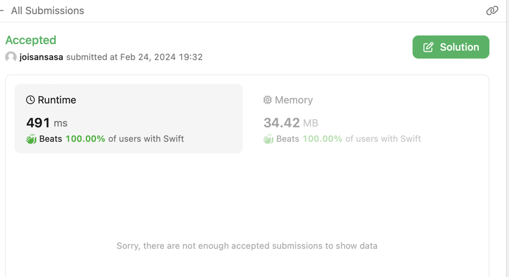

# Smallest self distances

**Author:** joisansasa
**Votes:** 0
**Link:** [https://leetcode.com/problems/minimum-seconds-to-equalize-a-circular-array/solutions/4778558/](https://leetcode.com/problems/minimum-seconds-to-equalize-a-circular-array/solutions/4778558/)

---



# Intuition
<!-- Describe your first thoughts on how to solve this problem. -->
It is not a complicated problem but take quite some experiments to find out what this problem is about - maximum self distance of any value to same value, i.e. number of different values between two occurrences circularly. For example, in [1,2,2,1], the value 1 at index 0 and index 3 has two other numbers between them. Similarly the value 2 at index 1 and index 2 has two other numbers between them circularly. In [1,2,3,1,2,3,1]. There are two different numbers between value at index 0 and index 3, index 3 and index 6. Since every second we can change a value both way, so it will take about dist/2 + dist%2 seconds to change all other numbers the any value. We need to find the value that has the smallest maximum self distance.

# Approach
<!-- Describe your approach to solving the problem. -->
For every distinct value, get its index ranges in the input. So it will be easy to calculate max distance for any distinctive value. Then we could get the minimum once all distinctive values are considered. This will be the answer we are looking for this problem.

# Complexity
- Time complexity:
<!-- Add your time complexity here, e.g. $$O(n)$$ -->
O(n) where n is size of input array.
Please note that even in our code there is a nested loop, however, all ranges of distinctive values add up at most to n. So total calculations add up to O(n)

- Space complexity:
<!-- Add your space complexity here, e.g. $$O(n)$$ -->
O(n) where n is size of input array.
A dictionary is used to keep all ranges of distinctive values for easier calculation of max distances.

# Code
```
class Solution {
    func minimumSeconds(_ nums: [Int]) -> Int {
        guard nums.count > 1 else {return 0}
        return mxDist(nums)
    }

    func mxDist(_ nums: [Int]) -> Int {
        let N = nums.count
        var a: [Int:[[Int]]] = [:]
        var i = 0
        while i < N {
            let n = nums[i]
            var j = i + 1
            while j < N && nums[j] == n {
                j += 1
            }
            a[n, default: []].append([i, j-1]) //inclusive
            i = j
        }
        if a.count == 1 {return 0}
        var mx = N
        for (n, ranges) in a {
            //find out max dist in ranges
            var d = 0
            if ranges.count == 1 {
                let others = N - (ranges[0][1] - ranges[0][0] + 1)
                d = others/2 + others%2
            } else {
                var others = 0
                var i = 1
                while i < ranges.count {
                    others = max(ranges[i][0] - 1 - ranges[i-1][1], others)
                    i += 1
                }
                others = max(others, N - 1 - ranges.last![1] + ranges.first![0])
                d = others/2 + others%2
            }
            mx = min(mx, d)
        }
        return mx
    }
}
```