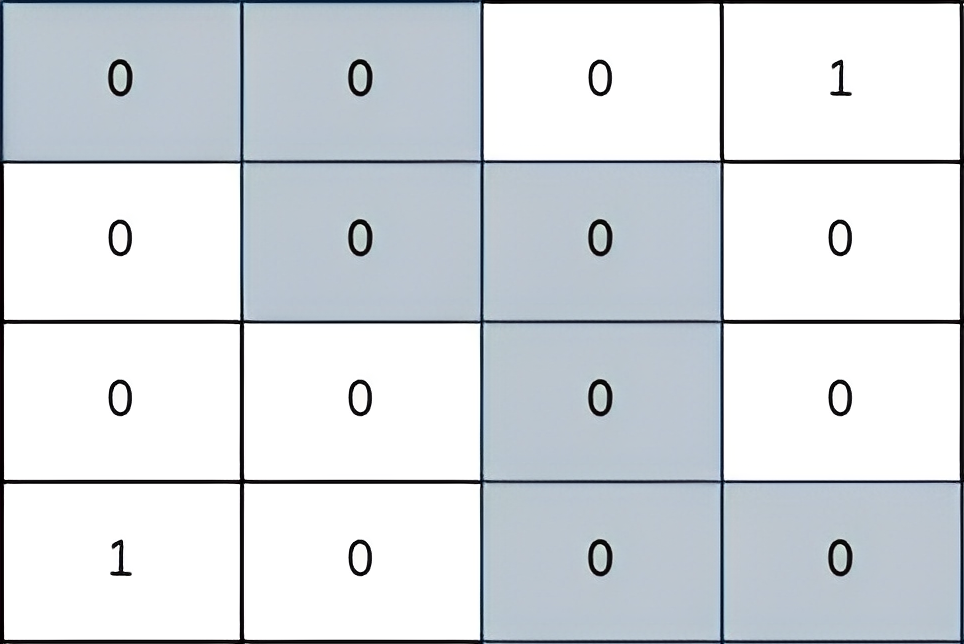

# [2812. Find the Safest Path in a Grid](https://leetcode.com/problems/find-the-safest-path-in-a-grid/)

| Category | Difficulty | Likes | Dislikes |
| :------: | :--------: | :---: | :------: |
| Algorithms | Medium | 1795 | 318 |

**Tags:** [`array`](https://leetcode.com/tag/array), [`binary-search`](https://leetcode.com/tag/binary-search), [`breadth-first-search`](https://leetcode.com/tag/breadth-first-search), [`union-find`](https://leetcode.com/tag/union-find), [`heap-priority-queue`](https://leetcode.com/tag/heap-priority-queue), [`matrix`](https://leetcode.com/tag/matrix)

**Companies:** `google`, `imc`, `amazon`

## Description

You are given a **0-indexed** 2D matrix `grid` of size `n x n`, where `(r, c)` represents:

	- A cell containing a thief if `grid[r][c] = 1`

	- An empty cell if `grid[r][c] = 0`

You are initially positioned at cell `(0, 0)`. In one move, you can move to any adjacent cell in the grid, including cells containing thieves.

The **safeness factor** of a path on the grid is defined as the **minimum** manhattan distance from any cell in the path to any thief in the grid.

Return *the **maximum safeness factor** of all paths leading to cell *`(n - 1, n - 1)`*.*

An **adjacent** cell of cell `(r, c)`, is one of the cells `(r, c + 1)`, `(r, c - 1)`, `(r + 1, c)` and `(r - 1, c)` if it exists.

The **Manhattan distance** between two cells `(a, b)` and `(x, y)` is equal to `|a - x| + |b - y|`, where `|val|` denotes the absolute value of val.

 

**Example 1:**


```

Input: grid = [[1,0,0],[0,0,0],[0,0,1]]
Output: 0
Explanation: All paths from (0, 0) to (n - 1, n - 1) go through the thieves in cells (0, 0) and (n - 1, n - 1).

```

**Example 2:**


```

Input: grid = [[0,0,1],[0,0,0],[0,0,0]]
Output: 2
Explanation: The path depicted in the picture above has a safeness factor of 2 since:
- The closest cell of the path to the thief at cell (0, 2) is cell (0, 0). The distance between them is | 0 - 0 | + | 0 - 2 | = 2.
It can be shown that there are no other paths with a higher safeness factor.

```

**Example 3:**


```

Input: grid = [[0,0,0,1],[0,0,0,0],[0,0,0,0],[1,0,0,0]]
Output: 2
Explanation: The path depicted in the picture above has a safeness factor of 2 since:
- The closest cell of the path to the thief at cell (0, 3) is cell (1, 2). The distance between them is | 0 - 1 | + | 3 - 2 | = 2.
- The closest cell of the path to the thief at cell (3, 0) is cell (3, 2). The distance between them is | 3 - 3 | + | 0 - 2 | = 2.
It can be shown that there are no other paths with a higher safeness factor.

```

 

**Constraints:**

	- `1 <= grid.length == n <= 400`

	- `grid[i].length == n`

	- `grid[i][j]` is either `0` or `1`.

	- There is at least one thief in the `grid`.

---

**Links:** [Submissions](https://leetcode.com/problems/find-the-safest-path-in-a-grid/) | [Solutions](https://leetcode.com/problems/find-the-safest-path-in-a-grid/)
