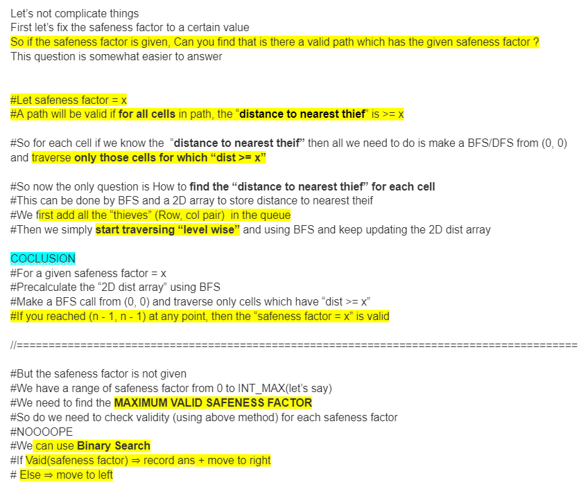

# Complete Explanation || Binary Search + BFS || Easy to understand

**Author:** MohakHarjani
**Votes:** 100
**Link:** [https://leetcode.com/problems/find-the-safest-path-in-a-grid/solutions/3869904/](https://leetcode.com/problems/find-the-safest-path-in-a-grid/solutions/3869904/)

---




```
class Solution {
public:
    vector<int>rowDir = {-1, 1, 0, 0};
    vector<int>colDir = {0, 0, -1, 1};
    bool isValid(vector<vector<bool>>&visited, int i, int j)
    {
        if (i < 0 || j < 0 || i == visited.size() || j == visited[0].size() || visited[i][j])
            return false;
        return true;
    }
    //============================================================================================================
    bool isSafe(vector<vector<int>>&distToTheif, int safeDist) //check the validity of safenessFactor
    {
        int n = distToTheif.size();
        queue<pair<int, int>>q;
        if (distToTheif[0][0] < safeDist) return false;
        q.push({0, 0});
        vector<vector<bool>>visited(n, vector<bool>(n, false));
        visited[0][0] = true;
        while(!q.empty())
        {
            int currRow = q.front().first, currCol = q.front().second;
            q.pop();
            if (currRow == n - 1 && currCol == n - 1) return true;
            for (int dirIdx = 0; dirIdx < 4; dirIdx++)
            {
                int newRow = currRow + rowDir[dirIdx];
                int newCol = currCol + colDir[dirIdx];
                if (isValid(visited, newRow, newCol))
                {
                    if (distToTheif[newRow][newCol] < safeDist) continue;
                    visited[newRow][newCol] = true;
                    q.push({newRow, newCol});
                }
            }
        }
        return false;
    }
    //===========================================================================================================
    int maximumSafenessFactor(vector<vector<int>>& grid) 
    {
        int n = grid.size();
        queue<pair<int, int>>q;
        vector<vector<bool>>visited(n, vector<bool>(n, false));
        vector<vector<int>>distToTheif(n, vector<int>(n, -1));
        //========================================================================
        //Add all the theives in current queue
        for (int i = 0; i < n; i++)
        {
            for (int j = 0; j < n; j++)
            {
                if (grid[i][j] == 1) 
                {
                    visited[i][j] = true;
                    q.push({i, j});
                }
            }
        }
        //=============================================================================
        //BFS to fill the "DistToTheif" 2D array
        int dist = 0;
        while(!q.empty())
        {
            int size = q.size();
            while(size--)
            {
                int currRow = q.front().first, currCol = q.front().second;
                q.pop();
                distToTheif[currRow][currCol] = dist;
                for (int dirIdx = 0; dirIdx < 4; dirIdx++)
                {
                    int newRow = currRow + rowDir[dirIdx], newCol = currCol + colDir[dirIdx];
                    if (!isValid(visited, newRow, newCol)) continue;
                    
                    visited[newRow][newCol] = true;
                    q.push({newRow, newCol});
                }
            }
            dist++;
        }
        //==================================================================================
        //BINARY SEARCH
        int low = 0, high = INT_MAX;
        int ans = 0;
        while(low <= high)
        {
            int mid = low + (high - low) / 2;
            if (isSafe(distToTheif, mid))
            {
                ans = mid;
                low = mid + 1;
            }
            else high = mid - 1;
        }
        //=========================================================================================
        return ans;
        
    }
};
```