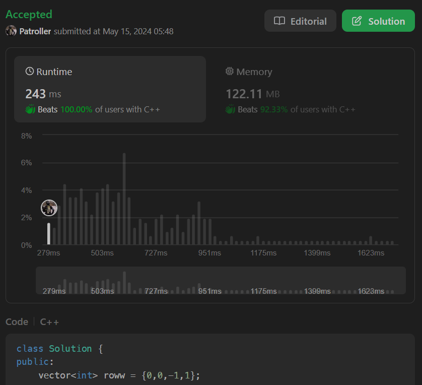

# Fastest (100%) || Easy to Understand || Clean & Concise

**Author:** gameboey
**Votes:** 236
**Link:** [https://leetcode.com/problems/find-the-safest-path-in-a-grid/solutions/5158873/](https://leetcode.com/problems/find-the-safest-path-in-a-grid/solutions/5158873/)

---



# Intuition
We precompute distances to thieves using BFS, then find the maximum safeness factor (minimum distance to any thief) along any path from `(0, 0)` to `(n - 1, n - 1)` using Dijkstra's algorithm with a priority queue.

# Approach: BFS + PQ + DIJKSTRA'S ALGO
Here's how the approach works:

1. **Precompute Distances**: We perform a BFS from all cells containing thieves to compute the minimum distance from each cell to the nearest thief. Store these distances in a separate 2D array `score`.

2. **Maximize 'Minimum' Distance**: Then, to find the maximum safeness factor (minimum distance to any thief) along a path from `(0, 0)` to `(n-1, n-1)`, model it as a shortest path problem with the objective of maximizing the minimum distance along the path.

3. **Dijkstra's Algorithm**: We then use Dijkstra's algorithm with a priority queue, where the priority is the safeness factor (minimum distance to any thief). We start from `(0, 0)` with its safeness factor `score[0][0]`.

4. **Priority Queue Traversal**: Then, at each step, we dequeue the cell with the maximum safeness factor. If it's `(n-1, n-1)`, we return the safeness factor. Otherwise, we enqueue its unvisited neighbors with the minimum of the current safeness factor and the neighbor's safeness factor `score[newX][newY]`.

5. **Pruning**: We use a separate 2D boolean array `vis` to mark visited cells and avoid revisiting them.

6. **Boundary Cases**: If `(0, 0)` or `(n-1, n-1)` contains a thief, return 0 as the maximum safeness factor, cuz we gotta start from `(0, 0)` and end at `(n - 1, n - 1)`.

The combination of BFS preprocessing, Dijkstra's algorithm with a priority queue, and proper handling of boundary cases and visited cells provides an efficient solution.


---


# Dry - Run:

Please give it a minute of reading, i have tried to make it as readable as possible:

Input: `grid = [[0, 0, 1], [0, 0, 0], [0, 0, 0]]`

First, we call the `bfs` function to compute the minimum distance from each cell to the nearest thief. This will initialize the `score` matrix with the minimum distances.

```
bfs(grid, score, 3)
```

Initial state:
```
grid:
 [0, 0, 1]
 [0, 0, 0]
 [0, 0, 0]

score (initialized to INT_MAX):
 [ INT_MAX, INT_MAX, INT_MAX ]
 [ INT_MAX, INT_MAX, INT_MAX ]
 [ INT_MAX, INT_MAX, INT_MAX ]
```

The BFS starts from the thief cell `(0, 2)`. It sets `score[0][2] = 0` and pushes `(0, 2)` into the queue.

```
queue: [(0, 2)]
score:
 [ INT_MAX, INT_MAX,       0 ]
 [ INT_MAX, INT_MAX, INT_MAX ]
 [ INT_MAX, INT_MAX, INT_MAX ]
```

It then processes the neighbors of `(0, 2)`, updating their scores and pushing them into the queue:

```
queue: [(0, 1), (1, 2)]
score:
 [ INT_MAX,       1,       0 ]
 [ INT_MAX, INT_MAX,       1 ]
 [ INT_MAX, INT_MAX, INT_MAX ]
```

Continuing the BFS:

```
queue: [(0, 0), (1, 1), (1, 2), (2, 2)]
score:
 [       2,       1,   0 ]
 [ INT_MAX,       2,   1 ]
 [ INT_MAX, INT_MAX,   2 ]
```

At the end of the BFS, the `score` matrix will be:

```
score:
 [ 2, 1, 0 ]
 [ 3, 2, 1 ]
 [ 4, 3, 2 ]
```


We initialize the priority queue with the starting cell `(0, 0)` and its score:    
`score[0][0] = 2`.

```
pq: [(2, (0, 0))]
```

We process the element with the highest safeness factor, which is `(0, 0)` with a safeness factor of 2.

```
pq: [(1, (0, 1)), (3, (1, 0))]
```

The next highest safeness factor is 3, so we process `(1, 0)`.

```
pq: [(1, (0, 1)), (2, (1, 1)), (4, (2, 0))]
```

The next highest safeness factor is 4, so we process `(2, 0)`.

```
pq: [(1, (0, 1)), (2, (1, 1)), (3, (2, 1)), (2, (2, 2))]
```

The next highest safeness factor is 3, so we process `(2, 1)`.

```
pq: [(1, (0, 1)), (2, (1, 1)), (2, (2, 2))]
```

Since there are two elements with a safeness factor of 2, we can process them in any order. Let's say we process `(2, 2)` first, which is our target cell.

```
pq: [(1, (0, 1)), (2, (1, 1))]
```

We have reached the target cell `(2, 2)` with a safeness factor of 2, so we return 2 as the maximum safeness factor.


---


# Complexity
- Time complexity: O(n^2 * log(n))

- Space complexity: O(n^2)

# Code
```C++ []
class Solution {
public:
    vector<int> roww = {0,0,-1,1};
    vector<int> coll = {-1,1,0,0};

    void bfs(vector<vector<int>>& grid,vector<vector<int>>& score,int n) {
        queue<pair<int, int>> q;

        for(int i = 0; i < n; i++) {
            for(int j = 0; j < n; j++){
                if(grid[i][j]) {
                    score[i][j] = 0;
                    q.push({i, j});
                }
            }
        }

        while(!q.empty()){
            auto t = q.front();
            q.pop();

            int x = t.first, y = t.second;
            int s = score[x][y];

            for(int i =0; i < 4; i++){
                int newX = x + roww[i];
                int newY = y + coll[i];

                if(newX >= 0 && newX < n && newY >= 0 && newY < n && score[newX][newY] > 1 + s) { 

                    score[newX][newY] = 1 + s;
                    q.push({newX, newY});
                }
            }
        }
    }

    int maximumSafenessFactor(vector<vector<int>>& grid) {
        ios_base::sync_with_stdio(false);cin.tie(nullptr);cout.tie(nullptr);
        int n = grid.size();
        if(grid[0][0] || grid[n - 1][n - 1]) return 0;

        vector<vector<int>> score(n,vector<int>(n,INT_MAX));
        bfs(grid, score, n);
        vector<vector<bool>> vis(n, vector<bool>(n, false));

        priority_queue<pair<int,pair<int,int>>> pq;
        pq.push({score[0][0], {0,0}});

        while(!pq.empty()){
            auto temp = pq.top().second;
            auto safe = pq.top().first;
            pq.pop();

            if(temp.first == n - 1 && temp.second == n - 1) return safe;
            vis[temp.first][temp.second] = true;

            for(int i = 0; i < 4; i++) {
                int newX = temp.first + roww[i];
                int newY = temp.second + coll[i];

                if(newX >= 0 && newX < n && newY >= 0 && newY < n && !vis[newX][newY]){
                    int s = min(safe, score[newX][newY]);
                    pq.push({s, {newX, newY}});
                    vis[newX][newY] = true;
                }
            }
        }

        return -1;
    }
};
```
```java []
class Solution {
    private int[] roww = {0, 0, -1, 1};
    private int[] coll = {-1, 1, 0, 0};
    private void bfs(List<List<Integer>> grid, int[][] score, int n) {
        Queue<int[]> q = new LinkedList<>();

        for (int i = 0; i < n; i++) {
            for (int j = 0; j < n; j++) {
                if (grid.get(i).get(j) == 1) {
                    score[i][j] = 0;
                    q.offer(new int[]{i, j});
                }
            }
        }

        while (!q.isEmpty()) {
            int[] t = q.poll();
            int x = t[0], y = t[1];
            int s = score[x][y];

            for (int i = 0; i < 4; i++) {
                int newX = x + roww[i];
                int newY = y + coll[i];

                if (newX >= 0 && newX < n && newY >= 0 && newY < n && score[newX][newY] > 1 + s) {
                    score[newX][newY] = 1 + s;
                    q.offer(new int[]{newX, newY});
                }
            }
        }
    }

    public int maximumSafenessFactor(List<List<Integer>> grid) {
        int n = grid.size();
        if (grid.get(0).get(0) == 1 || grid.get(n - 1).get(n - 1) == 1) {
            return 0;
        }

        int[][] score = new int[n][n];
        for (int[] row : score) Arrays.fill(row, Integer.MAX_VALUE);
        bfs(grid, score, n);

        boolean[][] vis = new boolean[n][n];
        PriorityQueue<int[]> pq = new PriorityQueue<>((a, b) -> b[0] - a[0]);
        pq.offer(new int[]{score[0][0], 0, 0});

        while (!pq.isEmpty()) {
            int[] temp = pq.poll();
            int safe = temp[0];
            int i = temp[1], j = temp[2];

            if (i == n - 1 && j == n - 1) return safe;
            vis[i][j] = true;

            for (int k = 0; k < 4; k++) {
                int newX = i + roww[k];
                int newY = j + coll[k];

                if (newX >= 0 && newX < n && newY >= 0 && newY < n && !vis[newX][newY]) {
                    int s = Math.min(safe, score[newX][newY]);
                    pq.offer(new int[]{s, newX, newY});
                    vis[newX][newY] = true;
                }
            }
        }

        return -1;
    }
}
```
```python []
class Solution:
    def __init__(self):
        self.roww = [0, 0, -1, 1]
        self.coll = [-1, 1, 0, 0]

    def bfs(self, grid, score, n):
        q = deque()

        for i in range(n):
            for j in range(n):
                if grid[i][j]:
                    score[i][j] = 0
                    q.append((i, j))

        while q:
            x, y = q.popleft()
            s = score[x][y]

            for i in range(4):
                new_x = x + self.roww[i]
                new_y = y + self.coll[i]

                if 0 <= new_x < n and 0 <= new_y < n and score[new_x][new_y] > s + 1:
                    score[new_x][new_y] = s + 1
                    q.append((new_x, new_y))

    def maximumSafenessFactor(self, grid):
        n = len(grid)
        if grid[0][0] or grid[n - 1][n - 1]:
            return 0

        score = [[float('inf')] * n for _ in range(n)]
        self.bfs(grid, score, n)

        vis = [[False] * n for _ in range(n)]
        pq = [(-score[0][0], 0, 0)]
        heapq.heapify(pq)

        while pq:
            safe, x, y = heapq.heappop(pq)
            safe = -safe

            if x == n - 1 and y == n - 1:
                return safe

            vis[x][y] = True

            for i in range(4):
                new_x = x + self.roww[i]
                new_y = y + self.coll[i]

                if 0 <= new_x < n and 0 <= new_y < n and not vis[new_x][new_y]:
                    s = min(safe, score[new_x][new_y])
                    heapq.heappush(pq, (-s, new_x, new_y))
                    vis[new_x][new_y] = True

        return -1
```

---

### Luffy: Zoro, let's just sprint through this grid!
### Zoro: What if we run into trouble?
### Luffy: We'll just blame it on the thieves and keep running!.


