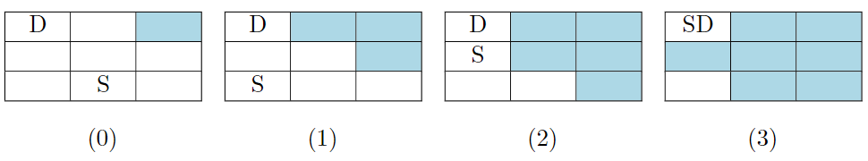
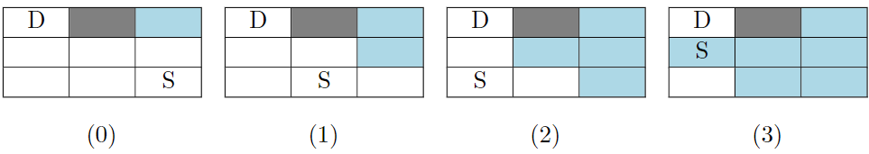

# [2814. Minimum Time Takes to Reach Destination Without Drowning](https://leetcode.com/problems/minimum-time-takes-to-reach-destination-without-drowning/)

| Category | Difficulty | Likes | Dislikes |
| :------: | :--------: | :---: | :------: |
| Algorithms | Hard | 25 | 2 |

**Tags:** [`array`](https://leetcode.com/tag/array), [`breadth-first-search`](https://leetcode.com/tag/breadth-first-search), [`matrix`](https://leetcode.com/tag/matrix)

**Companies:** `wix`

## Description

You are given an `n * m` **0-indexed** grid of string `land`. Right now, you are standing at the cell that contains `"S"`, and you want to get to the cell containing `"D"`. There are three other types of cells in this land:

	- `"."`: These cells are empty.

	- `"X"`: These cells are stone.

	- `"*"`: These cells are flooded.

At each second, you can move to a cell that shares a side with your current cell (if it exists). Also, at each second, every **empty cell** that shares a side with a flooded cell becomes flooded as well.

There are two problems ahead of your journey:

	- You can't step on stone cells.

	- You can't step on flooded cells since you will drown (also, you can't step on a cell that will be flooded at the same time as you step on it).

Return* the **minimum** time it takes you to reach the destination in seconds, or *`-1`* if it is impossible.*

**Note** that the destination will never be flooded.

 

**Example 1:**

```

Input: land = [[&quot;D&quot;,&quot;.&quot;,&quot;*&quot;],[&quot;.&quot;,&quot;.&quot;,&quot;.&quot;],[&quot;.&quot;,&quot;S&quot;,&quot;.&quot;]]
Output: 3
Explanation: The picture below shows the simulation of the land second by second. The blue cells are flooded, and the gray cells are stone.
Picture (0) shows the initial state and picture (3) shows the final state when we reach destination. As you see, it takes us 3 second to reach destination and the answer would be 3.
It can be shown that 3 is the minimum time needed to reach from S to D.

```



**Example 2:**

```

Input: land = [[&quot;D&quot;,&quot;X&quot;,&quot;*&quot;],[&quot;.&quot;,&quot;.&quot;,&quot;.&quot;],[&quot;.&quot;,&quot;.&quot;,&quot;S&quot;]]
Output: -1
Explanation: The picture below shows the simulation of the land second by second. The blue cells are flooded, and the gray cells are stone.
Picture (0) shows the initial state. As you see, no matter which paths we choose, we will drown at the 3rd&nbsp;second. Also the minimum path takes us 4 seconds to reach from S to D.
So the answer would be -1.

```



**Example 3:**

```

Input: land = [[&quot;D&quot;,&quot;.&quot;,&quot;.&quot;,&quot;.&quot;,&quot;*&quot;,&quot;.&quot;],[&quot;.&quot;,&quot;X&quot;,&quot;.&quot;,&quot;X&quot;,&quot;.&quot;,&quot;.&quot;],[&quot;.&quot;,&quot;.&quot;,&quot;.&quot;,&quot;.&quot;,&quot;S&quot;,&quot;.&quot;]]
Output: 6
Explanation: It can be shown that we can reach destination in 6 seconds. Also it can be shown that 6 is the minimum seconds one need to reach from S to D.

```

 

**Constraints:**

	- `2 <= n, m <= 100`

	- `land` consists only of `"S"`, `"D"`, `"."`, `"*"` and `"X"`.

	- **Exactly** one of the cells is equal to `"S"`.

	- **Exactly** one of the cells is equal to `"D"`.

---

**Links:** [Submissions](https://leetcode.com/problems/minimum-time-takes-to-reach-destination-without-drowning/) | [Solutions](https://leetcode.com/problems/minimum-time-takes-to-reach-destination-without-drowning/)
