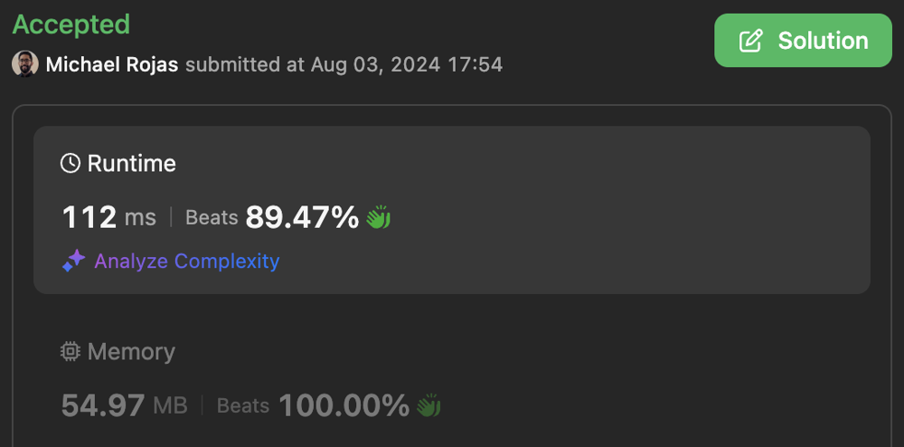
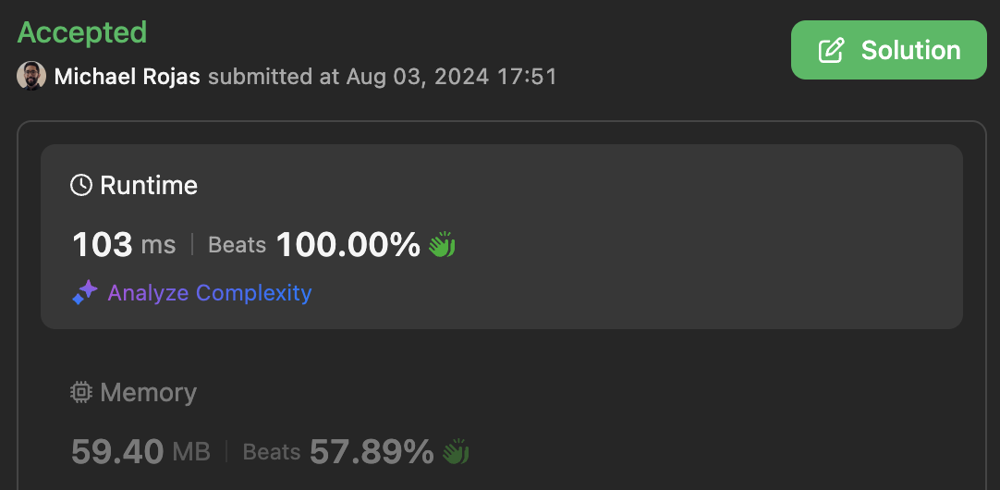
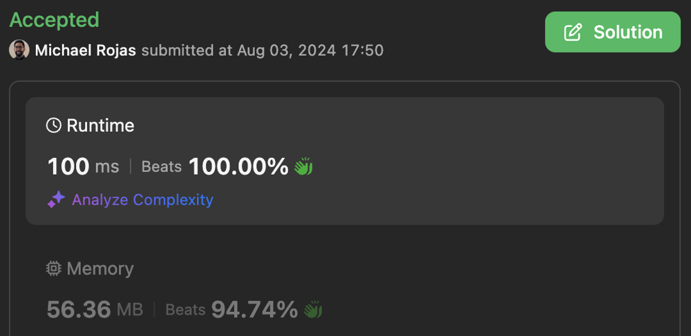
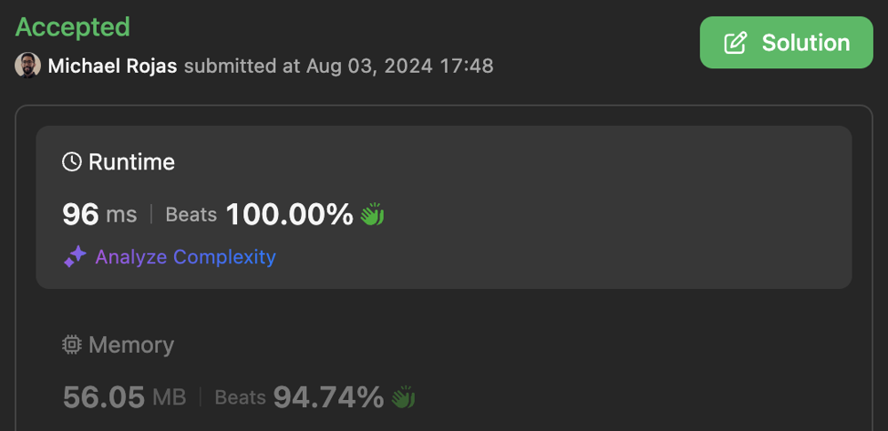

# 100% | 4 Solutions | From O(N^2) to O(N)

**Author:** rojas
**Votes:** 5
**Link:** [https://leetcode.com/problems/max-pair-sum-in-an-array/solutions/4173131/](https://leetcode.com/problems/max-pair-sum-in-an-array/solutions/4173131/)

---

# Table of Contents

[toc]

# Code 1 - Brute Force

[Submission](https://leetcode.com/problems/max-pair-sum-in-an-array/submissions/1343569182/)



- Time complexity: $O(N^2)$

- Space complexity: $O(1)$

```Typescript []
function maxSum(nums: number[]): number {
    const N = nums.length;

    let max = -1;
    for (let i = 0; i < N; ++i) {
        const maxDigit = getMaxDigit(nums[i]);
        for (let j = 0; j < i; ++j) {
            if (maxDigit == getMaxDigit(nums[j])) {
                max = Math.max(max, nums[i] + nums[j]);
            }
        }
    }

    return max;
};

function getMaxDigit(n: number): number {
    let max = 0;
    while (n > 0) {
        const mod = n % 10;
        max = Math.max(max, mod);
        n = (n - mod)/10;
    }
    return max;
}
```

```Javascript []
/**
 * @param {number[]} nums
 * @return {number}
 */
function maxSum(nums) {
    const N = nums.length;

    let max = -1;
    for (let i = 0; i < N; ++i) {
        const maxDigit = getMaxDigit(nums[i]);
        for (let j = 0; j < i; ++j) {
            if (maxDigit == getMaxDigit(nums[j])) {
                max = Math.max(max, nums[i] + nums[j]);
            }
        }
    }

    return max;
};

function getMaxDigit(n) {
    let max = 0;
    while (n > 0) {
        const mod = n % 10;
        max = Math.max(max, mod);
        n = (n - mod)/10;
    }
    return max;
}
```

# Code 2 - Array.sort

[Submission](https://leetcode.com/problems/max-pair-sum-in-an-array/submissions/1343567945/)



- Time complexity: $O(N\\log{N})$

- Space complexity: $O(N)$

```Typescript []
function maxSum(nums: number[]): number {
    const N = nums.length;

    const arr: number[][] = [];
    for (let i = 0; i < N; ++i) {
        arr.push([nums[i], getMaxDigit(nums[i])]);
    }

    arr.sort((a, b) => (a[1] - b[1]) || (a[0] - b[0]));

    let max = -1;
    for (let i = 1; i < N; ++i) {
        if (arr[i-1][1] === arr[i][1]) {
            max = Math.max(max, arr[i-1][0] + arr[i][0]);
        }
    }

    return max;
};

function getMaxDigit(n: number): number {
    let max = 0;
    while (n > 0) {
        const mod = n % 10;
        max = Math.max(max, mod);
        n = (n - mod)/10;
    }
    return max;
}
```

```Javascript []
/**
 * @param {number[]} nums
 * @return {number}
 */
function maxSum(nums) {
    const N = nums.length;

    const arr = [];
    for (let i = 0; i < N; ++i) {
        arr.push([nums[i], getMaxDigit(nums[i])]);
    }

    arr.sort((a, b) => (a[1] - b[1]) || (a[0] - b[0]));

    let max = -1;
    for (let i = 1; i < N; ++i) {
        if (arr[i-1][1] === arr[i][1]) {
            max = Math.max(max, arr[i-1][0] + arr[i][0]);
        }
    }

    return max;
};

function getMaxDigit(n) {
    let max = 0;
    while (n > 0) {
        const mod = n % 10;
        max = Math.max(max, mod);
        n = (n - mod)/10;
    }
    return max;
}
```

# Code 3 - Set

[Submission](https://leetcode.com/problems/max-pair-sum-in-an-array/submissions/1343567196/)



- Time complexity: $O(N)$

- Space complexity: $O(1)$

```Typescript []
function maxSum(nums: number[]): number {
    const map = new Map<number, number>();

    let max = -1;
    for (const num of nums) {
        const maxDigit = getMaxDigit(num);
        const pair = map.get(maxDigit);
        if (pair == null) {
            map.set(maxDigit, num);
        } else {
            max = Math.max(max, num + pair);
            map.set(maxDigit, Math.max(num, pair));
        }
    }

    return max;
};

function getMaxDigit(n: number): number {
    let max = 0;
    while (n > 0) {
        const mod = n % 10;
        max = Math.max(max, mod);
        n = (n - mod)/10;
    }
    return max;
}
```

```Javascript []
/**
 * @param {number[]} nums
 * @return {number}
 */
function maxSum(nums) {
    const map = new Map();

    let max = -1;
    for (const num of nums) {
        const maxDigit = getMaxDigit(num);
        const pair = map.get(maxDigit);
        if (pair == null) {
            map.set(maxDigit, num);
        } else {
            max = Math.max(max, num + pair);
            map.set(maxDigit, Math.max(num, pair));
        }
    }

    return max;
};

function getMaxDigit(n) {
    let max = 0;
    while (n > 0) {
        const mod = n % 10;
        max = Math.max(max, mod);
        n = (n - mod)/10;
    }
    return max;
}
```

# Code 4 - Array

[Submission](https://leetcode.com/problems/max-pair-sum-in-an-array/submissions/1343566338/)



- Time complexity: $O(N)$

- Space complexity: $O(1)$

```Typescript []
function maxSum(nums: number[]): number {
    const maxes = new Array(10).fill(-Infinity);

    let max = -1;
    for (const num of nums) {
        const maxDigit = getMaxDigit(num);
        max = Math.max(max, num + maxes[maxDigit]);
        maxes[maxDigit] = Math.max(num, maxes[maxDigit]);
    }

    return max;
};

function getMaxDigit(n: number): number {
    let max = 0;
    while (n > 0) {
        const mod = n % 10;
        max = Math.max(max, mod);
        n = (n - mod)/10;
    }
    return max;
}
```

```Javascript []
function maxSum(nums) {
    const maxes = new Array(10).fill(-Infinity);

    let max = -1;
    for (const num of nums) {
        const maxDigit = getMaxDigit(num);
        max = Math.max(max, num + maxes[maxDigit]);
        maxes[maxDigit] = Math.max(num, maxes[maxDigit]);
    }

    return max;
};

function getMaxDigit(n) {
    let max = 0;
    while (n > 0) {
        const mod = n % 10;
        max = Math.max(max, mod);
        n = (n - mod)/10;
    }
    return max;
}
```