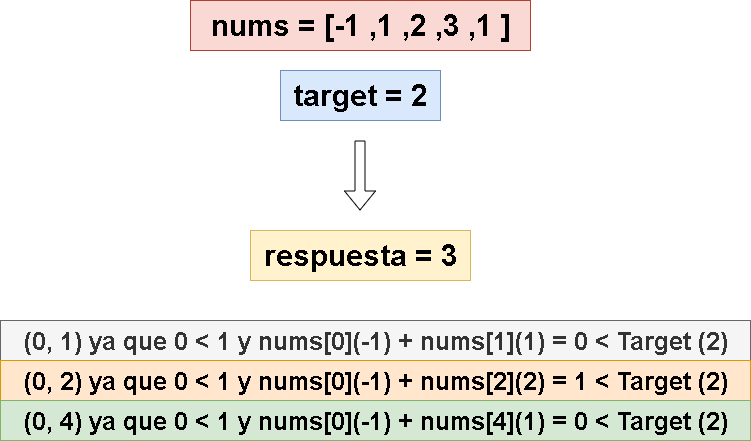
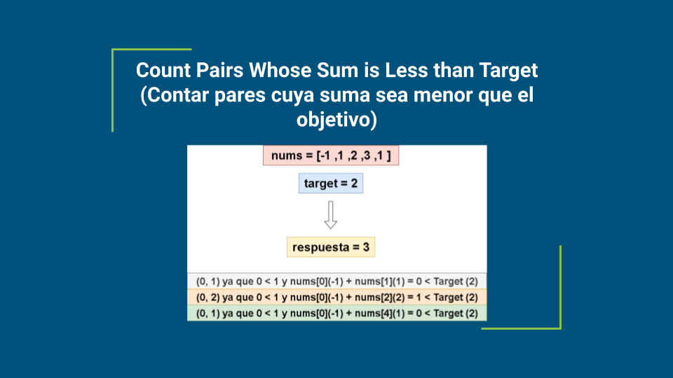
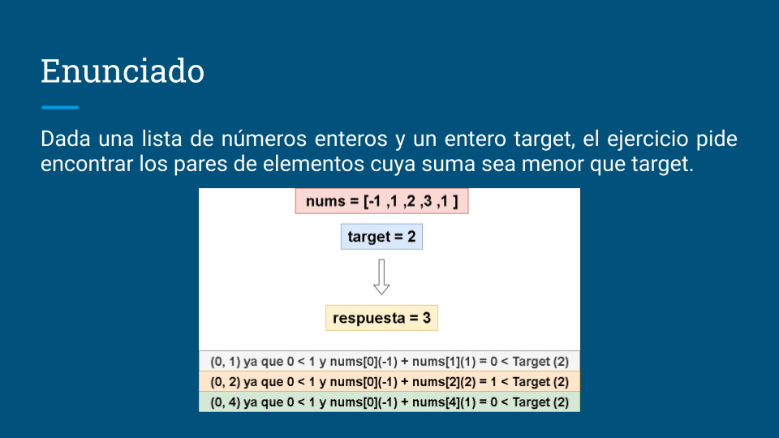
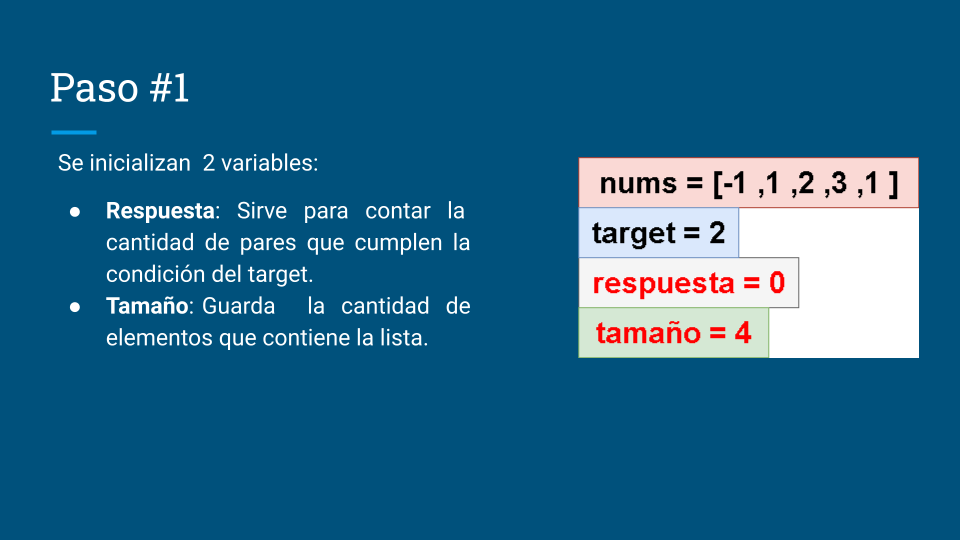
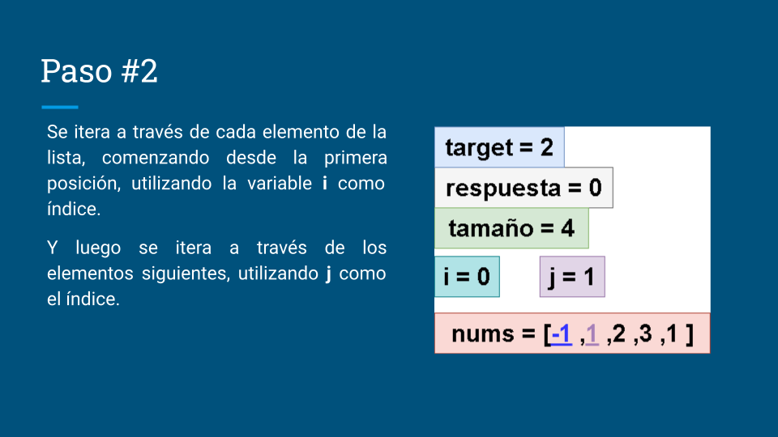
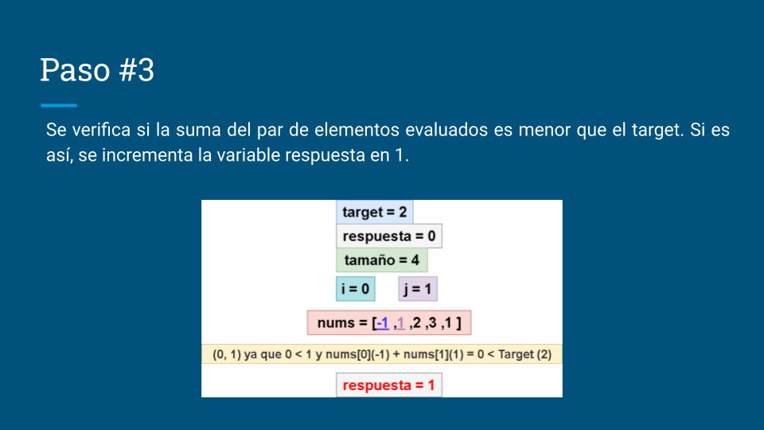
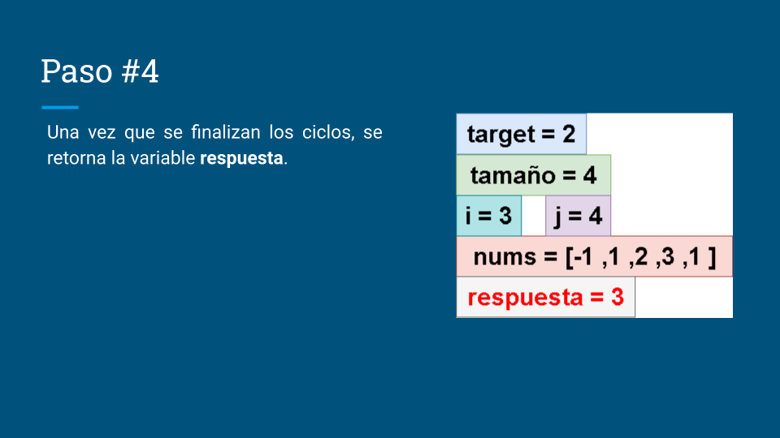

# 🔥🔥 Explicación y Resolución Del Ejercicio En Español Java | Python | PHP | JavaScript | C++  🔥🔥

**Author:** hermescoder02
**Votes:** 5
**Link:** [https://leetcode.com/problems/count-pairs-whose-sum-is-less-than-target/solutions/4902663/](https://leetcode.com/problems/count-pairs-whose-sum-is-less-than-target/solutions/4902663/)

---

# Lectura

*Contar pares cuya suma sea menor que el objetivo (Java, Python, PHP, C++, Javascript)*

Dada una lista de n\xFAmeros enteros y un entero target, el ejercicio pide encontrar los pares de elementos cuya suma sea menor que target.


# Video

https://youtu.be/2xDIOvCFO1w

Si te gust\xF3 el contenido \xA1te invito a suscribirte!: 
\u2705https://www.youtube.com/@hermescoder?sub_confirmation=1

# Pasos para realizar el algoritmo:

**1.-** Se inicializan  2 variables:
- **Respuesta:** Sirve para contar la cantidad de pares que cumplen la condici\xF3n del target.
- **Tama\xF1o:**	Guarda  la cantidad de elementos que contiene la lista.

**2.-** Se itera a trav\xE9s de cada elemento de la lista, comenzando desde la primera posici\xF3n, utilizando la variable **i** como \xEDndice. 
Y luego se itera a trav\xE9s de los elementos siguientes, utilizando **j** como el \xEDndice.

**3.-** Se verifica si la suma del par de elementos evaluados es menor que el **target**. Si es as\xED, se incrementa la variable **respuesta** en 1.

**4.-** Una vez que se finalizan los ciclos, se retorna la variable **respuesta**.

# C\xF3digo 

```Java []
class Solution {
    public int countPairs(List<Integer> nums, int target) {
        //paso#1
        int respuesta = 0;
        int tamano = nums.size();

        //paso#2
        for (int i = 0; i < tamano ; i++) {
            for (int j = i + 1; j < tamano; j++) {
                //paso#3
                if (nums.get(i) + nums.get(j) < target) 
                    respuesta++;
            }
        }

        //paso#4
        return respuesta;
    }
}
```

```PHP []
class Solution {
    function countPairs($nums, $target) {
        //paso#1
        $respuesta = 0;
        $tamano = count($nums);

        //paso#2
        for ($i = 0; $i < $tamano; $i++) {
            for ($j = $i + 1; $j < $tamano; $j++) {
                //paso#3
                if ($nums[$i] + $nums[$j] < $target) {
                    $respuesta++;
                }
            }
        }

        //paso#4
        return $respuesta;
    }
}
```

```Python []
class Solution(object):
    def countPairs(self, nums, target):
        # Paso #1
        respuesta = 0
        tamano = len(nums)

        # Paso #2
        for i in range(tamano):
            for j in range(i + 1, tamano):
                # Paso #3
                if nums[i] + nums[j] < target:
                    respuesta += 1

        # Paso #4
        return respuesta
```
```JavaScript []
var countPairs = function(nums, target) {
    //paso#1
  let respuesta = 0;
  const tamano = nums.length;

  //paso#2
  for (let i = 0; i < tamano; i++) {
    for (let j = i + 1; j < tamano; j++) {
      //paso#3
      if (nums[i] + nums[j] < target) {
        respuesta++;
      }
    }
  }

  //paso#4
  return respuesta;
};
```

```C++ []
class Solution {
public:
    int countPairs(vector<int>& nums, int target) {
        // Paso #1
        int respuesta = 0;
        int tamano = nums.size();

        // Paso #2
        for (int i = 0; i < tamano; ++i) {
            for (int j = i + 1; j < tamano; ++j) {
                // Paso #3
                if (nums[i] + nums[j] < target) {
                    respuesta++;
                }
            }
        }
        // Paso #4
        return respuesta;
    }
};
```


# Imagenes de la Explicaci\xF3n 
 














# Mas ejercicios de leetcode en espa\xF1ol \uD83D\uDE42

- [Length of Last Word (longitud de la \xFAltima palabra)
](https://leetcode.com/problems/length-of-last-word/solutions/4885539/explicacion-y-resolucion-del-ejercicio-en-espanol-java-python-php-javascript/)

- [Integer To Roman (Entero a romano)
](https://leetcode.com/problems/integer-to-roman/solutions/4872642/explicacion-y-resolucion-del-ejercicio-en-espanol-java-python-php-javascript-c/)

- [Median of two sorted arrays (Mediana de dos arrays ordenadas)
](https://leetcode.com/problems/median-of-two-sorted-arrays/solutions/4843610/explicacion-y-resolucion-del-ejercicio-en-espanol-java-python-php-javascript-c/)


- [Container with most water (Recipiente con m\xE1s agua)
](https://leetcode.com/problems/container-with-most-water/solutions/4797655/explicacion-y-resolucion-del-ejercicio-en-espanol-java-python-php-javascript-c/)

- [Linked list cycle II (Ciclo de una lista enlazada II)
](https://leetcode.com/problems/linked-list-cycle-ii/solutions/4757653/explicacion-y-resolucion-del-ejercicio-en-espanol-java-python-php-javascript-c/)
