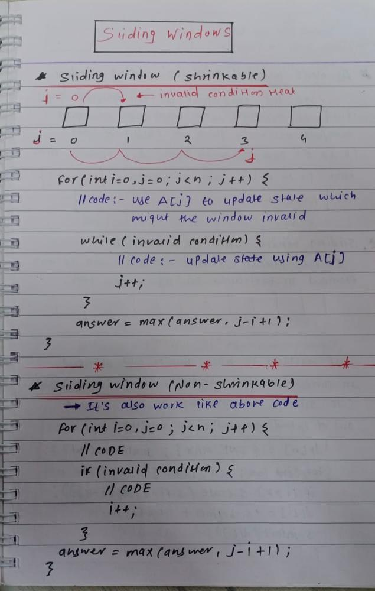
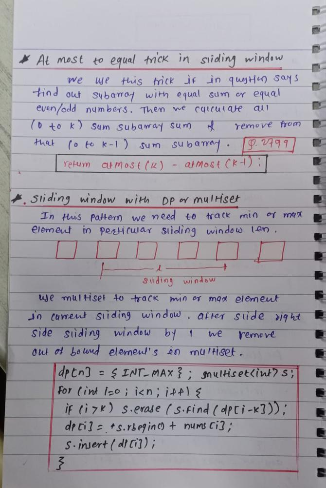

# ✅ CPP | Sliding Window Solution | With Explanation & Notes

**Author:** rushi_mungse
**Votes:** 29
**Link:** [https://leetcode.com/problems/find-the-longest-equal-subarray/solutions/3933994/](https://leetcode.com/problems/find-the-longest-equal-subarray/solutions/3933994/)

---


##### NOTES : 





##### Time Complexity : O(N)

##### Q&A
> Q : What if after moving left pointer, the current most element frequency decreases?
> A : Nothing happen: most don't change, sliding window size don't change. until we have bigger most. (@lee215)

```
class Solution {
public:
    int longestEqualSubarray(vector<int>& nums, int k) {
        int ans = 0, n = nums.size();
        // Keep track maximum freq element because we maximize our ans 
        unordered_map<int, int> freq;
        
        for(int i = 0, j = 0, most = 0; i < n; i++) {
            most = max(most, ++freq[nums[i]]);
            // checking invalid case
            while(i - j - most >= k) {
                // We remove jth element from current window that's why we decrement freq[nums[j]]
                --freq[nums[j]];
                j++;
            }
            // maximize ans
            ans = max(ans, most);
        }
        return ans;
    }
};
```
> Thanks for upvoting! Have a good day ^_^