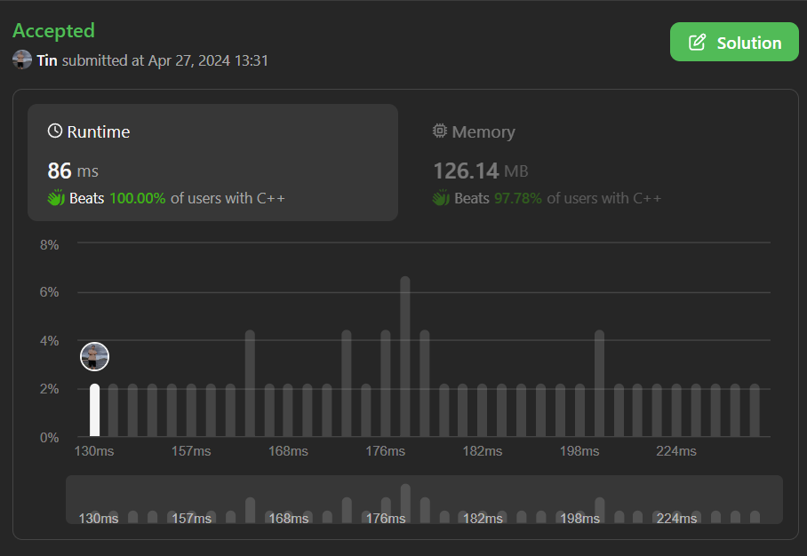

# MOST OPTIMIZED C++ CODE || BEAT 100% || BEGINNER FRIENDLY

**Author:** tin_le
**Votes:** 1
**Link:** [https://leetcode.com/problems/maximal-range-that-each-element-is-maximum-in-it/solutions/5081257/](https://leetcode.com/problems/maximal-range-that-each-element-is-maximum-in-it/solutions/5081257/)

---

# Intuition
<!-- Describe your first thoughts on how to solve this problem. -->

# Approach
<!-- Describe your approach to solving the problem. -->

# Complexity
- Time complexity:
<!-- Add your time complexity here, e.g. $$O(n)$$ -->O(n)

- Space complexity:
<!-- Add your space complexity here, e.g. $$O(n)$$ -->O(n)
image.png

# Code
```
class Solution {
public:
    vector<int> maximumLengthOfRanges(vector<int>& nums) {
        ios_base::sync_with_stdio(false);
        cin.tie(nullptr);
        cout.tie(nullptr);
        stack<int> list;
        int n = nums.size();
        vector<int> res(n);
        for(int i = 0; i <= n; i++)
        {
            while(!list.empty() && (i == n || nums[list.top()] < nums[i]))
            {
                int index = list.top();
                list.pop();
                if(list.empty()) res[index] = i;
                else res[index] = i - list.top() - 1;
            }
            list.push(i);
        }
        return res;
    }
};
```