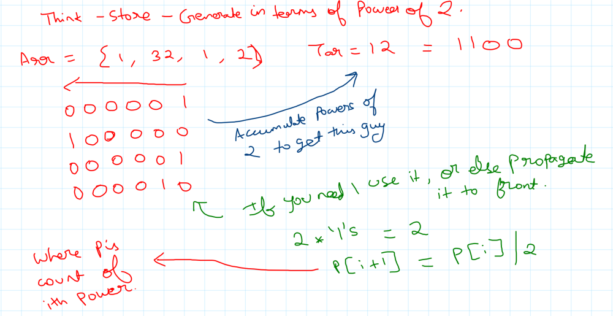
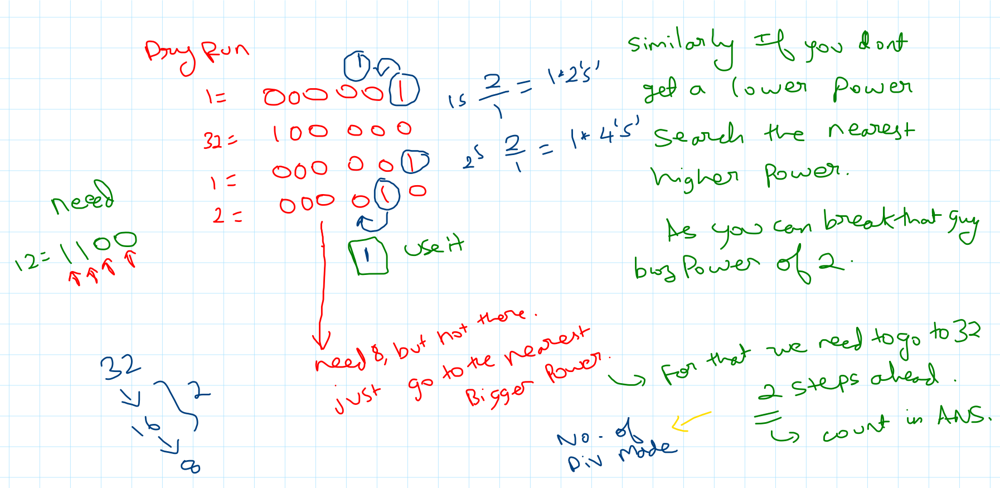
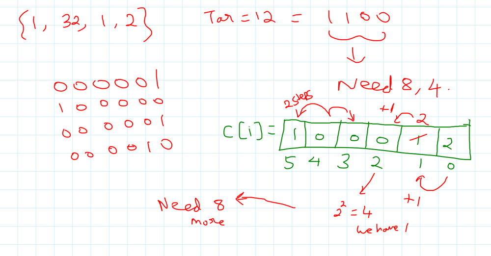

# Handwritten | Think - Store - Calc in Pow of 2 | Greedy

**Author:** bala_000
**Votes:** 86
**Link:** [https://leetcode.com/problems/minimum-operations-to-form-subsequence-with-target-sum/solutions/3965229/](https://leetcode.com/problems/minimum-operations-to-form-subsequence-with-target-sum/solutions/3965229/)

---

# Intuition
<!-- Describe your first thoughts on how to solve this problem. -->
- Looking at problem stating "Powers of 2" - started to think in direction of Powers of 2 and bit operations.
- Basically ***can we form target or not?***:
    - SUM of all <  Target : NO (return -1) As no matter what u divide, u cannot make it
    - SUM of all >= Target : YES
    - Bcoz u can simply divide continuously and make it all 1's.
    - How? Say 32 - 16 + 16, then again 8+8 8+8, ... atlast 32 * 1's. 
    - From all those ones, simply form ur target
- But here we need **MIN Operations = MIN DIVISIONS.**
- When we don't need lower powers, just propagate them to higer powers.
- As we need a summation of all those in future for a higer power.
- Eg: 2 * 1 's = 1 * 2's
- Say you have 5 * 2's, take 2* 4's, keep 1 two as such.
- THAT IS WHAT WE DO IN **c[i+1] = c[i] / 2;** c[i] means count of ith power in overall numbers.
- Now Important part, When you don't find a power of i, what to do?
- Say you cannot find 8, then move ahead in search of NEAREST HIGHER POWER that is there.
- Say u found 32, 32 = 16 + 16 , 16 = 8 + 8. Here u need to move a distance of 2. So those many divisions u need to make. 
- **The front propagation is FREE, but back is costing you 1 divison = 1 operation = 1 distance.**
- Finally Arr[] = [1, 32, 1, 2], Target = 12:
    - 12 = 4 + 8 , So Need 4, 8. 
    - 4 you get from 2 + 1 + 1. (Free)
    - 8 you get from dividing 2 times 32. (Costed u 2)
    - ANS : 2 
    

# Approach

#### Store the count of ith Power in c[i]
*In the image used p[i] instead of c[i]*




*Code based*



# Code
```
class Solution {
public:
    int minOperations(vector<int>& nums, int m) {
        vector<int> c(31, 0);
        long long s = 0;
        int n = nums.size();

        for (int i = 0; i < n; ++i) {
            int x = nums[i];
            c[int(log2(x))]++;
            s += x;
        }

        if (s < m) {
            return -1;
        }

        int i = 0, res = 0;
        while (i < 30) {
            if ((1 << i) & m) {
                if (c[i] > 0) {
                    c[i]--;
                } else {
                    while (i < 30 && c[i] == 0) {
                        i++;
                        res++;
                    }
                    c[i]--;
                    continue;
                }
            }
            c[i + 1] += c[i] / 2;
            i++;
        }
        
        return res;
    }
};
```

### FAQ:
#### Edit 1 : (Based on a question on comments)
##### why are we not accumulating the count when we are dividing a large number to smaller and then that count may be used on forward part?
The point is from org i to new i all guys are incremented by 1, when we break the next greatest power.

*Eg: We need 8, but we have 64
Then 64 = 32 + 32, take 1 32
32 = 16 + 16, take 1 16
16 = 8 + 8*

So we have one - 32, 16 still, and 2 * 8s

But as we accumulate TARGET in powers of 2 (Bin format), we need only **one occurance of 1 particular power.**

**So hence, by moving and breaking the next highest power, we kind of generate all powers of 2 in between. So, if we need we have it ready, so better no need to check and we skip those in between i's.**

*Eg: For 8, when we broke 64, we now don't need to check for 32, 16. Why? Bcoz if we are in need of those then we have it. So better start checking from 128.*

#### To make it even more simple:
*Here we simply increment the counter for those inbetween powers. Eg: For 8, 64 was broken, then 16, 32 counters are also incremented by one.*
```
while (i < 30) {
    if ((1 << i) & m) {
        cout<<(1 << i)<<"\
";
        if (c[i] > 0) {
            c[i]--;
        } else {
            int j = i;
            while (j < 30 && c[j] == 0) {
                j++;
                res++;
            }
            c[j]--;
            j--;
            //addition of count for in between powers
            while(j>i){
                c[j]++;
                j--;
            }
            
        }
    }
    c[i + 1] += c[i] / 2;
    i++;
}
```

### Guys, if found useful & learnt something, just tap that upvote. As it helps others to map the soln at top and motivates me a lot to do more.

**Linkedin post:** [Click here](https://www.linkedin.com/posts/balakrishnan-r-906404184_leetcode-leetcode2023-weeklychallenge-activity-7101428892434923520-CZoi?utm_source=share&utm_medium=member_desktop)