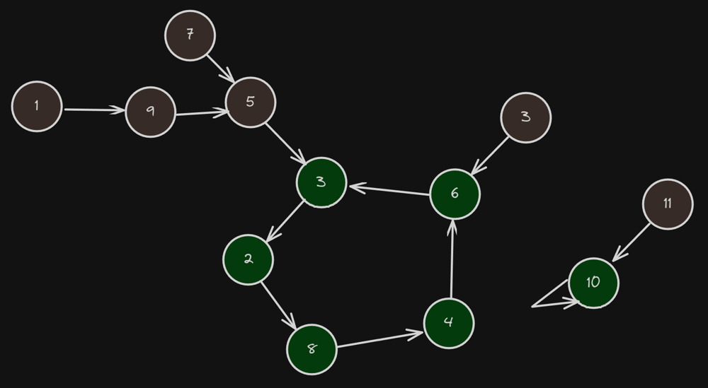
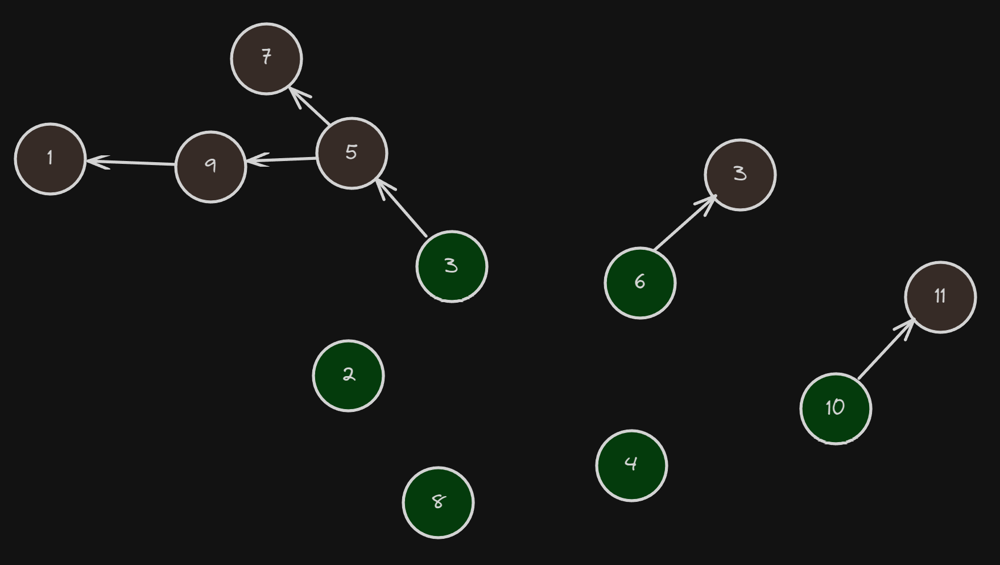

# JavaScript DFS O(n)

**Author:** ektegjetost
**Votes:** 2
**Link:** [https://leetcode.com/problems/maximize-value-of-function-in-a-ball-passing-game/solutions/3968731/](https://leetcode.com/problems/maximize-value-of-function-in-a-ball-passing-game/solutions/3968731/)

---

# Intuition
We got ourselves a directed, possibly disconnected graph where each component ultimately ends in a cycle


We want to find
- The nodes in each cycle
- The starting position of each node in each cycle
- The sum of nodes in each cycle (prefixSum)

If we have these three things, then we can easily calculate the score for a cycle even with a very large ```k```, because we can calculate ```fullCycleScore * floor(k / cycleLength) + scoreOfAdditionalDistanceThroughCycle```

To calculate the score from one of the nodes outside of a cycle, let's flip the graph and remove the edges within each cycle (we don't need them anymore)




- Since we know which cycle each green node is apart of, and we know where it starts in the cycle, we can backtrack from each green node to the outer nodes, calculating a prefixSum along the way.
- Each outer node then knows how far it is from a cycle based on the length of the prefixSum, and we can calculate the score for that node based on a combination of the prefixSum we're building + the same logic for calculating how far into a cycle we would go from that node.
- Since each green node is now the root of a tree, we can safely calculate the score for all nodes in ```O(n)```


# Approach
Create some state:
1. An array ```inCycle``` which holds 4 types of values for each node:
  a. -3 - we haven't seen the node yet
  b. -2 - we've seen the node, we don't know if it's in a cycle yet
  b. -1 - we know it's not in a cycle
  c. >= 0 - the cycle it's in
2. An array ```cycles``` which is the prefixSum for each cycle
3. An array ```cyclePositions``` which is the starting position for a node in whichever cycle it's apart of

Then DFS from each node - ```findCycle```
1. If we've seen the node and we know whether it's in a cycle, return early
2. If we've seen the node and we don't know if it's in a cycle, then it's the root of the cycle, return it
3. If ```findCycle``` returns a cycle root and it's not the current node, add the node to the cycle and return the cycle root
3. If ```findCycle``` returns a cycle root and it's the current node, we've uncovered the entire cycle. Reverse the cycle (since we've been pushing nodes into it, it's now backwards), turn it into a prefix sum and set the starting position for each node. Now return ```-1``` since the rest of the nodes are not in the cycle

Now we're ready for one more DFS to calculate the score of each node
- Build an adjacency list using ```receiver```, but now the relationship between ```i``` and ```receiver[i]``` is reversed.
- Loop through each node, if the node is in a cycle, calculate its score and backtrack through its tree of outer nodes, calculating the score from each node

# Complexity
- Time complexity:
$$O(n)$$

- Space complexity:
$$O(n)$$

# Code
```
/**
 * @param {number[]} receiver
 * @param {number} k
 * @return {number}
 */
const State = {
  NotVisited: -3,
  Visited: -2,
  NotInCycle: -1,
}

var getMaxFunctionValue = function(receiver, k) {
  const inCycle = receiver.map(() => State.NotVisited);
  const cycles = receiver.map(() => []);
  const cyclePositions = receiver.map(() => -1);

  const findCycle = (thrower) => {
    // we've already figured out if this node is in a cycle
    // so whoever called this definitely isn't
    if (inCycle[thrower] > State.Visited) return State.NotInCycle;
    // we found the root of the cycle, return it
    if (inCycle[thrower] === State.Visited) return thrower;
    inCycle[thrower] = State.Visited;

    inCycle[thrower] = findCycle(receiver[thrower]);

    if (inCycle[thrower] === State.NotInCycle) return State.NotInCycle;

    // we're in a cycle
    const cycle = cycles[inCycle[thrower]];
    cycle.push(thrower);

    if (inCycle[thrower] === thrower) {
      cycle.reverse();
      for (let i = 0; i < cycle.length; i += 1) {
        cyclePositions[cycle[i]] = i;
        cycle[i] += (cycle[i - 1] ?? 0);
      }
      // this node is the cycle root, so everyone else
      // from here on out is not
      return State.NotInCycle;
    }
    
    return inCycle[thrower];
  }

  for (let i = 0; i < receiver.length; i += 1) findCycle(i);

  const adjList = receiver.reduce((adjList, to, from) => {
    if (inCycle[from] < 0) adjList[to].push(from);
    return adjList;
  }, receiver.map(() => []))

  // i'm sure there's a simpler way to do this, oh well
  const calc = (cycle, start, count) => {
    const fullCycles = cycle.at(-1) * Math.floor(count / cycle.length);
    const extra = count % cycle.length;
    const untilEnd = Math.min(extra, cycle.length - start)
    const extraAfter = untilEnd > 0 ? cycle[start + untilEnd - 1] - (cycle[start - 1] ?? 0) : 0;
    const fromBeginning = extra - untilEnd;
    const extraBefore = fromBeginning > 0 ? cycle[fromBeginning - 1] : 0;

    return fullCycles + extraAfter + extraBefore;
  }

  let maxScore = 0;

  const getMaxScore = (thrower, scores, cycle, start) => {
    scores.push(scores.at(-1) + thrower || thrower);
    const count = k + 1 - scores.length;
    const score = count <= 0
      ? scores.at(-1) - (scores.at(-1 - k - 1) ?? 0)
      : scores.at(-1) + calc(cycle, start, count);
    maxScore = Math.max(maxScore, score);
    adjList[thrower].forEach((next) => getMaxScore(next, scores, cycle, start))
    scores.pop();
  }

  for (let thrower = 0; thrower < receiver.length; thrower += 1) {
    if (inCycle[thrower] < 0) continue;
    const cycle = cycles[inCycle[thrower]];
    const start = cyclePositions[thrower];
    maxScore = Math.max(maxScore, calc(cycle, start, k + 1));
    adjList[thrower].forEach((next) => getMaxScore(next, [], cycle, start));
  }

  return maxScore;
};
```