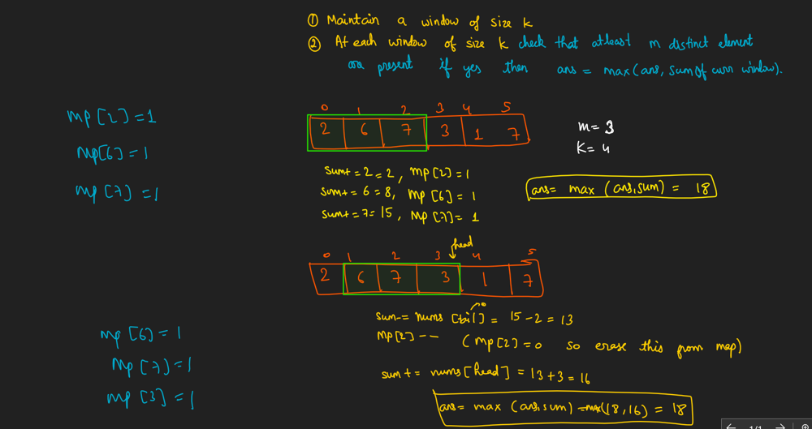
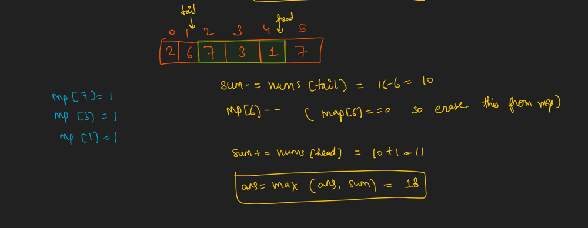
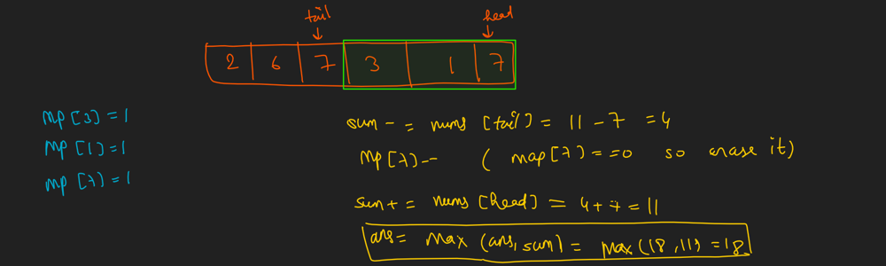

# ✅Sliding window (Picture) + 20+ similar problems

**Author:** rishi800900
**Votes:** 4
**Link:** [https://leetcode.com/problems/maximum-sum-of-almost-unique-subarray/solutions/3992895/](https://leetcode.com/problems/maximum-sum-of-almost-unique-subarray/solutions/3992895/)

---

**Important**: If you want to master 20+ problems of sliding window just using single template please visit my leetcode profile and you will get my youtube link where i have created biggest sliding window playlist just using single template. 






```
unordered_map<int,int>mp;
    long long sum= 0;
    long long ans= 0;
    
        int head=0, tail=0;
        for(head=0; head<k; head++){
            mp[nums[head]]++;
            sum+=nums[head];
            
            if(mp.size() >= m){
                ans= max(ans,sum);
            }
        }
        
        for(head=k; head<nums.size(); head++){
           mp[nums[tail]]--;
           sum-=nums[tail];
            if(mp[nums[tail]] == 0) mp.erase(nums[tail]);
            
           mp[nums[head]]++;
           sum+=nums[head];
            
            tail++;
           
            if(mp.size() >= m) ans= max(ans,sum);
            
        }
        return ans;
```