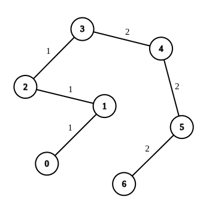

# [2846. Minimum Edge Weight Equilibrium Queries in a Tree](https://leetcode.com/problems/minimum-edge-weight-equilibrium-queries-in-a-tree/)

| Category | Difficulty | Likes | Dislikes |
| :------: | :--------: | :---: | :------: |
| Algorithms | Hard | 349 | 9 |

**Tags:** [`array`](https://leetcode.com/tag/array), [`tree`](https://leetcode.com/tag/tree), [`graph`](https://leetcode.com/tag/graph), [`strongly-connected-component`](https://leetcode.com/tag/strongly-connected-component)

**Companies:** `sprinklr`

## Description

There is an undirected tree with `n` nodes labeled from `0` to `n - 1`. You are given the integer `n` and a 2D integer array `edges` of length `n - 1`, where `edges[i] = [u_i, v_i, w_i]` indicates that there is an edge between nodes `u_i` and `v_i` with weight `w_i` in the tree.

You are also given a 2D integer array `queries` of length `m`, where `queries[i] = [a_i, b_i]`. For each query, find the **minimum number of operations** required to make the weight of every edge on the path from `a_i` to `b_i` equal. In one operation, you can choose any edge of the tree and change its weight to any value.

**Note** that:

	- Queries are **independent** of each other, meaning that the tree returns to its **initial state** on each new query.

	- The path from `a_i` to `b_i` is a sequence of **distinct** nodes starting with node `a_i` and ending with node `b_i` such that every two adjacent nodes in the sequence share an edge in the tree.

Return *an array *`answer`* of length *`m`* where* `answer[i]` *is the answer to the* `i^th` *query.*

 

**Example 1:**


```

Input: n = 7, edges = [[0,1,1],[1,2,1],[2,3,1],[3,4,2],[4,5,2],[5,6,2]], queries = [[0,3],[3,6],[2,6],[0,6]]
Output: [0,0,1,3]
Explanation: In the first query, all the edges in the path from 0 to 3 have a weight of 1. Hence, the answer is 0.
In the second query, all the edges in the path from 3 to 6 have a weight of 2. Hence, the answer is 0.
In the third query, we change the weight of edge [2,3] to 2. After this operation, all the edges in the path from 2 to 6 have a weight of 2. Hence, the answer is 1.
In the fourth query, we change the weights of edges [0,1], [1,2] and [2,3] to 2. After these operations, all the edges in the path from 0 to 6 have a weight of 2. Hence, the answer is 3.
For each queries[i], it can be shown that answer[i] is the minimum number of operations needed to equalize all the edge weights in the path from ai to bi.

```

**Example 2:**


```

Input: n = 8, edges = [[1,2,6],[1,3,4],[2,4,6],[2,5,3],[3,6,6],[3,0,8],[7,0,2]], queries = [[4,6],[0,4],[6,5],[7,4]]
Output: [1,2,2,3]
Explanation: In the first query, we change the weight of edge [1,3] to 6. After this operation, all the edges in the path from 4 to 6 have a weight of 6. Hence, the answer is 1.
In the second query, we change the weight of edges [0,3] and [3,1] to 6. After these operations, all the edges in the path from 0 to 4 have a weight of 6. Hence, the answer is 2.
In the third query, we change the weight of edges [1,3] and [5,2] to 6. After these operations, all the edges in the path from 6 to 5 have a weight of 6. Hence, the answer is 2.
In the fourth query, we change the weights of edges [0,7], [0,3] and [1,3] to 6. After these operations, all the edges in the path from 7 to 4 have a weight of 6. Hence, the answer is 3.
For each queries[i], it can be shown that answer[i] is the minimum number of operations needed to equalize all the edge weights in the path from ai to bi.

```

 

**Constraints:**

	- `1 <= n <= 10^4`

	- `edges.length == n - 1`

	- `edges[i].length == 3`

	- `0 <= u_i, v_i < n`

	- `1 <= w_i <= 26`

	- The input is generated such that `edges` represents a valid tree.

	- `1 <= queries.length == m <= 2 * 10^4`

	- `queries[i].length == 2`

	- `0 <= a_i, b_i < n`

---

**Links:** [Submissions](https://leetcode.com/problems/minimum-edge-weight-equilibrium-queries-in-a-tree/) | [Solutions](https://leetcode.com/problems/minimum-edge-weight-equilibrium-queries-in-a-tree/)
